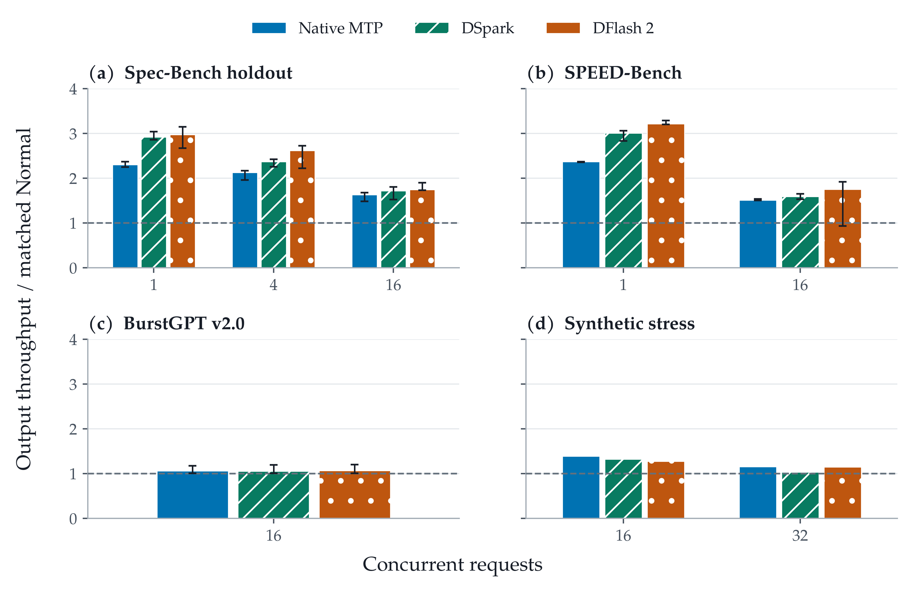

# Qwen3.8-27B-FP8 推测解码实测

周熙言（`xiyanzhou`）在单张 NVIDIA B200 上测量 Qwen3.8-27B-FP8 的输出吞吐、P95 首 token 延迟（TTFT）、P95 每 token 延迟（TPOT）和草稿接受率。每个吞吐倍率先按同卡、同引擎构建、同输入和同种子配对 Normal，再取每档并发的中位数。综合倍率取各档的几何平均。

## Spec-Bench 七档并发重测

重新测试了六种推测解码方法和各自的同卡 Normal。并发覆盖 1、2、4、8、16、24、32，每档三轮，每轮 64 条请求。同一种子在七档并发使用同一批输入。

DFlash 2 在并发 32 时达到 Normal 的 **1.310×**，P95 首 token 延迟增加约 51%，P95 每 token 延迟降低约 14%。DSpark 在并发 8 时的吞吐倍率最高，为 **1.953×**。自适应 Suffix 从并发 16 起低于 Normal，标准 Suffix 从并发 8 起低于 Normal。这轮给两种 Suffix 关闭了跨请求后缀缓存，以便在各档复用同一批输入。[完整结果与图表](report/unified_framework/concurrency.md) · [逐轮数据](results/processed/unified-framework/concurrency-summary.json)

## 各方法在什么负载上有效

| 方法 | 实测表现 |
|---|---|
| Normal | 关闭推测解码。EAGLE-4 对照组使用作者的 vLLM 构建，其余方法使用 vLLM 0.34.0。公开负载、EAGLE-4 对照和标准 Suffix 各自使用该轮的 Normal。 |
| Native MTP | 主模型自带的动态 MTP 在公开 Spec-Bench 达到 1.998×。BurstGPT 回放的吞吐为 1.057×，P95 TPOT 从 10.61 ms 降到 6.60 ms，P95 TTFT 从 63.07 ms 升到 75.91 ms。 |
| DSpark | Triton 草稿端和 K=8 在公开 Spec-Bench 达到 2.282×。随机压力并发 32 的单轮吞吐为 1.035×，P95 TPOT 从 19.45 ms 升到 28.10 ms。 |
| DFlash 2 | MXFP8 草稿在公开 Spec-Bench 达到 2.385×，在后续配对实验中为 2.402×。量化将模型加载显存从 31.31 GiB 降到 29.64 GiB，三套负载综合吞吐为 BF16 的 1.001×。 |
| EAGLE-4 | 相对作者构建的 Normal，Spec-Bench 为 2.322×，合成重复代码与 JSON 为 2.288×。Spec-Bench 并发 16 三轮吞吐倍率为 1.016× 至 2.879×，含一次对照组额外编译。 |
| 自适应 Suffix | 合成重复代码与 JSON 为 3.127×，Spec-Bench 为 1.256×。Spec-Bench 并发 16 的收益缩至 1.038×，P95 TPOT 从 10.74 ms 升到 12.43 ms。 |
| 标准 Suffix | 在独立的 Spec-Bench 划分上，并发 1 达到 1.494×，P95 TPOT 从 8.42 ms 降到 6.93 ms。并发 16 的吞吐为 1.045×，P95 TPOT 从 11.36 ms 升到 11.84 ms。 |

[公开负载与量化](report/unified_framework/results.md) · [EAGLE-4 和自适应 Suffix 对照](report/unified_framework/eagle4_suffix.md) · [标准 Suffix 与输出一致性](report/unified_framework/early_suffix.md)



## 复现

从仓库根目录运行。预览计划和重生成报告只需 Python 3.11 或更新版本，出图需 Matplotlib 和系统安装的 TeX Gyre Pagella 常规及粗体。每张图输出一份 400 dpi PNG。[字体下载](https://ctan.org/pkg/tex-gyre-pagella)

```bash
python src/unified_framework.py profiles
python src/unified_framework.py benchmark --method dspark --print-plan --output replay/dspark-plan
python -m pip install matplotlib==3.11.2
python src/unified_framework.py report --output replay/report-hd
```

B200 上可用同一入口准备输入、启动服务、配对压测、调参和复跑草稿量化。Native MTP 使用主模型内置的头，DSpark 和 DFlash 2 需要各自的草稿权重，EAGLE-4 需要作者的 vLLM 构建。[实验协议与命令](report/unified_framework/README.md) · [EAGLE-4 环境](report/unified_framework/eagle4_suffix_replay.md) · [统一配置](config/unified_framework.json)
