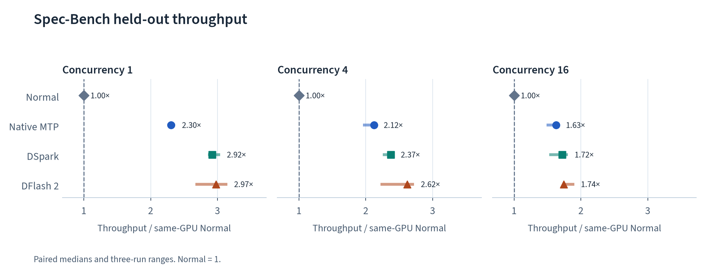

# Qwen3.8-27B 推测解码实验


在单张 NVIDIA B200 上，用 vLLM 0.34.0 跑 Qwen3.8-27B-FP8。实验比较四种解码设置在同样请求下的吞吐、延迟和草稿接受率。

## 快速开始

从仓库根目录运行。下面两条命令可以在没有 GPU 的机器上查看配置和启动参数。

```bash
python src/unified_framework.py profiles
python src/unified_framework.py serve --method dflash --print-command
```

实际启动需要 B200、vLLM 和模型权重。服务命令里的 `--model`、`--draft-model` 与 `--vllm` 可替换成本机路径。[下载权重和复跑命令](report/unified_framework/README.md)

## 实测

| 方法 | 发布设置 |
|---|---|
| Normal | 自回归解码基线 |
| Native MTP | 按活动 batch size 选 K。1 至 4 用 K=6，5 至 32 用 K=5 |
| DSpark | K=8，草稿端 FP8 per-tensor，Triton Attention |
| DFlash 2 | K=7，独立草稿模型在线量化为 MXFP8，FlashAttention 4 |

Spec-Bench 和 SPEED-Bench 使用公开文本提示，BurstGPT v2.0 回放请求长度和到达间隔。每个公开负载配对测三轮，Normal 是同卡基线。



[各负载结果、延迟和量化对照](report/unified_framework/results.md) · [发布配置](config/unified_framework.json)

## 目录

| 路径 | 内容 |
|---|---|
| [src/](src/) | 统一 CLI、负载准备、结果汇总和绘图 |
| [report/unified_framework/](report/unified_framework/) | 当前框架的复跑命令、结果和图表 |
| [report/course_study/](report/course_study/) | 课程实验、早期 Suffix 对照、汇总表和命令记录 |
| [results/](results/) | 原始测量和结构化结果 |
| [logs/](logs/) | 课程实验日志，按运行标签查找 |

复现当前图表只需要发布的 JSON 和 Matplotlib。

```bash
python -m pip install matplotlib==3.11.2
python src/unified_framework.py report \
  --results results/processed/unified-framework/summary.json --output replay/report
```
