# Qwen3.8-27B-FP8 推测解码性能报告

2026-11-24 在 NVIDIA B200 上完成，使用 vLLM 0.34.0。

## 摘要

我们测量 Native MTP 和 DSpark 在随机请求和 Spec-Bench 上的吞吐、尾延迟和草稿接受率。随机基线比较 Normal、MTP K=3、DSpark K=7，测试并发 1、4、16、32，每个组合用种子 42、43、44 各跑一轮，共 36 轮。每轮包含 128 个请求，输入 1,024 tokens，输出 512 tokens。随后扫描 MTP 的 K=1 到 7 和 DSpark 的固定 K，并在同卡复测动态选 K 和 Adaptive Verification。

在四档随机并发下，MTP K=3 相对 Normal 的配对速度比分别为 2.783×、2.510×、1.656×、1.683×。DSpark K=7 则为 2.008×、1.743×、1.274×、1.016×，跨轮波动也更大。MTP 单轮扫描中，各并发下吞吐最高的 K 分别为 7、6、7、5。草稿的接受概率和验证开销都会影响这个排序。换用 Spec-Bench 后，两种推测方法的相对排名发生了变化。

同卡三轮复测中，MTP 平均吞吐最高的固定 K 分别为 7、7、5、3。Dynamic-Smooth 相对 Normal 的配对速度比为 3.361×、2.766×、1.967×、1.558×。在并发 16 和 32 时，它接近同批复测中最快的固定配置。DSpark Adaptive Verification 在高负载下快于默认 K=7。随机负载并发 32 时，它的吞吐仍约为固定 K=3 的 0.900×。

## 1. 研究背景与问题定义

### 1.1 为什么自回归解码需要投机执行

标准自回归解码每次前向只生成一个 token。低并发下，显存带宽和 kernel launch 等固定开销会限制吞吐。推测解码先由草稿模型提出 K 个候选 token，再由目标模型并行验证。一次验证可以提交被接受的前缀和目标模型给出的 bonus token，从而减少生成同样长度的输出所需的解码步数。

将第 i 个草稿位置的无条件接受概率记为 p_i。期望接受长度为

$$
A(K)=1+\sum_{i=1}^{K}p_i.
$$

常数 1 对应验证步骤生成的 bonus token。原始数据中的 `spec_decode_per_position_acceptance_rates` 和 `spec_decode_acceptance_length` 满足这一恒等式。p_i 衡量前 i 个位置均被接受的概率。

在持续有 C 个请求解码的理想稳态下，吞吐约为

$$
\mathrm{OutputTPS}\approx C\cdot\frac{A(K)}{T_{\mathrm{cycle}}(C,K)},
$$

一个周期包含三部分耗时。

$$
T_{\mathrm{cycle}}(C,K)=T_{\mathrm{draft}}(C,K)+T_{\mathrm{verify}}(C,K)+T_{\mathrm{overhead}}(C,K).
$$

增大 K 会提高 A(K)，也会增加起草、验证和调度成本。后续位置的接受概率通常更低。低并发时仍有计算余量，高并发时草稿位置和其他请求会竞争同一批资源，因此最高吞吐对应的 K 会随负载变化。

### 1.2 两类 drafter

Native MTP 由 vLLM 递归调用目标模型自带的 MTP head，串行生成多个草稿位置。DSpark 使用独立的 1.86B BF16 草稿模型，初始设置每步提出 7 个候选。它的 confidence head 提供各位置的置信度，可用于 vLLM 的 Adaptive Verification。

Adaptive Verification 根据启动时测得的成本模型确定验证预算，再按各请求的累计置信度分配。置信度高的请求可以保留完整草稿块，低置信度的请求可能只验证前一两个位置。

### 1.3 研究问题

- **Q1：** Normal、MTP K=3、DSpark K=7 在不同并发下的吞吐、P95 延迟和波动如何？
- **Q2：** 随机 token 负载与真实语义任务的接受行为是否一致，能否用前者代替后者？
- **Q3：** MTP 的最优固定 K 如何变化，接受长度与有效步骤成本能否解释这种变化？
- **Q4：** 相对最佳固定 K，按 batch size 选 K 和 DSpark Adaptive Verification 是否还有可重复的额外收益？

---

## 2. 实验平台与可复现协议

### 2.1 硬件、软件与模型

| 项目 | 配置 |
|---|---|
| GPU | NVIDIA B200，单卡显存约 183359 MiB |
| 并行方式 | 每次服务 TP=1，单实例独占一张卡 |
| 同时用于实验的 GPU | 仅 GPU 0/1/2/3，最多四张；GPU 4–7 未作为本实验计算资源 |
| CPU | Intel Xeon Platinum 8568Y+，192 logical CPUs |
| 驱动 | 590.48.01 |
| Python / vLLM | 3.12.16 / 0.34.0 |
| PyTorch / CUDA | 2.14.0+cu130 / 13.0 |
| Target | `/home/model/Qwen3.8-27B-FP8`，27B，FP8 |
| DSpark drafter | `/home/genai/models/Qwen3.8-27B-DSpark-vLLM`，1.86B，BF16，serving block size 7 |

所有正式服务使用 `max_model_len=8192`、`max_num_seqs=256`、`gpu_memory_utilization=0.90`、`generation_config=vllm`，并关闭 prefix caching。压测采用 greedy 解码，参数为 `temperature=0`、`top_p=1`、`top_k=-1`。通过 `ignore_eos=true` 固定输出长度。

审计包装器记录 vLLM 启动命令、每轮压测的 argv、起止时间、退出码和合并输出。[实验协议](../config/experiment_protocol.json) · [实际命令](command_audit.md)

### 2.2 正式随机负载

Normal 使用标准自回归解码。MTP 使用 `{"method":"mtp","num_speculative_tokens":3}`。DSpark 使用本地草稿模型，将 `num_speculative_tokens=7`。

每个组合覆盖 C=1、4、16、32，seed=42、43、44，同 seed 跨方法配对。每次运行 128 个请求，输入严格为 1024 tokens，输出严格为 512 tokens，`random_range_ratio=0`，请求以无限速率提交并受 `max_concurrency` 限制。每个方法与并发组合在正式计时前单独 warmup。总计 3 方法 × 4 并发 × 3 seed = **36 次正式运行**，不包含 warmup。

三种方法最初在不同 B200 上并行运行。后续策略比较在同一张 GPU 上顺序复测，以控制卡间差异。

### 2.3 Spec-Bench 真实语义负载

语义实验使用 [Spec-Bench question.jsonl](../data/spec_bench/question.jsonl)，文件包含 480 条记录，覆盖 writing、roleplay、reasoning、math、coding、translation、RAG 等类别。vLLM loader 使用每条记录的第一轮 prompt 并应用 chat template。每次取 128 请求，输出 256 tokens，其他并发、seed 和重复次数与随机正式矩阵一致，共 36 次正式运行。

该数据文件 SHA-256 为：

```text
4b6d33e79484f9841c487ee87d1cf6aa8c6066f61d5d482ff09e5a007fafdf04
```

随机负载用于控制输入输出长度，便于分析硬件开销。Spec-Bench 用于测量真实文本下的草稿接受行为。接受率按负载分别统计。语义基线在不同 GPU 上并行运行。DSpark 固定 K、自适应和短 K 对照在 GPU 2 上顺序复测，MTP 最终策略在 GPU 3 上顺序复测。

### 2.4 K 扫描与策略复测

MTP 先扫 K=1 到 5。K=5 在该范围最快，于是补扫 K=6、7。扫描用种子 42，并发依次为 32、16、4、1。每轮 32 个请求，输入 1,024 tokens，输出 512 tokens。DSpark 扫描 K=1、3、5、7。单轮扫描用于筛选候选和估算成本，最终配置由后续复测决定。

动态策略复测使用相同服务参数，在同一 GPU 上顺序启动不同配置，并对每个配置重复三次。比较的 MTP 策略包括 Normal、初始 K3、固定 K5/K6/K7、按扫描 argmax 构造的 Oracle batch-size 表，以及去除单轮非单调选择的平滑动态表。

### 2.5 统计口径

- 每次 Benchmark 独立保存 JSON，不挑选最快一次。
- 吞吐、延迟和接受统计使用三轮算术均值与样本标准差（ddof=1）。样本标准差描述轮次间的波动。
- 先用相同种子计算 `candidate TPS / baseline TPS`，再汇总三个比值。另保留平均吞吐之比，便于核对。
- 请求级 TPOT 定义为 `1000×(E2EL−TTFT)/(output_tokens−1)` ms。
- P50/P95/P99 按三轮合并后的请求计算。正式配置每组共 384 个请求。ITL 使用原始 JSON 记录的所有流式输出事件间隔。
- 输出吞吐等于总输出 token 数除以端到端耗时，包含 prefill、解码、调度和收尾。

---

## 3. 初始基线：随机负载正式结果

### 3.1 吞吐与配对加速比

36 次正式运行覆盖三种方法、四档并发和三个种子。每种方法的吞吐取三轮均值 ± 样本标准差。加速比先按种子配对，再取三轮均值。

| 方法 | 并发 | 输出吞吐 (tokens/s) | 相对 Normal 配对加速比 | 接受长度 | P95 请求级 TPOT (ms) |
|---|---:|---:|---:|---:|---:|
| Normal | 1 | 117.10 ± 0.01 | 1.000 | — | 8.469 |
| MTP K=3 | 1 | 325.82 ± 0.74 | 2.783× | 3.595 | 3.789 |
| DSpark K=7 | 1 | 235.12 ± 18.94 | 2.008× | 2.648 | 10.959 |
| Normal | 4 | 432.54 ± 0.07 | 1.000 | — | 9.162 |
| MTP K=3 | 4 | 1085.63 ± 6.63 | 2.510× | 3.572 | 4.557 |
| DSpark K=7 | 4 | 753.72 ± 49.63 | 1.743× | 2.611 | 13.206 |
| Normal | 16 | 1438.59 ± 0.23 | 1.000 | — | 10.666 |
| MTP K=3 | 16 | 2382.18 ± 24.73 | 1.656× | 3.579 | 8.081 |
| DSpark K=7 | 16 | 1832.41 ± 105.46 | 1.274× | 2.592 | 20.069 |
| Normal | 32 | 2325.83 ± 1.38 | 1.000 | — | 12.176 |
| MTP K=3 | 32 | 3913.63 ± 123.26 | 1.683× | 3.552 | 9.078 |
| DSpark K=7 | 32 | 2362.21 ± 93.29 | 1.016× | 2.656 | 29.382 |

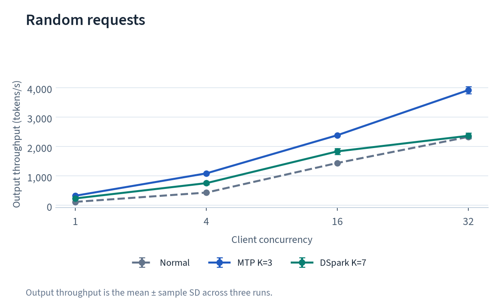


### 3.2 MTP：初始配置在所有并发点都有明显收益

MTP K=3 的接受长度在四个并发点稳定在约 3.55–3.60，即平均每个验证步骤推进约 3.6 个 token。C=1 时输出吞吐从 117.10 提升到 325.82 tokens/s，配对加速约 2.783×；C=4 仍有约 2.510×。并发升到 16 和 32 后，加速比回落到约 1.66–1.68×，反映额外 draft/verify 计算开始占用本可用于其他请求的资源。

C=32 时 MTP 仍有正收益。随机负载上，MTP 的逐位置接受概率较高，K=3 的验证块也更短。这两点可能降低了每个已接受 token 的验证成本。

MTP 在 C=1 时的吞吐样本标准差为 0.74 tokens/s。波动相对较大的 C=32，标准差是 123.26 tokens/s，约占均值 3913.63 的 3.1%。

### 3.3 DSpark：接受长度近似不变，但有效收益随负载消失

DSpark K=7 的接受长度在四档并发下为 2.59 至 2.65。相对 Normal 的加速比从 C=1 的约 2.008× 降至 C=32 的约 1.016×。C=32 时，每步最多验证 7 个候选，平均只推进约 2.65 个 token。宽验证块的计算与调度开销可能抵消了减少解码步数带来的收益。

DSpark 的跨轮吞吐波动高于 Normal 和 MTP。C=1 时样本标准差为 18.94 tokens/s，约占均值 8.1%。C=16 时为 105.46 tokens/s，约占均值 5.8%。C=16 的请求级 P95 TPOT 从 Normal 的 8.469 ms 升至 10.959 ms。C=32 时，DSpark 和 Normal 的 P95 TPOT 分别为 29.382 和 12.176 ms。固定验证整块草稿时，低接受请求可能拖长尾延迟。

### 3.4 TPOT 与 ITL 的解释

推测解码可能在一个 engine step 中提交多个 token。请求级 TPOT 把总解码时间均摊到各输出 token。ITL 记录相邻流式输出事件的间隔，一个事件可以携带多个 token。评估交互延迟时，可同时查看平均 TPOT、P95 和 ITL，分别观察平均速度、慢请求和输出间隔。


---

## 4. 固定 K 扫描与成本分析

### 4.1 MTP 扫描结果

MTP K=1 到 7 共跑了 28 次扫描。每次使用种子 42，测 32 个请求。单轮吞吐用于筛选后续三轮复测的候选配置。

| K | C=1 TPS | C=4 TPS | C=16 TPS | C=32 TPS |
|---:|---:|---:|---:|---:|
| 1 | 199.36 | 714.45 | 2151.66 | 2589.33 |
| 2 | 267.38 | 909.79 | 2377.95 | 3364.68 |
| 3 | 319.40 | 1017.18 | 2285.91 | 3363.50 |
| 4 | 347.23 | 1134.45 | 2622.87 | 3355.13 |
| 5 | 370.94 | 1137.66 | 2834.88 | 3646.64 |
| 6 | 382.67 | 1199.79 | 2628.09 | 3537.39 |
| 7 | 385.54 | 1121.94 | 2872.25 | 3193.06 |

单轮配置级 Oracle 为：

| 并发 | 最佳 K | 最佳 TPS | 相对同轮 K=3 |
|---:|---:|---:|---:|
| 1 | 7 | 385.54 | 1.207× |
| 4 | 6 | 1199.79 | 1.180× |
| 16 | 7 | 2872.25 | 1.256× |
| 32 | 5 | 3646.64 | 1.084× |

C=16 时，K=7 只比 K=5 快约 1.3%，K=6 在该点的吞吐较低。单轮扫描可能受输入差异和运行波动影响，因此后续同时复测 K3、K5、K6、K7 和动态表。


### 4.2 逐位置接受率与接受长度

以 K=5 为例，C=1 的五个逐位置无条件接受率约为 89.12%、79.73%、72.67%、63.26%、59.33%，因此：

$$
A(5)=1+0.8912+0.7973+0.7267+0.6326+0.5933\approx4.641.
$$

C=32 的 K=5 接受长度约为 4.779，说明该扫描中高并发并未显著降低草稿质量。K 增大时，新增位置仍能提供正接受收益；是否提高吞吐取决于新增接受长度能否覆盖新增 draft/verify 成本。

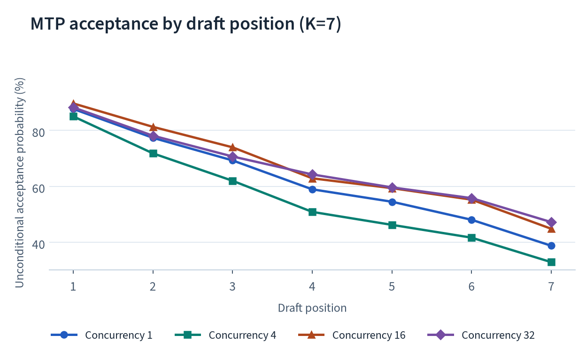

### 4.3 有效周期成本

为把 TPOT 与接受长度放到同一成本框架中，定义：

$$
\hat T_{\mathrm{cycle}}=\overline{\mathrm{TPOT}}\times A(K).
$$

有效周期成本由端到端请求指标估算，包含调度和请求完成尾部。用 K=1 到 7 的测值作描述性线性拟合。

| 并发 | 拟合 $\hat T_{\mathrm{cycle}}\approx a+bK$ | R² |
|---:|---|---:|
| 1 | 8.928 + 0.624K ms | 0.9995 |
| 4 | 9.629 + 0.939K ms | 0.9926 |
| 16 | 12.879 + 1.399K ms | 0.8082 |
| 32 | 15.077 + 1.398K ms | 0.8820 |

C=1 和 C=4 的拟合边际成本分别约为 0.62 和 0.94 ms/K。C=1 的截距为 8.928 ms，接近 Normal 的平均 TPOT 8.465 ms。并发提高时，拟合的固定成本和边际成本都上升。C=16 至 32 的边际成本约为 1.40 ms/K，拟合误差也更大。这些斜率描述端到端成本随 K 的变化。

### 4.4 从扫描到候选动态表

严格按单轮 argmax 构造的 Oracle 表为：

```json
{
  "method": "mtp",
  "num_speculative_tokens": 7,
  "num_speculative_tokens_per_batch_size": [
    [1, 1, 7],
    [2, 4, 6],
    [5, 16, 7],
    [17, 256, 5]
  ]
}
```

我们还构造了两段平滑表，batch size 1 至 4 使用 K=6，5 至 256 使用 K=5，以减少对 C=16 单轮峰值的依赖。Oracle 表和平滑表都使用 vLLM 的 batch-size 调度，随后在同卡复测。

### 4.5 DSpark 固定 K 扫描

DSpark 在同一 GPU 上顺序扫描 K=1、3、5、7，每个组合使用 32 请求、seed=42，共 16 次 Benchmark。吞吐结果如下：

| K | C=1 TPS | C=4 TPS | C=16 TPS | C=32 TPS |
|---:|---:|---:|---:|---:|
| 1 | 150.91 | 533.65 | **1476.41** | 1791.55 |
| 3 | 198.12 | 649.67 | 1326.95 | **1905.26** |
| 5 | 207.88 | 627.61 | 1405.09 | 1748.01 |
| 7 | **211.73** | **655.90** | 1344.77 | 1491.24 |

该扫描中的配置级最优点是 C=1/4 选择 K=7，C=16 选择 K=1，C=32 选择 K=3。相对同轮 K=7，C=16 的 K=1 高约 9.8%，C=32 的 K=3 高约 27.8%。这与 DSpark 的验证成本趋势一致：C=1 时 K=7 接受长度为 2.378，吞吐高于短草稿；C=32 时 K=7 接受长度为 2.552，但有效周期成本达到 21.039 ms，而 K=3 的接受长度仍有 2.093、有效周期成本为 15.763 ms，缩短验证块更有利。

| 并发 | DSpark 有效周期成本拟合 $a+bK$ | R² |
|---:|---|---:|
| 1 | 10.176 + 0.120K ms | 0.9995 |
| 4 | 10.790 + 0.342K ms | 0.9896 |
| 16 | 13.705 + 0.695K ms | 0.6122 |
| 32 | 15.473 + 0.658K ms | 0.5964 |

低并发下的拟合接近线性，高并发下的耗时随 K 非单调变化，拟合误差也更大。K=1 的草稿接受率约为 55% 至 57%，K=7 约为 20% 至 23%。K=7 的比例包含更难接受的后续位置。要比较每步平均推进距离，应看接受长度。

另一个交叉检查是：用 K=7 运行中的前 k 个逐位置接受率预测较短 K 的接受长度，再与短 K 的实测值比较。排除 K=7 自身后，各并发上的最大相对误差为：

| 并发 | MTP 最大相对误差 | DSpark 最大相对误差 |
|---:|---:|---:|
| 1 | 6.37% | 13.52% |
| 4 | 11.38% | 12.85% |
| 16 | 3.24% | 13.72% |
| 32 | 3.55% | 12.79% |

$A(K)=1+\sum p_i$ 描述同一次运行内的关系。不同 K 分开运行时，各位置的接受率也可能变化。用 K=7 的统计预测 K=1 或 K=3 只能得到近似值，应在目标负载上实测短草稿。

这一轮每次跑 32 个请求，与此前在另一张卡上每轮 128 个请求的基线协议不同。后续在同卡加入 K=1、K=3 和 Adaptive Verification，对照缩短验证块是否有收益。


---

## 5. Spec-Bench 真实语义负载结果

### 5.1 吞吐、接受长度与配对加速比

Spec-Bench 对三种初始配置共跑 36 次，每轮 128 个请求、输出 256 tokens。两套负载的长度和文本分布不同，吞吐应在同一负载内比较。

| 方法 | 并发 | 输出吞吐 (tokens/s) | 相对 Normal 配对加速比 | 接受长度 | P95 请求级 TPOT (ms) |
|---|---:|---:|---:|---:|---:|
| Normal | 1 | 118.46 ± 0.04 | 1.000 | — | 8.367 |
| MTP K=3 | 1 | 262.89 ± 0.08 | 2.219× | 2.907 | 4.366 |
| DSpark K=7 | 1 | 320.00 ± 0.08 | 2.701× | 3.688 | 4.160 |
| Normal | 4 | 442.08 ± 0.12 | 1.000 | — | 8.959 |
| MTP K=3 | 4 | 894.79 ± 6.55 | 2.024× | 2.901 | 4.991 |
| DSpark K=7 | 4 | 1014.30 ± 7.61 | 2.294× | 3.636 | 4.956 |
| Normal | 16 | 1512.27 ± 0.11 | 1.000 | — | 10.058 |
| MTP K=3 | 16 | 2107.68 ± 4.69 | 1.394× | 2.904 | 8.345 |
| DSpark K=7 | 16 | 2638.93 ± 12.89 | 1.745× | 3.685 | 7.521 |
| Normal | 32 | 2510.96 ± 3.17 | 1.000 | — | 12.192 |
| MTP K=3 | 32 | 3765.54 ± 0.83 | 1.500× | 2.893 | 9.310 |
| DSpark K=7 | 32 | 3367.17 ± 6.13 | 1.341× | 3.678 | 11.240 |

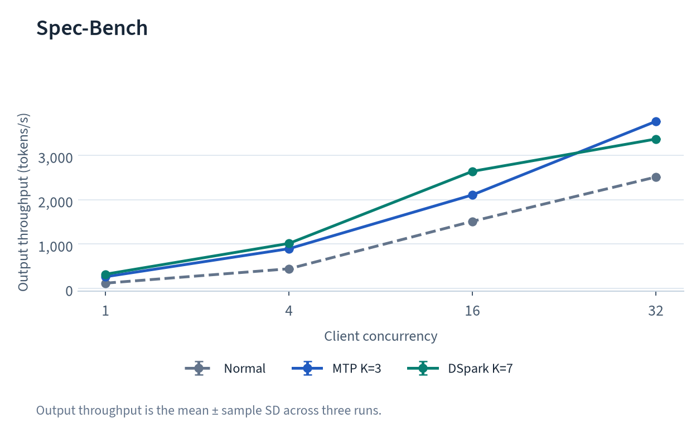

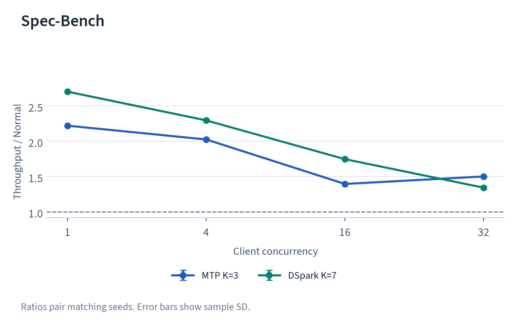

### 5.2 语义分布改变两种 drafter 的相对排序

在 Spec-Bench 上，DSpark K=7 在并发 1、4、16 时快于 MTP K=3。C=1 时两者分别为 320.00 和 262.89 tokens/s，C=16 时分别为 2638.93 和 2107.68 tokens/s。C=32 时，MTP 以 3765.54 对 3367.17 tokens/s 领先。DSpark 平均每步推进约 3.68 个 token，MTP 约为 2.90。低、中并发下，较长的推进距离有利于吞吐。高并发下，宽验证块的计算开销可能抵消这部分收益。

四档并发下，MTP 的接受长度为 2.893 至 2.907，DSpark 为 3.636 至 3.688。两者都变化很小，因此验证开销和调度竞争更可能解释 C=32 的排序变化。

### 5.3 随机请求与真实文本的接受率

将两种负载分开比较可以看到：

| 方法 | 随机负载接受长度 | Spec-Bench 接受长度 | 随机负载中的相对表现 | Spec-Bench 中的相对表现 |
|---|---:|---:|---|---|
| MTP K=3 | 约 3.55–3.60 | 约 2.90 | 四个并发点均显著优于 DSpark K=7 | C=1/4/16 低于 DSpark，C=32 反超 |
| DSpark K=7 | 约 2.59–2.65 | 约 3.68 | 加速收益随并发增加明显收窄 | 低、中并发领先，C=32 仍有 1.341× 加速 |

草稿接受率会随文本分布以及草稿模型与目标模型的匹配程度变化。随机请求便于控制长度和分析硬件成本。在随机负载上，MTP 各档吞吐都更高。Spec-Bench 上，DSpark 在并发 1、4、16 领先。

Spec-Bench 三轮的组内吞吐波动较小。本实验只测一个语义问题集和固定输出长度。代码、长上下文或多轮对话等特定应用仍需按实际负载验证。


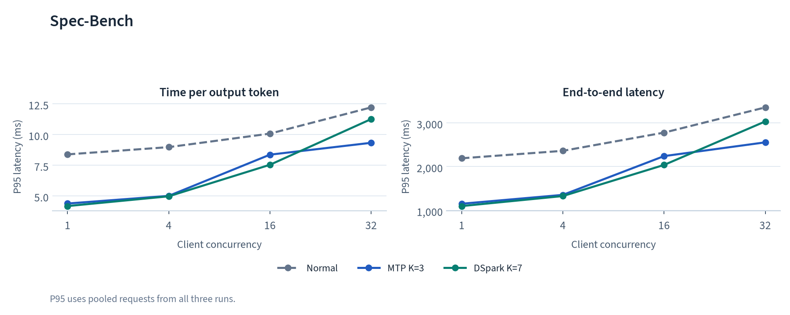

---

## 6. 动态选 K 与 Adaptive Verification 对照

MTP 比较 Normal、固定 K3、K5、K6、K7 和两张动态表。DSpark 比较固定 K7 与 Adaptive Verification。每个配置在同卡顺序启动，用种子 42、43、44 各跑 32 个请求。请求级百分位按每组的 96 个请求计算。策略分别与默认配置、同批最快的固定 K 配对。

### 6.1 MTP 固定 K 同卡三轮复测

最终套件中的 Normal 与四种固定 K 已全部完成，共 60 次独立 Benchmark。下表为每种配置的三轮输出吞吐均值与样本标准差；每次 32 请求，因此每组请求级百分位由 96 个请求计算。这里的绝对数值只在本套件内部比较，不与第一轮每次 128 请求的基线混用。

| 并发 | Normal TPS | MTP K3 TPS | MTP K5 TPS | MTP K6 TPS | MTP K7 TPS | 三轮均值最高的固定 K |
|---:|---:|---:|---:|---:|---:|---|
| 1 | 116.99 ± 0.01 | 319.40 ± 3.65 | 380.07 ± 16.62 | 392.47 ± 20.82 | **397.82 ± 24.15** | K7 |
| 4 | 432.31 ± 0.13 | 1043.58 ± 22.67 | 1163.23 ± 22.57 | 1202.49 ± 28.89 | **1217.84 ± 99.57** | K7 |
| 16 | 1447.57 ± 3.06 | 2290.47 ± 23.75 | **2857.38 ± 113.15** | 2817.20 ± 227.52 | 2816.93 ± 50.63 | K5 |
| 32 | 2331.87 ± 2.32 | **3622.57 ± 114.43** | 3586.37 ± 95.39 | 3596.52 ± 126.60 | 3352.30 ± 132.32 | K3 |

| 并发 | K3 / Normal | K5 / Normal | K6 / Normal | K7 / Normal | K3 / 当轮最佳固定 K |
|---:|---:|---:|---:|---:|---:|
| 1 | 2.730 ± 0.031× | 3.249 ± 0.142× | 3.355 ± 0.178× | 3.400 ± 0.207× | 0.805 ± 0.056× |
| 4 | 2.414 ± 0.052× | 2.691 ± 0.052× | 2.782 ± 0.067× | 2.817 ± 0.230× | 0.860 ± 0.062× |
| 16 | 1.582 ± 0.019× | 1.974 ± 0.082× | 1.946 ± 0.158× | 1.946 ± 0.038× | 0.802 ± 0.023× |
| 32 | 1.554 ± 0.049× | 1.538 ± 0.042× | 1.542 ± 0.056× | 1.438 ± 0.057× | 1.000× |

低并发时，增加草稿长度仍能带来明显收益。C=1 的 K7 达到 397.82 tokens/s，相对 Normal 的配对加速为 3.400×；但 K6/K7 的配对比值已为 0.987±0.007，说明从 K6 增至 K7 的平均收益不足 2%。C=4 的 K7 三轮均值最高，不过其样本标准差达到 99.57 tokens/s，K6/K7 的配对比值为 0.991±0.068，不能把 K6 与 K7 的均值差解释为稳定的配置优劣。

C=16 时，K5 的平均吞吐最高，K6 和 K7 相对 K5 的配对比值分别为 0.985±0.055 和 0.987±0.039，三者接近；默认 K3 则只有最佳固定 K5 的约 0.802×。C=32 时排序再次变化：K3、K5、K6 的三轮平均吞吐接近，K3 的描述性均值最高；K7/K3 的配对比值为 0.925±0.021，长草稿的开销已在高负载下明确抵消其接受长度收益。

接受长度随 K 增大而增长，但吞吐并不单调增长。以 C=32 为例，K3、K5、K7 的接受长度分别约为 3.520、4.708、5.543，K7 每次验证平均推进更远，却比 K3 慢约 7.5%。这与第 4 章的有效周期成本拟合一致：高并发下每增加一个草稿位置的边际成本并未消失，继续增加 K 的边际接受收益不足以补偿验证成本。

各固定 MTP 配置在三个 seed 上的吞吐均高于 Normal。C=32 的 Normal、K3、K5、K6、K7 请求级 P95 TPOT 分别为 11.939、6.677、6.609、6.709、6.987 ms，说明即使 K7 不再是最高吞吐配置，其延迟仍明显低于普通自回归解码。最佳固定 K 由同一批三轮结果按平均吞吐选出，属于描述性、post-selection 比较，不是独立测试集上的泛化估计。


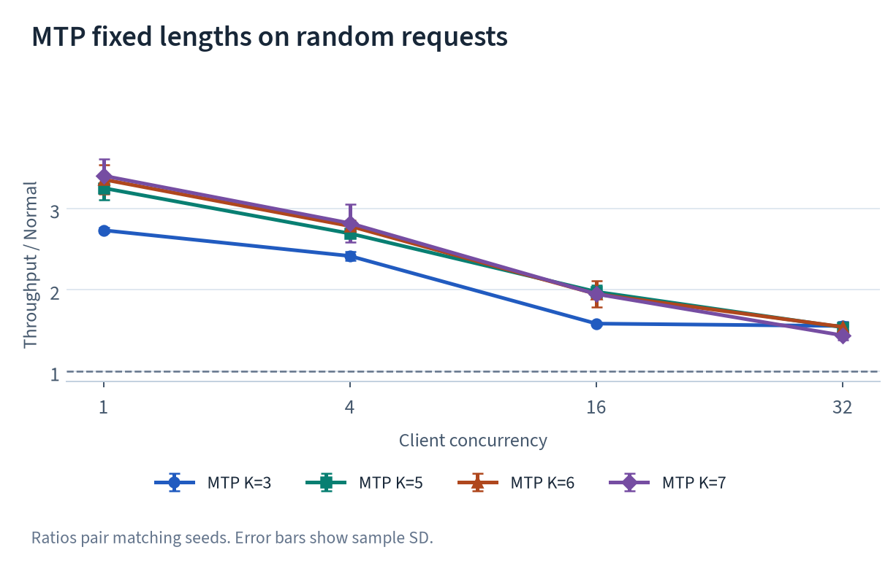

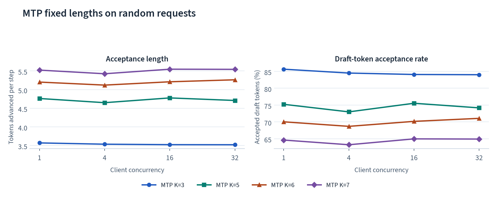

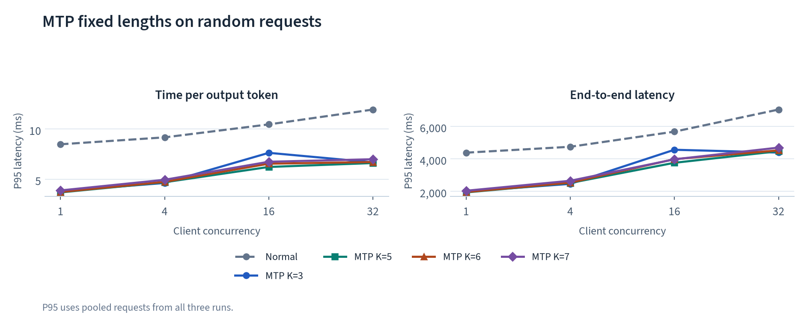

### 6.2 MTP 按 batch size 动态选 K

两张动态表在三轮复测前根据第 4 章的单轮扫描确定。Dynamic-Oracle 在 C=1、4、16、32 分别用 K=7、6、7、5。Dynamic-Smooth 的低并发段用 K6，高并发段用 K5。实际启用的调度表可以复核。[调度表](../results/processed/mtp-dynamic-schedule-lookup.json)

| 请求 batch size | dynamic-oracle | dynamic-smooth |
|---:|---:|---:|
| 1 | 7 | 6 |
| 2–4 | 6 | 6 |
| 5–16 | 7 | 5 |
| 17–256 | 5 | 5 |

这里的 Oracle 指单轮扫描的固定配置最优点。满载 decode batch 下，两张表在并发 1 分别用 K7 和 K6，在并发 16 分别用 K7 和 K5。并发 4 都用 K6，并发 32 都用 K5。运行期间，请求到达、prefill 和收尾会改变活动 batch，K 可能随之切换。实测比较的是两个事先定好的查表策略。

两种动态配置共完成 24 次运行，七配置套件合计 84/84 次。表中先与 Normal 和默认 MTP K3 比较。倍率按相同种子配对，报告均值与样本标准差。

| 并发 | Oracle TPS | Smooth TPS | Oracle / Normal | Smooth / Normal | Oracle / K3 | Smooth / K3 |
|---:|---:|---:|---:|---:|---:|---:|
| 1 | 397.76 ± 24.26 | 393.27 ± 20.87 | 3.400 ± 0.207× | 3.361 ± 0.179× | 1.246 ± 0.090× | 1.232 ± 0.079× |
| 4 | 1182.83 ± 27.84 | 1195.80 ± 12.70 | 2.736 ± 0.065× | 2.766 ± 0.030× | 1.134 ± 0.050× | 1.146 ± 0.035× |
| 16 | 2798.38 ± 53.76 | 2846.86 ± 84.61 | 1.933 ± 0.040× | 1.967 ± 0.062× | 1.222 ± 0.026× | 1.243 ± 0.024× |
| 32 | 3486.86 ± 91.85 | 3633.22 ± 158.27 | 1.495 ± 0.041× | 1.558 ± 0.069× | 0.964 ± 0.053× | 1.004 ± 0.056× |

相对默认 K3，Oracle 在 C=1、4、16 的吞吐分别提高约 24.6%、13.4%、22.2%。Smooth 分别提高约 23.2%、14.6%、24.3%。C=32 时，Oracle 低约 3.6%，Smooth 与默认 K3 基本持平。动态表的收益集中在低、中并发。

固定基线按同一批三轮复测的平均吞吐选出。略高于 1 的倍率只描述该批运行。

| 并发 | 当轮最佳固定 K | Oracle / 最佳固定 | Smooth / 最佳固定 | Oracle P95 TPOT (ms) | Smooth P95 TPOT (ms) |
|---:|---|---:|---:|---:|---:|
| 1 | K7 | 0.9998 ± 0.0003× | 0.9889 ± 0.0073× | 3.882 | 3.718 |
| 4 | K7 | 0.9756 ± 0.0839× | 0.9861 ± 0.0791× | 4.895 | 4.645 |
| 16 | K5 | 0.9804 ± 0.0423× | 0.9966 ± 0.0101× | 6.753 | 6.041 |
| 32 | K3 | 0.9636 ± 0.0529× | 1.0037 ± 0.0557× | 6.629 | 6.543 |

Oracle 在 C=1 与固定 K7 基本持平，在 C=4、16、32 分别达到最佳固定配置的约 0.976、0.980、0.964。Smooth 在 C=16 和 C=32 的配对比值分别为 0.9966 ± 0.0101 和 1.0037 ± 0.0557。C=32 的三轮结果有的略高于 K3，有的略低。

Oracle/Smooth 的配对吞吐比在 C=1、4、16、32 分别为 1.0111 ± 0.0078、0.9891 ± 0.0133、0.9835 ± 0.0329、0.9604 ± 0.0287。Oracle 在 C=1 使用 K7 并略快，Smooth 在其余三档吞吐更高，且四档的 P95 TPOT 都更低。C=16 时，Smooth 用 K5、Oracle 用 K7，P95 TPOT 分别为 6.041 和 6.753 ms。

另将两种动态配置与满载时 K 相同的固定配置按种子配对。Oracle 相对 K7/K6/K7/K5 的比值为 0.9725 至 0.9998，Smooth 相对 K6/K6/K5/K5 为 0.9947 至 1.0128。差异约在 1% 至 3% 以内。请求到达和收尾期间可能跨档，本实验未记录逐步调度数据，无法将小幅差异归因于某一次切换。

随机负载下保留 Dynamic-Smooth。两段表覆盖变化的活动 batch，在低、中并发快于默认 K3，在 C=16、32 接近同批最佳固定 K，P95 TPOT 也低于 Oracle。负载稳定时可复测对应的固定 K。活动 batch 变化较多时，可用实际提示重新校准 Smooth 的区间。


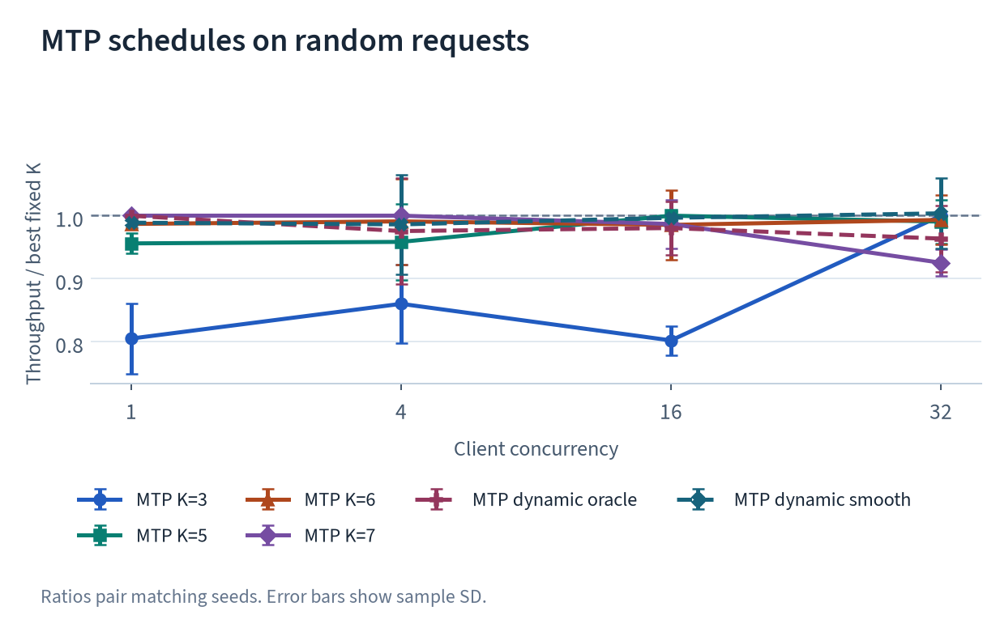

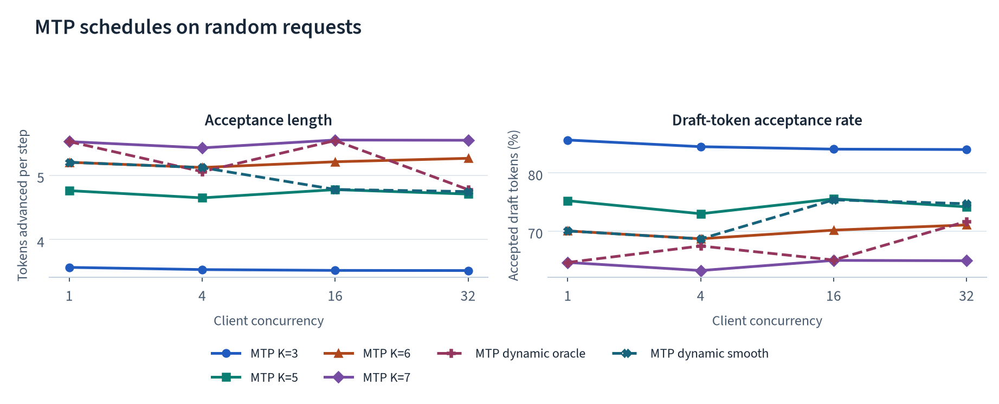

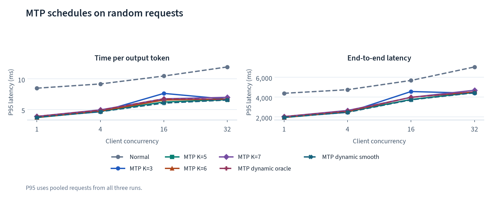

### 6.3 DSpark Adaptive Verification：随机负载

自适应组使用同一 DSpark checkpoint，最大 K 为 7，只增加 `enable_adaptive_verification=true`。Confidence head 给出逐位置置信度，框架按全局预算选取实际验证的位置。缩短验证块可以降低开销，也会缩短每步平均推进距离。

| 并发 | 固定 K7 TPS | Adaptive TPS | 同 seed 配对加速比 | 固定 K7 接受长度 | Adaptive 接受长度 | 固定 K7 P95 TPOT (ms) | Adaptive P95 TPOT (ms) |
|---:|---:|---:|---:|---:|---:|---:|---:|
| 1 | 244.99 ± 60.37 | 223.38 ± 45.32 | 0.918 ± 0.053× | 2.771 | 2.698 | 10.982 | 11.888 |
| 4 | 709.22 ± 117.52 | 678.30 ± 102.50 | 0.958 ± 0.015× | 2.706 | 2.659 | 13.222 | 13.891 |
| 16 | 1376.61 ± 138.30 | 1384.56 ± 85.01 | 1.009 ± 0.043× | 2.750 | 2.566 | 17.958 | 16.726 |
| 32 | 1587.28 ± 198.36 | 1754.27 ± 63.94 | 1.113 ± 0.092× | 2.828 | 2.486 | 19.336 | 16.160 |

C=1 和 C=4 时，自适应组平均吞吐分别低约 8.2% 和 4.2%。C=16 基本持平。C=32 的配对加速比为 1.113×，P95 TPOT 从 19.336 ms 降到 16.160 ms。该点的接受长度从 2.828 降到 2.486，按平均 TPOT 乘接受长度估算的周期成本从 21.626 ms 降到 18.340 ms，约减少 15.2%。

低负载下要同时考虑置信度计算、预算分配和接受长度缩短的成本。C=32 的吞吐样本标准差从 198.36 降至 63.94 tokens/s。这个变化来自各三轮的两组结果，固定组的波动较大。

#### 高并发最佳固定 K 补充对照

初扫显示短草稿可能优于默认 K7，因此在同一 GPU 上补做 K=1、K=3 在 C=16、32 的三轮复测。下表将新结果与原固定 K7、Adaptive 运行按相同 seed 配对。每个并发点的“最佳固定 K”由这三种固定配置的三轮平均吞吐选出，属于同一批数据上的描述性选择。

| 并发 | 方法 | 输出吞吐 (tokens/s) | 接受长度 | P95 TPOT (ms) | 相对最佳固定 K 配对加速比 |
|---:|---|---:|---:|---:|---:|
| 16 | DSpark K=1 | **1403.60 ± 144.33** | 1.607 | **13.370** | 1.000× |
| 16 | DSpark K=3 | 1313.30 ± 69.01 | 2.227 | 17.430 | 0.939 ± 0.054× |
| 16 | DSpark K=7 | 1376.61 ± 138.30 | 2.750 | 17.958 | 0.983 ± 0.068× |
| 16 | DSpark Adaptive | 1384.56 ± 85.01 | 2.566 | 16.726 | 0.991 ± 0.083× |
| 32 | DSpark K=1 | 1807.33 ± 20.21 | 1.601 | 15.680 | 0.928 ± 0.025× |
| 32 | DSpark K=3 | **1949.83 ± 74.47** | 2.300 | **14.220** | 1.000× |
| 32 | DSpark K=7 | 1587.28 ± 198.36 | 2.828 | 19.336 | 0.812 ± 0.069× |
| 32 | DSpark Adaptive | 1754.27 ± 63.94 | 2.486 | 16.160 | 0.900 ± 0.002× |

C=32 时，Adaptive 的吞吐为默认 K7 的 1.113×。固定 K3 达到 1949.83 tokens/s。Adaptive 的配对吞吐约为 K3 的 0.900×，P95 TPOT 也比 K3 高。

C=16 时，K1 的平均吞吐最高，但三轮波动较大；Adaptive 与 K1 的配对比值约为 0.991±0.083，不能据此宣称二者存在稳定优劣。整体部署顺序应是先复测少量固定 K，再判断置信度自适应是否带来额外收益。


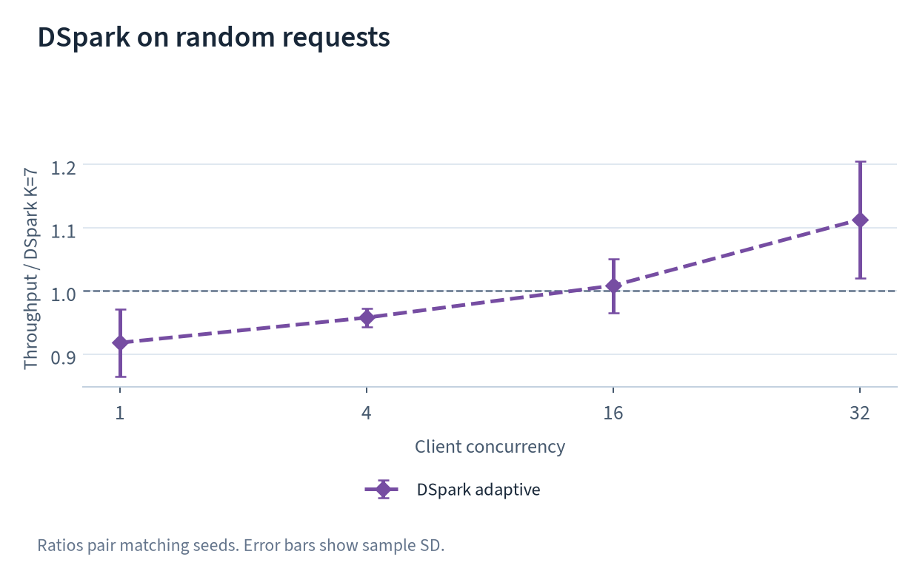

### 6.4 DSpark Adaptive Verification：Spec-Bench 扩展

为检验上述负载依赖是否只存在于随机 token，实验又在同一 GPU 上对 DSpark Adaptive Verification 运行了 12 次 Spec-Bench Benchmark，并与原固定 K7 的 12 次语义运行按 seed 配对。每次 128 请求、输出 256 tokens，因此每组百分位由 384 个请求计算。

| 并发 | 固定 K7 TPS | Adaptive TPS | 同 seed 配对加速比 | 固定 K7 接受长度 | Adaptive 接受长度 | 固定 K7 P95 TPOT (ms) | Adaptive P95 TPOT (ms) |
|---:|---:|---:|---:|---:|---:|---:|---:|
| 1 | 320.00 ± 0.08 | 291.77 ± 0.09 | 0.912 ± 0.000× | 3.688 | 3.578 | 4.160 | 4.622 |
| 4 | 1014.30 ± 7.61 | 956.80 ± 2.39 | 0.943 ± 0.007× | 3.636 | 3.462 | 4.956 | 5.466 |
| 16 | 2638.93 ± 12.89 | 2568.34 ± 5.80 | 0.973 ± 0.007× | 3.685 | 3.295 | 7.521 | 7.620 |
| 32 | 3367.17 ± 6.13 | 3566.52 ± 45.62 | 1.059 ± 0.016× | 3.678 | 3.147 | 11.240 | 10.621 |

在 Spec-Bench 上，固定 K7 在 C=1 快于 Adaptive，C=16 时 Adaptive 仍低约 2.7%。C=32 时，Adaptive 的配对吞吐提高约 5.9%，P95 TPOT 降约 5.5%，P95 E2EL 从 3028.421 ms 降到 2844.837 ms。该点的接受长度下降约 14.4%，平均 TPOT 从 7.902 ms 降至 7.451 ms。测值与缩短验证周期带来收益的解释一致。

C=32 的自适应吞吐增益在随机负载约为 11.3%，在 Spec-Bench 约为 5.9%。固定 K7 在 Spec-Bench 上的接受长度约为 3.68。低、中并发可从固定 K7 开始，高并发则应在同一负载下比较短固定 K 和 Adaptive。

#### 高并发固定短块的语义对照

在同一 GPU 2 上补充的 Spec-Bench 三轮结果如下。最佳固定 K 从 K1/K3/K7 中按三轮平均吞吐选出。

| 并发 | 方法 | 输出吞吐 (tokens/s) | 接受长度 | P95 TPOT (ms) | 相对最佳固定 K 配对加速比 |
|---:|---|---:|---:|---:|---:|
| 16 | DSpark K=1 | 1947.57 ± 1.45 | 1.799 | 8.840 | 0.738 ± 0.004× |
| 16 | DSpark K=3 | 2105.25 ± 14.17 | 2.864 | 8.660 | 0.798 ± 0.002× |
| 16 | DSpark K=7 | **2638.93 ± 12.89** | 3.685 | **7.521** | 1.000× |
| 16 | DSpark Adaptive | 2568.34 ± 5.80 | 3.295 | 7.620 | 0.973 ± 0.007× |
| 32 | DSpark K=1 | 2548.86 ± 21.15 | 1.804 | 13.200 | 0.711 ± 0.013× |
| 32 | DSpark K=3 | **3586.70 ± 49.42** | 2.866 | **9.660** | 1.000× |
| 32 | DSpark K=7 | 3367.17 ± 6.13 | 3.678 | 11.240 | 0.939 ± 0.013× |
| 32 | DSpark Adaptive | 3566.52 ± 45.62 | 3.147 | 10.621 | 0.995 ± 0.021× |

C=16 时，固定 K7 在吞吐和 P95 TPOT 上都最好，K1/K3 明显不如 K7；随机初扫中“C=16 可缩短到 K1”的现象没有迁移到语义负载。C=32 时，固定 K3 的平均吞吐最高，Adaptive 与其几乎相同：Adaptive/K3 的配对均值为 0.995×，二者的平均吞吐分别为 3566.52 和 3586.70 tokens/s。K3 的 P95 TPOT 更低，因此在本轮语义实验中，简单固定 K3 已是很有竞争力的选择，Adaptive 没有表现出额外平均吞吐优势。

同为 C=32，Adaptive 相对固定 K3 的倍率在随机负载约为 0.900×，在 Spec-Bench 约为 0.995×。两种负载中固定 K3 的平均吞吐都最高，领先幅度随输入分布变化。

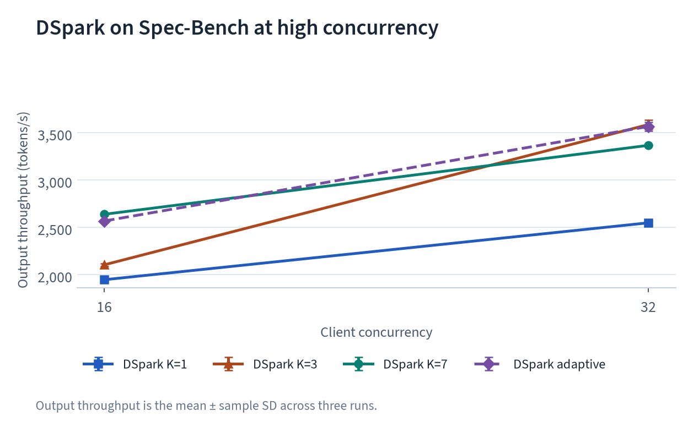


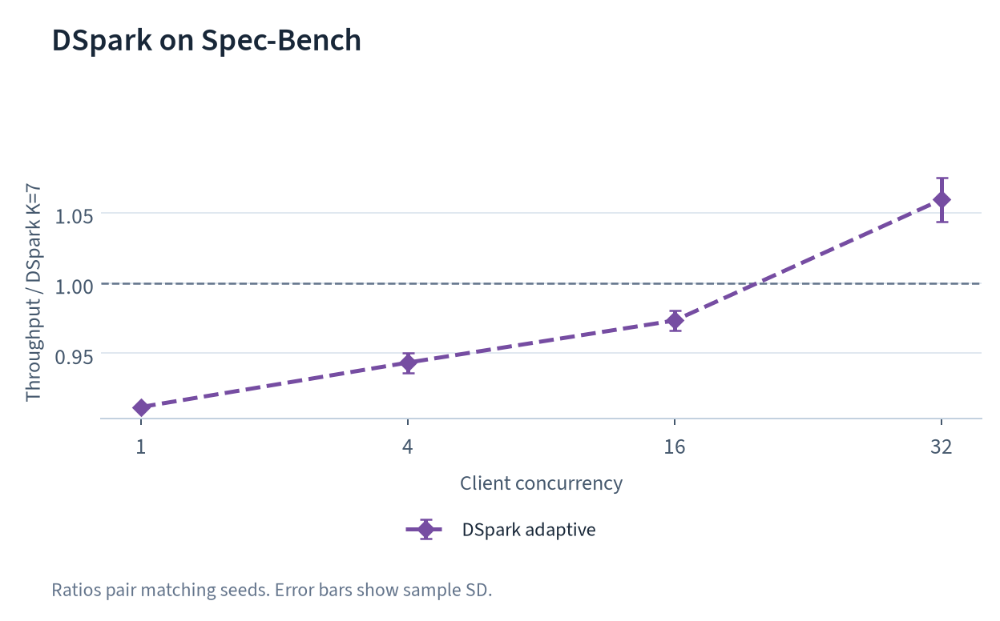

---

## 7. 综合结论、部署建议与实验边界

### 7.1 MTP：默认 K3 可用，但应按负载调长或调短

最佳固定 K 随并发变化。三轮平均吞吐最高的是 C=1、4 的 K7、C=16 的 K5 和 C=32 的 K3。C=4 的 K6/K7 及 C=16 的 K5/K6/K7 差距较小，且存在轮次波动。C=32 的 K7/K3 为 0.925 ± 0.021，长草稿在这档负载下确实更慢。

Dynamic-Smooth 相对默认 K3 在 C=1、4、16 分别达到 1.232×、1.146×、1.243×，C=32 基本持平。它相对 Normal 的四档倍率为 3.361×、2.766×、1.967×、1.558×。负载变化较大时，可以从 Smooth 开始在目标提示上验证。

Smooth 在 C=16、32 与当轮最佳固定配置的配对比值约为 0.997 和 1.004。Oracle 在 C=4、16、32 低于同批最佳固定配置。先用单轮扫描选候选区间，再用独立三轮复测确认。实验中的 `num_speculative_tokens_per_batch_size` 是固定映射。在线控制还可考虑实时接受率、队列状态和逐步成本。

固定低并发可复测 K6/K7，中等并发可复测 K5/K6，高并发从 K3 和 Smooth 开始。活动 batch 经常变化时，Smooth 可以减少切换服务配置的次数。这些 K 值来自当前模型的随机负载。部署前仍需按实际提示验证。

### 7.2 DSpark：先调固定块，再决定是否启用自适应

Spec-Bench 的 C=1、4、16 适合从固定 K7 开始验证。C=16 时，固定 K1/K3 的吞吐较低，Adaptive 约为 K7 的 0.973×。这几档负载的接受长度足以抵消 K7 的验证开销。

随机 C=32 时，固定 K3 的平均吞吐最高，P95 TPOT 也低于 Adaptive。Adaptive 快于默认 K7，但只有 K3 的约 0.900×。Spec-Bench C=32 时，Adaptive 约为固定 K3 的 0.995×，两者吞吐接近，K3 的 P95 TPOT 更低。部署时可先复测几个固定 K，再加入 Adaptive 作为高负载候选。

随机请求适合控制成本变量。DSpark 的接受长度和配置排序会随文本分布变化，部署时需用目标应用的请求样本校准。

### 7.3 实验边界

实测倍率适用于 Qwen3.8-27B-FP8、本地 DSpark checkpoint、vLLM 0.34.0 和 B200。每组只有三轮，样本标准差描述运行波动。最佳固定 K 也从这三轮选出，因此相对它的倍率只描述该批实验。

第一轮 Normal/MTP/DSpark 基线采用多 GPU 并行，提高了效率，但仍可能受到 GPU 个体和共享主机资源随时间变化的影响。关键 MTP 策略和 DSpark 固定/自适应对照已在单卡顺序复测，本实验没有完成所有配置的全量 GPU 轮换。报告因此把第一轮用于性能画像，把同卡复测用于策略判断，不混用不同阶段的绝对吞吐。

随机 token 与 Spec-Bench 仍只是两类负载。固定输出长度、greedy decoding、无限请求速率和最大客户端并发便于控制变量，但不完全等价于生产环境中的泊松到达、突发流量、多轮对话和长上下文。后续若面向具体应用部署，应使用该应用的真实请求分布重新选择 K。

有效周期成本由端到端 TPOT 与接受长度估算。要确定起草、验证和调度各自的耗时，需要对 kernel 分别计时。

### 7.4 后续工作

后续可用独立留出集确认扫描选出的固定 K，降低在同一批数据上选最快配置带来的偏差。在线策略可将 batch-size 成本模型与逐步接受率结合。DSpark 可进一步比较置信度裁剪和短固定块，观察何时适合裁剪单个请求，何时应统一降低 K。

负载方面应增加代码、长文本、多轮对话和不同输出长度，并使用真实到达过程检验尾延迟。若继续深挖硬件原因，应在相同 batch shape 下分别 profiling Draft、Verify 和调度开销，以验证本文有效周期成本拟合所提示的趋势。

## 8. 实验产物与复现入口

### 8.1 数据、日志和图表

| 产物 | 位置 | 内容 |
|---|---|---|
| 原始 Benchmark JSON | `results/raw/` | 每次运行的请求级延迟、输出长度、吞吐和投机接受统计，保留完整记录 |
| 汇总 JSON 与 CSV | `results/processed/` | 三轮均值、样本标准差、合并请求百分位、同 seed 配对加速比及 K 成本分析 |
| 服务与 Benchmark 日志 | `logs/commands/`、`logs/server/` | 每次主要命令的完整合并输出 |
| 命令审计 | `report/command_audit.md`、`results/processed/command-audit.csv` | 实际 argv、起止时间、退出码与日志位置 |
| 实验清单 | `results/processed/*manifest.json` | 每个矩阵的状态、每次运行标签、结果路径及校验摘要 |
| 图表与自动导出表 | `report/figures/`、`report/tables/` | PNG/SVG 图和 Markdown 数据表 |
| 文件校验 | `results/processed/raw-sha256.csv` | 原始 JSON 的字节数与 SHA-256 |

校验覆盖 274 份原始 JSON，含早期辅助记录和 260 次核心压测。九份汇总的状态均为 `complete`，原始记录、实验清单和接受长度恒等式检查的错误数均为 0。[校验记录](../results/processed/artifact-validation.json) · [文件哈希](../results/processed/raw-sha256.csv)

### 8.2 主要复现命令

从仓库根目录运行。原实验的 Python 和 vLLM 位于 `/home/genai/.pixi/envs/default/bin/`，换机器时请调整路径。用 `bin/run_logged.py` 或 `bin/launch_detached.py` 可以保存完整审计日志。

MTP K 扫描：

```bash
python src/run_k_scan.py \
  --method mtp --ks 1 2 3 4 5 6 7 \
  --gpu 3 --port 8103 --phase kscan-r1 --label-prefix kscan \
  --num-prompts 32 --seeds 42 --concurrencies 32 16 4 1
```

DSpark K 扫描：

```bash
python src/run_k_scan.py \
  --method dspark --ks 1 3 5 7 \
  --gpu 0 --port 8100 --phase kscan-r1 --label-prefix 057 \
  --num-prompts 32 --seeds 42 --concurrencies 32 16 4 1
```

MTP 七配置同卡复测：

```bash
python src/run_server_suite.py \
  --config config/mtp_policy_comparison.json \
  --gpu 3 --port 8103 --phase policy-mtp-r1 --label-prefix 063 \
  --num-prompts 32 --seeds 42 43 44 --concurrencies 32 16 4 1
```

DSpark Adaptive Verification 的 Spec-Bench 扩展：

```bash
python src/run_server_suite.py \
  --config config/dspark_policy_comparison.json --methods dspark-adaptive \
  --gpu 2 --port 8102 --phase semantic-r1 --label-prefix 064 \
  --num-prompts 128 --seeds 42 43 44 --concurrencies 32 16 4 1 \
  --dataset-name spec_bench --dataset-path data/spec_bench/question.jsonl \
  --output-len 256
```

DSpark 高并发固定短块的随机与语义复测：

```bash
python src/run_k_scan.py \
  --method dspark --ks 1 3 --gpu 2 --port 8102 \
  --phase policy-dspark-r1 --label-prefix 065 \
  --num-prompts 32 --seeds 42 43 44 --concurrencies 32 16

python src/run_server_suite.py \
  --config config/dspark_high_concurrency_confirmation.json \
  --gpu 2 --port 8102 --phase semantic-r1 --label-prefix 066 \
  --num-prompts 128 --seeds 42 43 44 --concurrencies 32 16 \
  --dataset-name spec_bench --dataset-path data/spec_bench/question.jsonl \
  --output-len 256
```

汇总、制图和核验：

```bash
python src/summarize_benchmarks.py \
  --phase formal-r1 --methods normal mtp-k3 dspark-k7 \
  --concurrencies 1 4 16 32 --seeds 42 43 44 --num-prompts 128

python src/summarize_benchmarks.py \
  --phase policy-mtp-r1 --output-stem policy-mtp-fixed-r1 \
  --methods normal mtp-k3 mtp-k5 mtp-k6 mtp-k7 \
  --best-fixed-methods mtp-k3 mtp-k5 mtp-k6 mtp-k7 \
  --concurrencies 1 4 16 32 --seeds 42 43 44 --num-prompts 32

python src/summarize_benchmarks.py \
  --phase policy-mtp-r1 \
  --methods normal mtp-k3 mtp-k5 mtp-k6 mtp-k7 mtp-dynamic-oracle mtp-dynamic-smooth \
  --additional-baseline-methods mtp-k3 mtp-k5 mtp-k6 mtp-k7 mtp-dynamic-smooth \
  --best-fixed-methods mtp-k3 mtp-k5 mtp-k6 mtp-k7 \
  --concurrencies 1 4 16 32 --seeds 42 43 44 --num-prompts 32

python src/summarize_benchmarks.py \
  --phase policy-dspark-r1 --methods dspark-k7 dspark-adaptive \
  --baseline-method dspark-k7 --concurrencies 1 4 16 32 \
  --seeds 42 43 44 --num-prompts 32

python src/analyze_k_scan.py --method mtp --ks 1 2 3 4 5 6 7
python src/analyze_k_scan.py --method dspark --ks 1 3 5 7 --reference-k 7
python src/make_figures.py --include-policies
python src/export_markdown_tables.py \
  --phases formal-r1 semantic-r1 policy-mtp-fixed-r1 policy-mtp-r1 policy-dspark-r1 \
  policy-dspark-high-r1 semantic-r1-dspark-adaptive semantic-r1-dspark-high
python src/export_command_audit.py
python src/validate_results.py \
  --required-summaries formal-r1 kscan-r1 semantic-r1 policy-mtp-fixed-r1 policy-mtp-r1 \
  policy-dspark-r1 policy-dspark-high-r1 semantic-r1-dspark-adaptive semantic-r1-dspark-high
```

原实验的 MTP 扫描分两次完成。逐次命令和运行标签可在审计记录中核对。复跑时请使用新的结果目录。[命令记录](command_audit.md)
