# 基于 vLLM 与 Qwen3.8-27B-FP8 的投机解码性能研究

## ——固定草稿长度、负载动态选 K 与 DSpark 自适应验证

实验日期：2026-11-24  
实验平台：vLLM 0.34.0、NVIDIA B200、Qwen3.8-27B-FP8  

## 摘要

本实验围绕大语言模型自回归解码的串行瓶颈，研究 Native MTP 与 DSpark 两类投机解码方案在不同并发、不同任务分布下的吞吐、尾延迟和草稿接受行为。正式随机负载采用 Normal、MTP K=3、DSpark K=7 三种配置，在 C=1、4、16、32 下分别以 seed=42、43、44 独立运行三次，共 36 次 Benchmark；每次包含 128 个输入 1024 tokens、输出 512 tokens 的请求。随后使用 Spec-Bench 真实语义任务、MTP K=1…7 与 DSpark 固定 K 扫描、同卡动态策略复测，分析草稿收益与验证成本之间的关系。

随机负载正式结果表明，MTP K=3 在两种投机方案中整体收益更高且跨轮波动更小，相对 Normal 的配对加速比在四个并发点分别约为 2.783×、2.510×、1.656×、1.683×；DSpark K=7 的对应加速比约为 2.008×、1.743×、1.274×、1.016×，其收益随并发增加迅速收窄。K 扫描进一步显示，初始 K=3 并不是 MTP 的最佳固定配置：单轮扫描的配置级 Oracle 在 C=1、4、16、32 分别选择 K=7、6、7、5，说明草稿长度需要同时考虑接受概率和实测步骤成本。真实语义任务改变了两种 drafter 的相对排序，因此最终策略同时报告随机负载与 Spec-Bench 结果，不用单一合成分布代表所有应用。

最终同卡三轮策略复测显示，MTP 的三轮均值最佳固定 K 在 C=1、4、16、32 分别为 K7、K7、K5、K3。dynamic-smooth 相对 Normal 的配对加速为 3.361×、2.766×、1.967×、1.558×，在 C=16、32 接近当轮最佳固定 K，但没有证明稳定超越最佳固定配置。DSpark Adaptive Verification 只在高负载相对默认 K7 显示收益；随机 C=32 中它仍仅为固定 K3 的约 0.900×，说明自适应验证不能替代目标负载上的固定 K 调优。

**关键词：** Speculative Decoding；MTP；DSpark；动态草稿长度；Adaptive Verification；vLLM；B200

---

## 1. 研究背景与问题定义

### 1.1 为什么自回归解码需要投机执行

标准自回归解码每个目标模型前向步骤只向前推进一个 token。低并发时，GPU 往往受到显存带宽和 kernel launch 等固定开销限制，单次前向并不能充分利用硬件计算能力。Speculative Decoding 的基本思想是：先由较低成本的 drafter 连续提出 K 个候选 token，再由 target model 在一次并行验证中检查这些位置；被接受的前缀连同 target 给出的 bonus token 一次提交，从而减少完成同样输出长度所需的 target decode step 数。

对第 i 个草稿位置，记其无条件接受概率为 p_i，则期望接受长度可写为：

$$
A(K)=1+\sum_{i=1}^{K}p_i.
$$

这里的 1 包含验证步骤产生的 bonus token。实验原始数据中的 `spec_decode_per_position_acceptance_rates` 与 `spec_decode_acceptance_length` 满足这一恒等式。需要注意，p_i 是“第 i 个位置仍被接受”的无条件概率，已经包含此前位置均被接受的影响，不能把它误解为只在前缀已接受条件下估计的条件概率。

在持续有 C 个请求解码的理想化稳态下，可用下式理解吞吐：

$$
\mathrm{OutputTPS}\approx C\cdot\frac{A(K)}{T_{\mathrm{cycle}}(C,K)},
$$

其中：

$$
T_{\mathrm{cycle}}(C,K)=T_{\mathrm{draft}}(C,K)+T_{\mathrm{verify}}(C,K)+T_{\mathrm{overhead}}(C,K).
$$

增大 K 会提高 A(K)，但接受概率通常随位置衰减，而 draft、verify 和调度成本持续增加。因此最优 K 不一定位于接受长度最大处，也不一定在不同并发下保持不变。低并发时额外计算可能接近“免费”；高并发时，草稿 token 与真实请求竞争同一批计算资源，被拒绝的候选会成为实际浪费。

### 1.2 两类 drafter

本实验比较两类机制：

1. **Native MTP**：目标模型checkpoint自带 MTP 能力，vLLM 递归调用 MTP head 产生多个草稿位置。其优点是无需外部独立 draft checkpoint；但多个位置需要串行递归生成。
2. **DSpark**：使用本地 1.86B BF16 外部 drafter，默认一次提出 7 个候选。该 checkpoint 带 confidence head，可为逐位置接受概率提供置信度，因此除固定 K 外还可启用 vLLM 的 Adaptive Verification。

Adaptive Verification 不是简单地按请求数切换一个全局 K。它将每个请求每个草稿位置的置信度连乘为 survival probability，在请求之间竞争全局验证预算，再由启动时 profiling 得到的成本模型决定预算。一个请求可能保留完整草稿块，另一个低置信请求可能只验证前一两个位置。

### 1.3 研究问题

本实验回答四个问题：

- **Q1：** Normal、MTP K=3、DSpark K=7 在不同并发下的吞吐、P95 延迟和波动如何？
- **Q2：** 随机 token 负载与真实语义任务的接受行为是否一致，能否用前者代替后者？
- **Q3：** MTP 的最优固定 K 如何变化，接受长度与有效步骤成本能否解释这种变化？
- **Q4：** 相对最佳固定 K，按 batch size 选 K 和 DSpark Adaptive Verification 是否还有可重复的额外收益？

---

## 2. 实验平台与可复现协议

### 2.1 硬件、软件与模型

| 项目 | 配置 |
|---|---|
| GPU | NVIDIA B200，单卡显存约 183359 MiB |
| 并行方式 | 每次服务 TP=1，单实例独占一张卡 |
| 同时用于实验的 GPU | 仅 GPU 0/1/2/3，最多四张；GPU 4–7 未作为本实验计算资源 |
| CPU | Intel Xeon Platinum 8568Y+，192 logical CPUs |
| 驱动 | 590.48.01 |
| Python / vLLM | 3.12.16 / 0.34.0 |
| PyTorch / CUDA | 2.14.0+cu130 / 13.0 |
| Target | `/home/model/Qwen3.8-27B-FP8`，27B，FP8 |
| DSpark drafter | `/home/genai/models/Qwen3.8-27B-DSpark-vLLM`，1.86B，BF16，serving block size 7 |

所有正式服务使用 `max_model_len=8192`、`max_num_seqs=256`、`gpu_memory_utilization=0.90`、`generation_config=vllm`，并关闭 prefix caching。Benchmark 使用 greedy sampling：`temperature=0`、`top_p=1`、`top_k=-1`、`ignore_eos=true`，以避免采样随机性和提前 EOS 干扰固定长度性能比较。

完整机器可读协议保存在 [experiment_protocol.json](../config/experiment_protocol.json)。vLLM 服务命令、每次 Benchmark 的完整 argv、起止时间、退出码和合并输出均由审计包装器记录。

### 2.2 正式随机负载

三种初始配置为：

- Normal：不启用投机解码；
- MTP：`{"method":"mtp","num_speculative_tokens":3}`；
- DSpark：本地 drafter，`num_speculative_tokens=7`。

每个组合覆盖 C=1、4、16、32，seed=42、43、44，同 seed 跨方法配对。每次运行 128 个请求，输入严格为 1024 tokens，输出严格为 512 tokens，`random_range_ratio=0`，请求以无限速率提交并受 `max_concurrency` 限制。每个方法与并发组合在正式计时前单独 warmup。总计 3 方法 × 4 并发 × 3 seed = **36 次正式运行**，不包含 warmup。

第一轮为提高效率，将三种方法放在不同 B200 上并行运行。因此第一轮用于完整性能画像，但关键策略另做同 GPU 顺序复测；不能把不同卡上的单次结果未经验证就当成严格同条件对照。

### 2.3 Spec-Bench 真实语义负载

语义实验使用 [Spec-Bench question.jsonl](../data/spec_bench/question.jsonl)，文件包含 480 条记录，覆盖 writing、roleplay、reasoning、math、coding、translation、RAG 等类别。vLLM loader 使用每条记录的第一轮 prompt 并应用 chat template。每次取 128 请求，输出 256 tokens，其他并发、seed 和重复次数与随机正式矩阵一致，共 36 次正式运行。

该数据文件 SHA-256 为：

```text
4b6d33e79484f9841c487ee87d1cf6aa8c6066f61d5d482ff09e5a007fafdf04
```

随机负载用于控制输入输出长度、隔离硬件成本；Spec-Bench 用于观察真实文本分布下的草稿质量。两者接受率不混合计算。第一轮语义基线按方法在不同 GPU 上并行，用于建立性能画像；DSpark 固定 K、Adaptive 与短 K 补充对照在同一 GPU 2 上顺序复测，MTP 最终策略在同一 GPU 3 上顺序复测。

### 2.4 K 扫描与策略复测

MTP 初扫 K=1…5；由于 K=5 位于边界且表现最好，扩展到 K=6、7。扫描采用 32 请求、seed=42、输入 1024、输出 512、C=32/16/4/1。DSpark 扫描 K=1、3、5、7。扫描用于筛选与建立成本模型，不将单轮扫描的最优点直接当作最终结论。

动态策略复测使用相同服务参数，在同一 GPU 上顺序启动不同配置，并对每个配置重复三次。比较的 MTP 策略包括 Normal、初始 K3、固定 K5/K6/K7、按扫描 argmax 构造的 Oracle batch-size 表，以及去除单轮非单调选择的平滑动态表。

### 2.5 统计口径

- 每次 Benchmark 独立保存 JSON，不挑选最快一次。
- 吞吐、延迟和接受统计报告三次运行的算术均值与**样本标准差**（ddof=1）。标准差不是置信区间。
- 加速比先在同 seed 内计算 `candidate TPS / baseline TPS`，再汇总三个比值；同时保留“平均吞吐之比”供核查。
- 请求级 TPOT 定义为 `1000×(E2EL−TTFT)/(output_tokens−1)` ms。
- P50/P95/P99 不对三轮百分位取平均，而是合并三轮全部请求后重新计算。正式配置每组共 384 请求；ITL 则使用原始 JSON 中记录的全部流式输出事件间隔。
- 输出吞吐采用 Benchmark 的总输出 tokens 除以端到端计时墙钟时间；它同时受到 prefill、decode、调度与请求完成尾部的共同影响。

---

## 3. 初始基线：随机负载正式结果

### 3.1 吞吐与配对加速比

下表为 36 次正式运行的汇总。吞吐列为三次独立 Benchmark 的均值 ± 样本标准差；加速比为同 seed 配对后三个比值的均值。

| 方法 | 并发 | 输出吞吐 (tokens/s) | 相对 Normal 配对加速比 | 接受长度 | P95 请求级 TPOT (ms) |
|---|---:|---:|---:|---:|---:|
| Normal | 1 | 117.10 ± 0.01 | 1.000 | — | 8.469 |
| MTP K=3 | 1 | 325.82 ± 0.74 | 2.783× | 3.595 | 3.789 |
| DSpark K=7 | 1 | 235.12 ± 18.94 | 2.008× | 2.648 | 10.959 |
| Normal | 4 | 432.54 ± 0.07 | 1.000 | — | 9.162 |
| MTP K=3 | 4 | 1085.63 ± 6.63 | 2.510× | 3.572 | 4.557 |
| DSpark K=7 | 4 | 753.72 ± 49.63 | 1.743× | 2.611 | 13.206 |
| Normal | 16 | 1438.59 ± 0.23 | 1.000 | — | 10.666 |
| MTP K=3 | 16 | 2382.18 ± 24.73 | 1.656× | 3.579 | 8.081 |
| DSpark K=7 | 16 | 1832.41 ± 105.46 | 1.274× | 2.592 | 20.069 |
| Normal | 32 | 2325.83 ± 1.38 | 1.000 | — | 12.176 |
| MTP K=3 | 32 | 3913.63 ± 123.26 | 1.683× | 3.552 | 9.078 |
| DSpark K=7 | 32 | 2362.21 ± 93.29 | 1.016× | 2.656 | 29.382 |


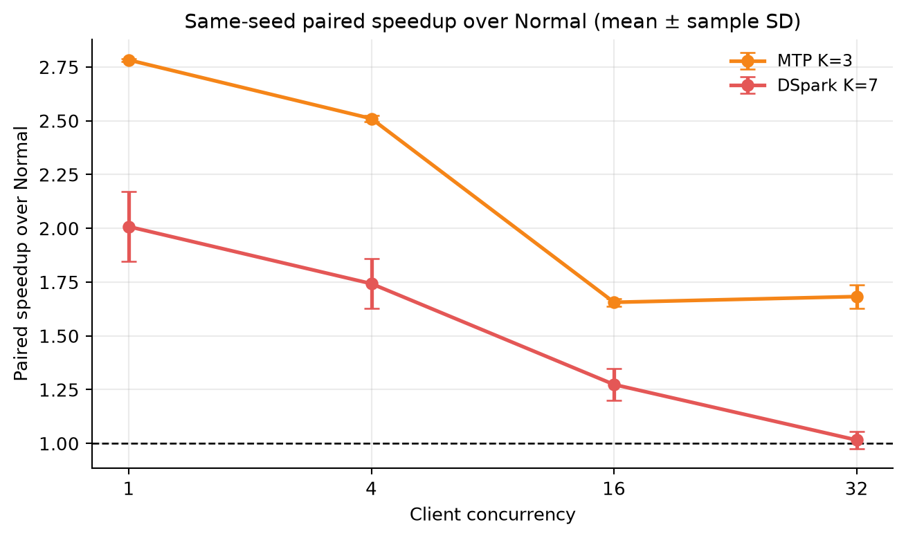

### 3.2 MTP：初始配置在所有并发点都有明显收益

MTP K=3 的接受长度在四个并发点稳定在约 3.55–3.60，即平均每个验证步骤推进约 3.6 个 token。C=1 时输出吞吐从 117.10 提升到 325.82 tokens/s，配对加速约 2.783×；C=4 仍有约 2.510×。并发升到 16 和 32 后，加速比回落到约 1.66–1.68×，反映额外 draft/verify 计算开始占用本可用于其他请求的资源。

不过，高并发下 MTP 仍保持明显正收益，并未像 DSpark K=7 那样在 C=32 接近 Normal。其原因是两方面的：随机负载上 MTP 的逐位置接受概率较高，且 K=3 的验证块相对较小，边际成本尚未抵消接受长度收益。

MTP 的三轮波动整体较小。C=1 的吞吐样本标准差仅 0.74 tokens/s；即使波动相对较大的 C=32，123.26 tokens/s 的标准差相对于 3913.63 的均值也约 3.1%。因此“初始 MTP K=3 优于 Normal”并不依赖某一次最快运行。

### 3.3 DSpark：接受长度近似不变，但有效收益随负载消失

DSpark K=7 的接受长度约为 2.59–2.65，随并发变化不大；但相对 Normal 的加速比从 C=1 的约 2.008× 持续下降到 C=32 的约 1.016×。这说明高并发收益下降不能归因于接受长度同比崩溃，而应从每个验证块的成本和调度竞争解释：C=32 时，一次最多验证 7 个草稿位置的宽块会消耗更多计算，而平均只推进约 2.65 个 token，额外成本几乎抵消了减少 decode step 的收益。

DSpark 的跨轮波动也明显高于 Normal 和 MTP。C=1 的三轮吞吐标准差为 18.94 tokens/s，约占均值 8.1%；C=16 的标准差为 105.46，约占均值 5.8%。其请求级 P95 TPOT 从 Normal 的 8.469 ms 增至 10.959 ms；C=32 时更达到 29.382 ms，而 Normal 为 12.176 ms。平均吞吐与尾延迟共同说明，对不同请求一视同仁地验证完整 K=7 块并不理想：低接受请求不仅收益小，还可能形成明显慢尾。

### 3.4 TPOT 与 ITL 的解释

投机解码会在一个 engine step 中提交多个 token，因此输出到客户端呈突发性。请求级 TPOT 是从请求总解码时间摊到每个输出 token 的平均值，而原始 ITL 记录的是相邻流式输出事件的间隔；一个事件可携带多个 token，所以它不是完整的逐 token 到达分布，二者也不需要相等。评估交互体验时，除平均 TPOT 外还应观察 P95 和已记录的 ITL 事件间隔，不能仅凭“平均每步接受多个 token”推断输出会均匀提前到达。

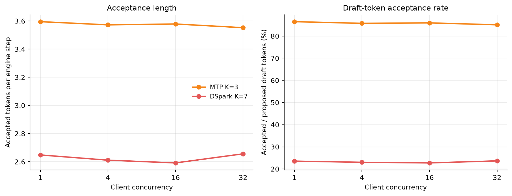

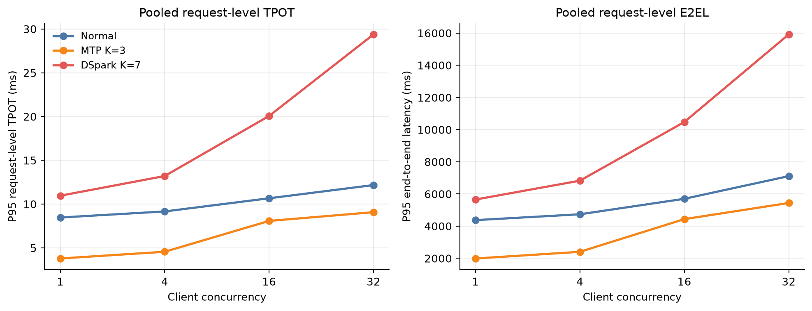

---

## 4. 固定 K 扫描与成本分析

### 4.1 MTP 扫描结果

MTP K=1…7 共完成 28 次扫描 Benchmark。以下为主要吞吐结果；每次 32 请求、seed=42。由于它是单轮筛选，表格用于发现趋势和构造候选策略，不替代后续三轮复测。

| K | C=1 TPS | C=4 TPS | C=16 TPS | C=32 TPS |
|---:|---:|---:|---:|---:|
| 1 | 199.36 | 714.45 | 2151.66 | 2589.33 |
| 2 | 267.38 | 909.79 | 2377.95 | 3364.68 |
| 3 | 319.40 | 1017.18 | 2285.91 | 3363.50 |
| 4 | 347.23 | 1134.45 | 2622.87 | 3355.13 |
| 5 | 370.94 | 1137.66 | 2834.88 | 3646.64 |
| 6 | 382.67 | 1199.79 | 2628.09 | 3537.39 |
| 7 | 385.54 | 1121.94 | 2872.25 | 3193.06 |

单轮配置级 Oracle 为：

| 并发 | 最佳 K | 最佳 TPS | 相对同轮 K=3 |
|---:|---:|---:|---:|
| 1 | 7 | 385.54 | 1.207× |
| 4 | 6 | 1199.79 | 1.180× |
| 16 | 7 | 2872.25 | 1.256× |
| 32 | 5 | 3646.64 | 1.084× |

因此，初始 K=3 留有明显调参空间，但“最佳 K 随并发变化”并不意味着任意动态表都能超过最佳固定 K。尤其 C=16 的 K=7 仅比 K=5 高约 1.3%，而 K=6 在该点出现局部回落，提示单轮结果包含请求输出差异和运行波动。最终必须比较动态表与固定 K5/K6/K7，而不能只与默认 K3 比较。

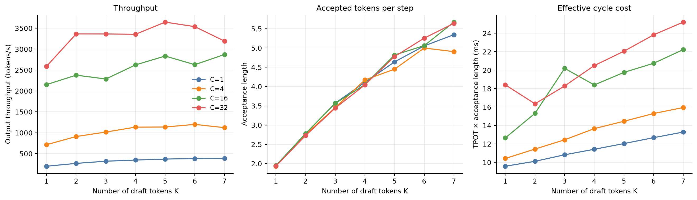

### 4.2 逐位置接受率与接受长度

以 K=5 为例，C=1 的五个逐位置无条件接受率约为 89.12%、79.73%、72.67%、63.26%、59.33%，因此：

$$
A(5)=1+0.8912+0.7973+0.7267+0.6326+0.5933\approx4.641.
$$

C=32 的 K=5 接受长度约为 4.779，说明该扫描中高并发并未显著降低草稿质量。K 增大时，新增位置仍能提供正接受收益；是否提高吞吐取决于新增接受长度能否覆盖新增 draft/verify 成本。


### 4.3 有效周期成本

为把 TPOT 与接受长度放到同一成本框架中，定义：

$$
\hat T_{\mathrm{cycle}}=\overline{\mathrm{TPOT}}\times A(K).
$$

它是从端到端请求指标反推的**有效周期成本**，包含调度、请求完成尾部等影响，不等价于 profiler 中单独的 draft 或 verify kernel 时间。对 K=1…7 做描述性线性拟合：

| 并发 | 拟合 $\hat T_{\mathrm{cycle}}\approx a+bK$ | R² |
|---:|---|---:|
| 1 | 8.928 + 0.624K ms | 0.9995 |
| 4 | 9.629 + 0.939K ms | 0.9926 |
| 16 | 12.879 + 1.399K ms | 0.8082 |
| 32 | 15.077 + 1.398K ms | 0.8820 |

C=1 和 C=4 的线性关系非常清晰，边际成本分别约 0.62、0.94 ms/K；C=1 的截距 8.928 ms 也接近 Normal 的请求平均 TPOT 8.465 ms。随着并发提高，固定成本上升，边际成本总体上升，并在 C=16–32 维持约 1.40 ms/K；不同 K 的运行波动也使高并发线性拟合变差。该结果支持“低负载更能承受长草稿，高负载需要更谨慎分配验证计算”的判断，但不把有效周期拟合冒充独立的 Draft/Verify 微基准。

### 4.4 从扫描到候选动态表

严格按单轮 argmax 构造的 Oracle 表为：

```json
{
  "method": "mtp",
  "num_speculative_tokens": 7,
  "num_speculative_tokens_per_batch_size": [
    [1, 1, 7],
    [2, 4, 6],
    [5, 16, 7],
    [17, 256, 5]
  ]
}
```

为避免直接过拟合 C=16 的非单调局部峰值，另构造平滑表：batch size 1–4 使用 K=6，5–256 使用 K=5。它保留“低负载允许更长草稿、高负载缩短验证块”的主要趋势。两表都使用 vLLM 已有动态调度机制；前者代表扫描配置级 Oracle，后者是候选部署策略。最终是否采用取决于同卡重复实验，而不是上述单轮表本身。

### 4.5 DSpark 固定 K 扫描

DSpark 在同一 GPU 上顺序扫描 K=1、3、5、7，每个组合使用 32 请求、seed=42，共 16 次 Benchmark。吞吐结果如下：

| K | C=1 TPS | C=4 TPS | C=16 TPS | C=32 TPS |
|---:|---:|---:|---:|---:|
| 1 | 150.91 | 533.65 | **1476.41** | 1791.55 |
| 3 | 198.12 | 649.67 | 1326.95 | **1905.26** |
| 5 | 207.88 | 627.61 | 1405.09 | 1748.01 |
| 7 | **211.73** | **655.90** | 1344.77 | 1491.24 |

该扫描中的配置级最优点是 C=1/4 选择 K=7，C=16 选择 K=1，C=32 选择 K=3。相对同轮 K=7，C=16 的 K=1 高约 9.8%，C=32 的 K=3 高约 27.8%。这与 DSpark 的验证成本趋势一致：C=1 时 K=7 接受长度为 2.378，吞吐高于短草稿；C=32 时 K=7 接受长度为 2.552，但有效周期成本达到 21.039 ms，而 K=3 的接受长度仍有 2.093、有效周期成本为 15.763 ms，缩短验证块更有利。

| 并发 | DSpark 有效周期成本拟合 $a+bK$ | R² |
|---:|---|---:|
| 1 | 10.176 + 0.120K ms | 0.9995 |
| 4 | 10.790 + 0.342K ms | 0.9896 |
| 16 | 13.705 + 0.695K ms | 0.6122 |
| 32 | 15.473 + 0.658K ms | 0.5964 |

低并发的拟合接近线性，高并发则出现明显非单调和较大拟合误差。K=1 的 draft-token 接受率约 55%–57%，K=7 约 20%–23%，这并不意味着 K=1 的草稿质量更好：接受率的分母包含 K=7 中更难接受的后续位置，而平均推进距离仍由接受长度衡量。

另一个交叉检查是：用 K=7 运行中的前 k 个逐位置接受率预测较短 K 的接受长度，再与短 K 的实测值比较。排除 K=7 自身后，各并发上的最大相对误差为：

| 并发 | MTP 最大相对误差 | DSpark 最大相对误差 |
|---:|---:|---:|
| 1 | 6.37% | 13.52% |
| 4 | 11.38% | 12.85% |
| 16 | 3.24% | 13.72% |
| 32 | 3.55% | 12.79% |

因此，$A(K)=1+\sum p_i$ 的恒等式只保证同一次运行内部的统计一致，并不意味着不同 K 的运行必然共享完全相同的逐位置接受率。最长草稿的统计可为短草稿提供近似，但不能替代目标负载上的实测，尤其不能简单把 DSpark 的 K7 接受统计截断后就当成 K1/K3 的真实值。

这些结果是单轮筛选证据，且不应与另一张卡、另一时间的正式 128 请求结果直接比较绝对吞吐。它们用于提出“高负载缩短 DSpark 验证块”的假设；Adaptive Verification 是否足够、是否优于最佳固定 K，需要分别判断，不能把超过默认 K=7 自动等同于超过所有固定配置。

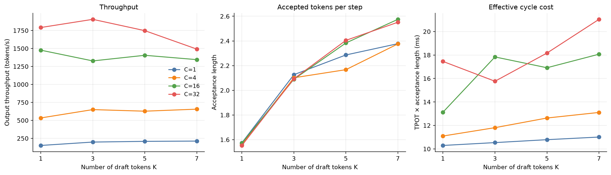

---

## 5. Spec-Bench 真实语义负载结果

### 5.1 吞吐、接受长度与配对加速比

三种初始配置的 Spec-Bench 矩阵均已完成，共 36 次独立运行。每次包含 128 个请求、输出 256 tokens；下表在每种语义负载内部比较不同解码方法。由于输入长度、输出长度和文本分布与随机实验不同，不能把本表的吞吐数值直接与表 3.1 做跨负载优劣判断。

| 方法 | 并发 | 输出吞吐 (tokens/s) | 相对 Normal 配对加速比 | 接受长度 | P95 请求级 TPOT (ms) |
|---|---:|---:|---:|---:|---:|
| Normal | 1 | 118.46 ± 0.04 | 1.000 | — | 8.367 |
| MTP K=3 | 1 | 262.89 ± 0.08 | 2.219× | 2.907 | 4.366 |
| DSpark K=7 | 1 | 320.00 ± 0.08 | 2.701× | 3.688 | 4.160 |
| Normal | 4 | 442.08 ± 0.12 | 1.000 | — | 8.959 |
| MTP K=3 | 4 | 894.79 ± 6.55 | 2.024× | 2.901 | 4.991 |
| DSpark K=7 | 4 | 1014.30 ± 7.61 | 2.294× | 3.636 | 4.956 |
| Normal | 16 | 1512.27 ± 0.11 | 1.000 | — | 10.058 |
| MTP K=3 | 16 | 2107.68 ± 4.69 | 1.394× | 2.904 | 8.345 |
| DSpark K=7 | 16 | 2638.93 ± 12.89 | 1.745× | 3.685 | 7.521 |
| Normal | 32 | 2510.96 ± 3.17 | 1.000 | — | 12.192 |
| MTP K=3 | 32 | 3765.54 ± 0.83 | 1.500× | 2.893 | 9.310 |
| DSpark K=7 | 32 | 3367.17 ± 6.13 | 1.341× | 3.678 | 11.240 |


### 5.2 语义分布改变两种 drafter 的相对排序

最真实的语义结果并不是“某一种方法始终最好”，而是出现了明确的并发区间分界。C=1、4、16 时，DSpark K=7 的输出吞吐均高于 MTP K=3：C=1 为 320.00 对 262.89 tokens/s，C=16 为 2638.93 对 2107.68 tokens/s。到 C=32，MTP 以 3765.54 对 3367.17 tokens/s 反超。这与接受长度和验证块成本共同一致：DSpark 的接受长度约为 3.68，高于 MTP 的约 2.90，低、中负载下更长的平均推进距离能够转化为更高吞吐；高负载下，K=7 宽验证块的资源消耗更加突出，而 MTP 的 K=3 配置更容易扩展。

两种方法在 Spec-Bench 上的接受长度都几乎不随并发变化。MTP 在四个并发点为 2.893–2.907，DSpark 为 3.636–3.688。因此，C=32 的排序反转主要不能用“DSpark 草稿突然变差”解释，而应归因于高并发下每个验证周期的成本及调度竞争。

### 5.3 随机 token 不能代替真实文本评价草稿质量

将两种负载分开比较可以看到：

| 方法 | 随机负载接受长度 | Spec-Bench 接受长度 | 随机负载中的相对表现 | Spec-Bench 中的相对表现 |
|---|---:|---:|---|---|
| MTP K=3 | 约 3.55–3.60 | 约 2.90 | 四个并发点均显著优于 DSpark K=7 | C=1/4/16 低于 DSpark，C=32 反超 |
| DSpark K=7 | 约 2.59–2.65 | 约 3.68 | 加速收益随并发增加明显收窄 | 低、中并发领先，C=32 仍有 1.341× 加速 |

这说明草稿接受率是与文本分布、drafter 与 target 的对齐程度共同相关的量，而不是服务配置的固定常数。随机 token 负载仍然适合控制序列长度和分析硬件成本，但若只用随机负载，就会得到“MTP 全面优于 DSpark”的不完整结论。真实语义负载是评价投机解码实际应用收益所必需的一层证据。

Spec-Bench 各组三轮吞吐波动整体较小，因此上述主要排序并非由单次异常值造成。不过，本实验仍只覆盖一个语义问题集和固定输出长度，不能把具体加速比直接外推到所有代码、长上下文或多轮对话应用。

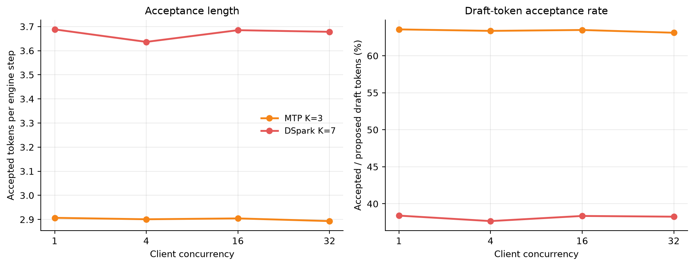


---

## 6. 动态选 K 与 Adaptive Verification 对照

策略实验把“相对默认配置的改善”与“相对最佳固定 K 的改善”分开。MTP 最终套件包含 Normal、K3、K5、K6、K7、dynamic-oracle 和 dynamic-smooth；DSpark 对照包含固定 K7 与 Adaptive Verification。每次运行 32 请求，seed=42、43、44，每组三轮共 96 个请求用于请求级百分位计算。所有配置在同一 GPU 上顺序启动，避免把 GPU 个体差异误当成策略收益。

### 6.1 MTP 固定 K 同卡三轮复测

最终套件中的 Normal 与四种固定 K 已全部完成，共 60 次独立 Benchmark。下表为每种配置的三轮输出吞吐均值与样本标准差；每次 32 请求，因此每组请求级百分位由 96 个请求计算。这里的绝对数值只在本套件内部比较，不与第一轮每次 128 请求的基线混用。

| 并发 | Normal TPS | MTP K3 TPS | MTP K5 TPS | MTP K6 TPS | MTP K7 TPS | 三轮均值最高的固定 K |
|---:|---:|---:|---:|---:|---:|---|
| 1 | 116.99 ± 0.01 | 319.40 ± 3.65 | 380.07 ± 16.62 | 392.47 ± 20.82 | **397.82 ± 24.15** | K7 |
| 4 | 432.31 ± 0.13 | 1043.58 ± 22.67 | 1163.23 ± 22.57 | 1202.49 ± 28.89 | **1217.84 ± 99.57** | K7 |
| 16 | 1447.57 ± 3.06 | 2290.47 ± 23.75 | **2857.38 ± 113.15** | 2817.20 ± 227.52 | 2816.93 ± 50.63 | K5 |
| 32 | 2331.87 ± 2.32 | **3622.57 ± 114.43** | 3586.37 ± 95.39 | 3596.52 ± 126.60 | 3352.30 ± 132.32 | K3 |

| 并发 | K3 / Normal | K5 / Normal | K6 / Normal | K7 / Normal | K3 / 当轮最佳固定 K |
|---:|---:|---:|---:|---:|---:|
| 1 | 2.730 ± 0.031× | 3.249 ± 0.142× | 3.355 ± 0.178× | 3.400 ± 0.207× | 0.805 ± 0.056× |
| 4 | 2.414 ± 0.052× | 2.691 ± 0.052× | 2.782 ± 0.067× | 2.817 ± 0.230× | 0.860 ± 0.062× |
| 16 | 1.582 ± 0.019× | 1.974 ± 0.082× | 1.946 ± 0.158× | 1.946 ± 0.038× | 0.802 ± 0.023× |
| 32 | 1.554 ± 0.049× | 1.538 ± 0.042× | 1.542 ± 0.056× | 1.438 ± 0.057× | 1.000× |

低并发时，增加草稿长度仍能带来明显收益。C=1 的 K7 达到 397.82 tokens/s，相对 Normal 的配对加速为 3.400×；但 K6/K7 的配对比值已为 0.987±0.007，说明从 K6 增至 K7 的平均收益不足 2%。C=4 的 K7 三轮均值最高，不过其样本标准差达到 99.57 tokens/s，K6/K7 的配对比值为 0.991±0.068，不能把 K6 与 K7 的均值差解释为稳定的配置优劣。

C=16 时，K5 的平均吞吐最高，K6 和 K7 相对 K5 的配对比值分别为 0.985±0.055 和 0.987±0.039，三者接近；默认 K3 则只有最佳固定 K5 的约 0.802×。C=32 时排序再次变化：K3、K5、K6 的三轮平均吞吐接近，K3 的描述性均值最高；K7/K3 的配对比值为 0.925±0.021，长草稿的开销已在高负载下明确抵消其接受长度收益。

接受长度随 K 增大而增长，但吞吐并不单调增长。以 C=32 为例，K3、K5、K7 的接受长度分别约为 3.520、4.708、5.543，K7 每次验证平均推进更远，却比 K3 慢约 7.5%。这与第 4 章的有效周期成本拟合一致：高并发下每增加一个草稿位置的边际成本并未消失，继续增加 K 的边际接受收益不足以补偿验证成本。

各固定 MTP 配置在三个 seed 上的吞吐均高于 Normal。C=32 的 Normal、K3、K5、K6、K7 请求级 P95 TPOT 分别为 11.939、6.677、6.609、6.709、6.987 ms，说明即使 K7 不再是最高吞吐配置，其延迟仍明显低于普通自回归解码。最佳固定 K 由同一批三轮结果按平均吞吐选出，属于描述性、post-selection 比较，不是独立测试集上的泛化估计。

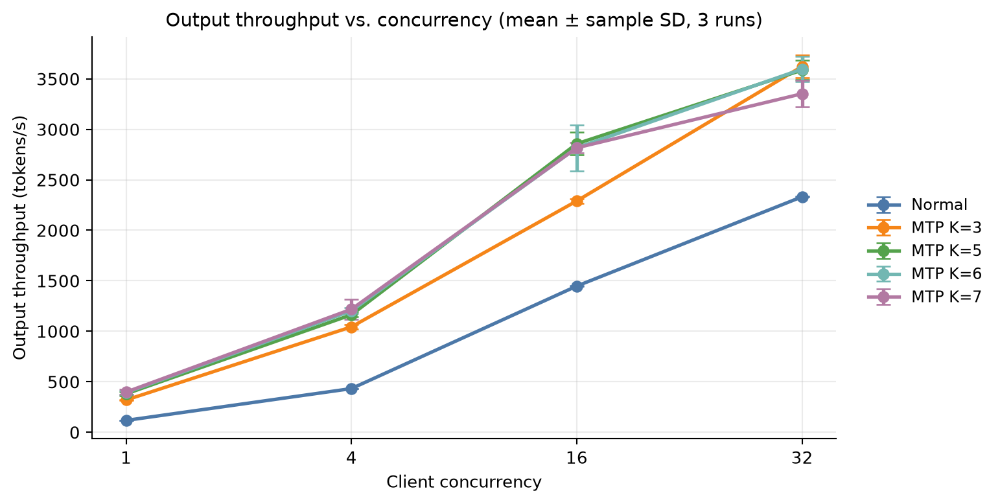


### 6.2 MTP 按 batch size 动态选 K

两种动态表来自第 4 章的单轮 K 扫描，而不是根据本节三轮复测结果反向修改。dynamic-oracle 在扫描的 C=1、4、16、32 分别选择 K=7、6、7、5；dynamic-smooth 使用更平滑的两段表，在低并发采用 K6、高并发采用 K5。服务实际展开的调度表已经单独保存并核对。

| 请求 batch size | dynamic-oracle | dynamic-smooth |
|---:|---:|---:|
| 1 | 7 | 6 |
| 2–4 | 6 | 6 |
| 5–16 | 7 | 5 |
| 17–256 | 5 | 5 |

因此，名称中的“oracle”仅指单轮扫描上的配置级最佳选择，不代表最终三轮复测中的最佳固定 K，也不是逐步预测未来接受率的在线最优策略。在标称客户端并发恰好形成对应的满载 decode batch 时，两种表在四个并发点上只有两处不同：C=1 分别为 K7/K6，C=16 分别为 K7/K5；C=4 的满载档位都是 K6，C=32 的满载档位都是 K5。实际请求到达、prefill 和收尾会改变活动 batch，运行过程因而可能跨档切换 K，不能把整个动态组视为始终执行一个固定 K。这一设计可以检验“直接搬用扫描最优表”与“减少档位、采用平滑表”的差异，但不能替代真正依据实时接受率和队列状态调整 K 的控制器。

两种动态配置的 24 次运行已全部完成，MTP 七配置套件因此达到 84/84 次完整运行。下表先与 Normal 和默认 MTP K3 比较；所有加速比均按相同 seed 配对后计算均值与样本标准差。

| 并发 | Oracle TPS | Smooth TPS | Oracle / Normal | Smooth / Normal | Oracle / K3 | Smooth / K3 |
|---:|---:|---:|---:|---:|---:|---:|
| 1 | 397.76 ± 24.26 | 393.27 ± 20.87 | 3.400 ± 0.207× | 3.361 ± 0.179× | 1.246 ± 0.090× | 1.232 ± 0.079× |
| 4 | 1182.83 ± 27.84 | 1195.80 ± 12.70 | 2.736 ± 0.065× | 2.766 ± 0.030× | 1.134 ± 0.050× | 1.146 ± 0.035× |
| 16 | 2798.38 ± 53.76 | 2846.86 ± 84.61 | 1.933 ± 0.040× | 1.967 ± 0.062× | 1.222 ± 0.026× | 1.243 ± 0.024× |
| 32 | 3486.86 ± 91.85 | 3633.22 ± 158.27 | 1.495 ± 0.041× | 1.558 ± 0.069× | 0.964 ± 0.053× | 1.004 ± 0.056× |

相对默认 K3，两种动态表都在 C=1、4、16 获得明显收益：Oracle 分别提高约 24.6%、13.4%、22.2%，Smooth 分别提高约 23.2%、14.6%、24.3%。C=32 时，默认 K3 已经处于最佳固定配置附近，Oracle 反而低约 3.6%，Smooth 与 K3 基本持平。这说明“按 batch size 选 K”的主要价值，是避免在低、中并发继续使用过短的默认 K3，而不是在所有负载上无条件增加吞吐。

更关键的对照是相对三轮复测选出的最佳固定 K。这里的最佳固定配置仍是同一批数据上的描述性选择，不能把略高于 1 的比值解释为独立泛化收益。

| 并发 | 当轮最佳固定 K | Oracle / 最佳固定 | Smooth / 最佳固定 | Oracle P95 TPOT (ms) | Smooth P95 TPOT (ms) |
|---:|---|---:|---:|---:|---:|
| 1 | K7 | 0.9998 ± 0.0003× | 0.9889 ± 0.0073× | 3.882 | 3.718 |
| 4 | K7 | 0.9756 ± 0.0839× | 0.9861 ± 0.0791× | 4.895 | 4.645 |
| 16 | K5 | 0.9804 ± 0.0423× | 0.9966 ± 0.0101× | 6.753 | 6.041 |
| 32 | K3 | 0.9636 ± 0.0529× | 1.0037 ± 0.0557× | 6.629 | 6.543 |

Oracle 在 C=1 与固定 K7 几乎完全一致，但在 C=4、16、32 分别只有最佳固定配置的约 0.976、0.980、0.964。Smooth 更接近最佳固定配置：C=16 的配对比值为 0.9966±0.0101，C=32 为 1.0037±0.0557。后者三轮波动覆盖了略低和略高于 K3 的结果，且最佳固定 K 本身来自同批复测，因此只能得出“Smooth 与 K3 接近”，不能宣称 Smooth 已稳定超过 K3。

两种动态表直接互比时，Oracle/Smooth 的配对吞吐比在 C=1、4、16、32 分别为 1.0111±0.0078、0.9891±0.0133、0.9835±0.0329、0.9604±0.0287。Oracle 只在 C=1 因使用 K7 而略快；Smooth 在其余三个并发点更有优势，并且四个点的 P95 TPOT 都低于 Oracle。尤其是 C=16，Smooth 使用 K5 而不是扫描 Oracle 的 K7，P95 TPOT 从 6.753 ms 降至 6.041 ms。这再次说明单轮吞吐最高的扫描点不一定能在独立复测中保持最优。

为了区分“换 K 的收益”和“动态调度本身的收益”，还把每个动态组与满载档位相同标称 K 的固定服务按 seed 配对。Oracle 相对 K7/K6/K7/K5 的比值在四个并发点为 0.9725–0.9998；Smooth 相对 K6/K6/K5/K5 的比值为 0.9947–1.0128。动态机制没有表现出普遍的大幅额外收益，观察到的差异最多为约 1%–3%。活动 batch 在到达和收尾阶段的跨档切换确实会改变平均行为，但本实验没有做逐步调度 profile，因此不把这些小幅差异全部归因于动态机制本身。

综合而言，**dynamic-smooth 是本实验随机负载上更值得保留的单一动态配置**：它用两段平滑表减少了档位，在低、中并发明显优于默认 K3，在 C=16、32 接近当轮最佳固定 K，并具有较低的 P95 TPOT。它的价值在于一个服务配置可以覆盖变化的活动 batch，而不是证明静态 batch-size 表能够稳定超越经过复测的固定 K。若部署负载长期稳定在单一并发，仍应优先使用该负载实测的固定 K；若负载变化，则可以把 Smooth 作为候选，并在目标语义负载上重新校准区间。

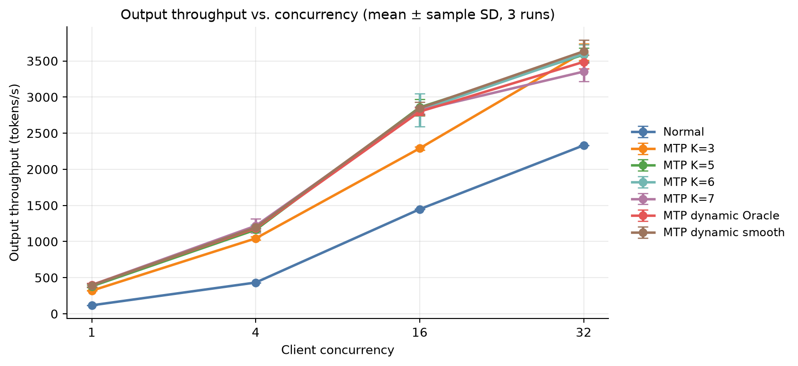


### 6.3 DSpark Adaptive Verification：随机负载

Adaptive Verification 使用与固定组相同的 DSpark checkpoint 和最大 K=7，仅额外启用 `enable_adaptive_verification=true`。其 confidence head 估计逐位置置信度，框架按照全局验证预算决定实际保留的草稿位置。因此，自适应组的接受长度允许低于固定组；关键是减少的验证成本能否补偿平均推进距离的下降。

| 并发 | 固定 K7 TPS | Adaptive TPS | 同 seed 配对加速比 | 固定 K7 接受长度 | Adaptive 接受长度 | 固定 K7 P95 TPOT (ms) | Adaptive P95 TPOT (ms) |
|---:|---:|---:|---:|---:|---:|---:|---:|
| 1 | 244.99 ± 60.37 | 223.38 ± 45.32 | 0.918 ± 0.053× | 2.771 | 2.698 | 10.982 | 11.888 |
| 4 | 709.22 ± 117.52 | 678.30 ± 102.50 | 0.958 ± 0.015× | 2.706 | 2.659 | 13.222 | 13.891 |
| 16 | 1376.61 ± 138.30 | 1384.56 ± 85.01 | 1.009 ± 0.043× | 2.750 | 2.566 | 17.958 | 16.726 |
| 32 | 1587.28 ± 198.36 | 1754.27 ± 63.94 | 1.113 ± 0.092× | 2.828 | 2.486 | 19.336 | 16.160 |

结果呈现清晰的负载依赖：C=1 和 C=4 时，自适应组平均吞吐分别低约 8.2% 和 4.2%；C=16 基本持平；C=32 时配对加速比为 1.113×，P95 TPOT 从 19.336 ms 降至 16.160 ms。C=32 的接受长度从 2.828 降至 2.486，但由平均 TPOT×接受长度估算的有效周期成本从 21.626 ms 降至 18.340 ms，减少约 15.2%。这支持 Adaptive Verification 的设计目标：高负载下牺牲一部分低置信草稿位置，以更短的验证周期换取吞吐和尾延迟改善。

低负载下没有出现同样收益，说明置信度计算、预算分配和较短平均推进距离的综合成本不能被自动忽略。C=32 的吞吐样本标准差也从固定组 198.36 降至自适应组 63.94 tokens/s，但每组只有三次运行，且固定组本身波动较大，因此这只能作为本组实验中稳定性改善的观察，不能解释为普遍的方差保证。

#### 高并发最佳固定 K 补充对照

初扫显示短草稿可能优于默认 K7，因此在同一 GPU 上补做 K=1、K=3 在 C=16、32 的三轮复测。下表将新结果与原固定 K7、Adaptive 运行按相同 seed 配对。每个并发点的“最佳固定 K”由这三种固定配置的三轮平均吞吐选出，属于同一批数据上的描述性选择。

| 并发 | 方法 | 输出吞吐 (tokens/s) | 接受长度 | P95 TPOT (ms) | 相对最佳固定 K 配对加速比 |
|---:|---|---:|---:|---:|---:|
| 16 | DSpark K=1 | **1403.60 ± 144.33** | 1.607 | **13.370** | 1.000× |
| 16 | DSpark K=3 | 1313.30 ± 69.01 | 2.227 | 17.430 | 0.939 ± 0.054× |
| 16 | DSpark K=7 | 1376.61 ± 138.30 | 2.750 | 17.958 | 0.983 ± 0.068× |
| 16 | DSpark Adaptive | 1384.56 ± 85.01 | 2.566 | 16.726 | 0.991 ± 0.083× |
| 32 | DSpark K=1 | 1807.33 ± 20.21 | 1.601 | 15.680 | 0.928 ± 0.025× |
| 32 | DSpark K=3 | **1949.83 ± 74.47** | 2.300 | **14.220** | 1.000× |
| 32 | DSpark K=7 | 1587.28 ± 198.36 | 2.828 | 19.336 | 0.812 ± 0.069× |
| 32 | DSpark Adaptive | 1754.27 ± 63.94 | 2.486 | 16.160 | 0.900 ± 0.002× |

C=32 的结论尤其清楚：Adaptive 虽然相对默认 K7 有 1.113× 配对加速，但固定 K3 又达到 1949.83 tokens/s；Adaptive 仅为最佳固定 K3 的约 0.900×，且 P95 TPOT 也高于 K3。这说明默认 K7 是一个容易被高负载短草稿超过的基线，不能把 Adaptive 胜过 K7 解释为已经获得最优高并发性能。

C=16 时，K1 的平均吞吐最高，但三轮波动较大；Adaptive 与 K1 的配对比值约为 0.991±0.083，不能据此宣称二者存在稳定优劣。整体部署顺序应是先复测少量固定 K，再判断置信度自适应是否带来额外收益。

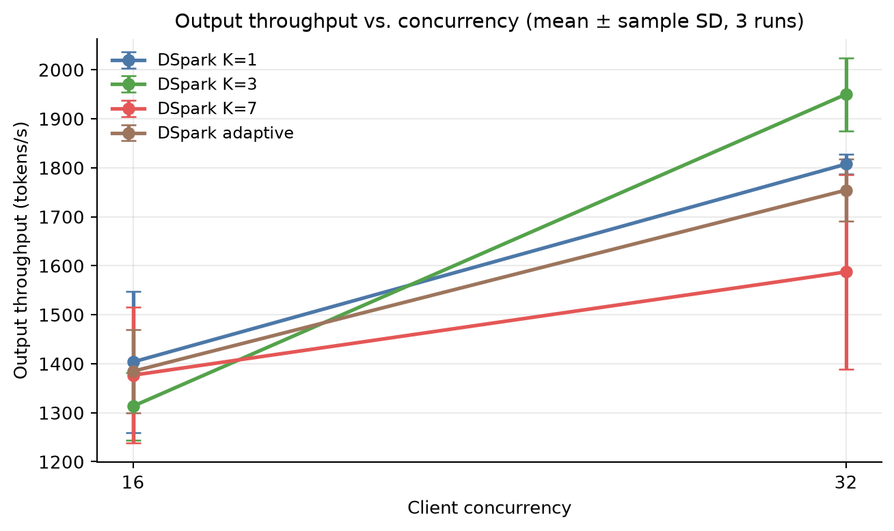

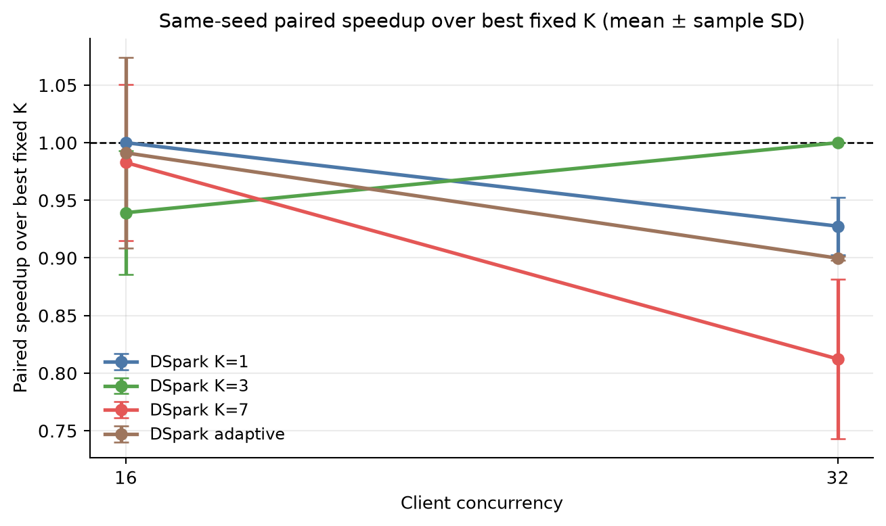

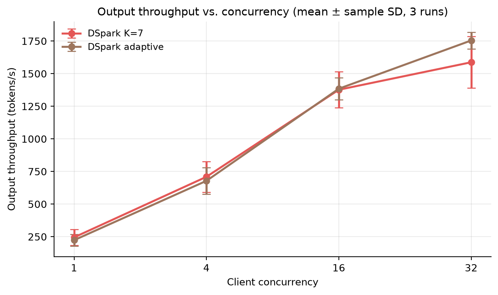


### 6.4 DSpark Adaptive Verification：Spec-Bench 扩展

为检验上述负载依赖是否只存在于随机 token，实验又在同一 GPU 上对 DSpark Adaptive Verification 运行了 12 次 Spec-Bench Benchmark，并与原固定 K7 的 12 次语义运行按 seed 配对。每次 128 请求、输出 256 tokens，因此每组百分位由 384 个请求计算。

| 并发 | 固定 K7 TPS | Adaptive TPS | 同 seed 配对加速比 | 固定 K7 接受长度 | Adaptive 接受长度 | 固定 K7 P95 TPOT (ms) | Adaptive P95 TPOT (ms) |
|---:|---:|---:|---:|---:|---:|---:|---:|
| 1 | 320.00 ± 0.08 | 291.77 ± 0.09 | 0.912 ± 0.000× | 3.688 | 3.578 | 4.160 | 4.622 |
| 4 | 1014.30 ± 7.61 | 956.80 ± 2.39 | 0.943 ± 0.007× | 3.636 | 3.462 | 4.956 | 5.466 |
| 16 | 2638.93 ± 12.89 | 2568.34 ± 5.80 | 0.973 ± 0.007× | 3.685 | 3.295 | 7.521 | 7.620 |
| 32 | 3367.17 ± 6.13 | 3566.52 ± 45.62 | 1.059 ± 0.016× | 3.678 | 3.147 | 11.240 | 10.621 |

语义负载复现了“低、中并发受损，高并发受益”的拐点。C=1 时固定 K7 明显更好；C=16 时自适应仍低约 2.7%；只有 C=32 转为约 5.9% 的配对吞吐收益，同时 P95 TPOT 下降约 5.5%，P95 E2EL 从 3028.421 ms 降至 2844.837 ms。自适应组 C=32 的接受长度下降约 14.4%，但平均 TPOT 也从 7.902 ms 降至 7.451 ms，说明收益仍来自更短的验证周期，而不是提高了草稿接受质量。

随机负载 C=32 的增益约 11.3%，语义负载则约 5.9%，因此不能把一种数据分布上的自适应收益直接移植到另一种分布。尤其在真实文本上，固定 DSpark K7 本来就有约 3.68 的接受长度，低、中并发下进一步裁剪草稿并不能覆盖自适应机制的成本。部署上不能一律开启 Adaptive Verification：低、中并发优先考虑固定 K7，高并发则应把短固定 K 与 Adaptive 放在同一负载下复测。

#### 高并发固定短块的语义对照

在同一 GPU 2 上补充的 Spec-Bench 三轮结果如下。最佳固定 K 从 K1/K3/K7 中按三轮平均吞吐选出。

| 并发 | 方法 | 输出吞吐 (tokens/s) | 接受长度 | P95 TPOT (ms) | 相对最佳固定 K 配对加速比 |
|---:|---|---:|---:|---:|---:|
| 16 | DSpark K=1 | 1947.57 ± 1.45 | 1.799 | 8.840 | 0.738 ± 0.004× |
| 16 | DSpark K=3 | 2105.25 ± 14.17 | 2.864 | 8.660 | 0.798 ± 0.002× |
| 16 | DSpark K=7 | **2638.93 ± 12.89** | 3.685 | **7.521** | 1.000× |
| 16 | DSpark Adaptive | 2568.34 ± 5.80 | 3.295 | 7.620 | 0.973 ± 0.007× |
| 32 | DSpark K=1 | 2548.86 ± 21.15 | 1.804 | 13.200 | 0.711 ± 0.013× |
| 32 | DSpark K=3 | **3586.70 ± 49.42** | 2.866 | **9.660** | 1.000× |
| 32 | DSpark K=7 | 3367.17 ± 6.13 | 3.678 | 11.240 | 0.939 ± 0.013× |
| 32 | DSpark Adaptive | 3566.52 ± 45.62 | 3.147 | 10.621 | 0.995 ± 0.021× |

C=16 时，固定 K7 在吞吐和 P95 TPOT 上都最好，K1/K3 明显不如 K7；随机初扫中“C=16 可缩短到 K1”的现象没有迁移到语义负载。C=32 时，固定 K3 的平均吞吐最高，Adaptive 与其几乎相同：Adaptive/K3 的配对均值为 0.995×，二者的平均吞吐分别为 3566.52 和 3586.70 tokens/s。K3 的 P95 TPOT 更低，因此在本轮语义实验中，简单固定 K3 已是很有竞争力的选择，Adaptive 没有表现出额外平均吞吐优势。

这与随机 C=32 中 Adaptive 仅为固定 K3 的约 0.900× 形成对照：两种负载都说明应先调固定 K，但 Adaptive 与最佳固定块之间的差距会随文本分布变化。不能把某一负载上的策略排序直接当成另一负载的部署结论。


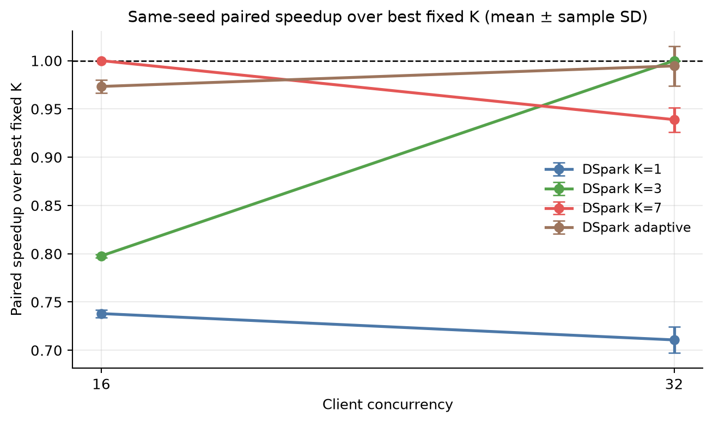

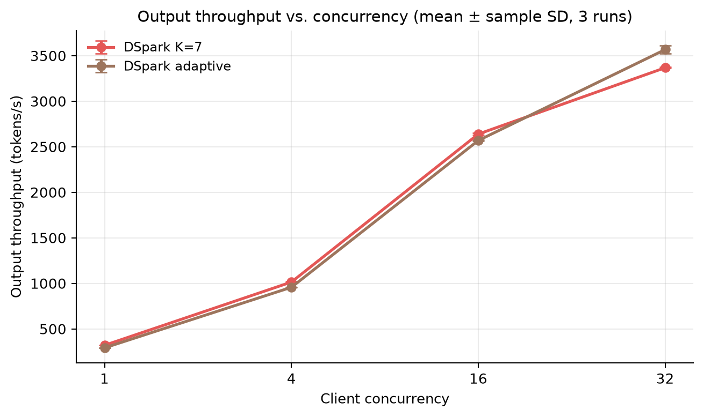


---

## 7. 综合结论、部署建议与实验边界

### 7.1 MTP：默认 K3 可用，但应按负载调长或调短

MTP 的核心结论不是“K 越大越好”，而是接受长度与验证成本之间的最优点随并发移动。同卡三轮复测中，K7 在 C=1、4 的三轮平均吞吐最高，K5 在 C=16 最高，K3 在 C=32 最高。C=4 的 K6/K7 和 C=16 的 K5/K6/K7 差距较小且存在波动，因此这些档位应理解为性能平台区，而不是不可变的精确边界。C=32 的 K7/K3 配对比值为 0.925±0.021，则清楚表明高负载下继续拉长草稿会产生实际损失。

默认 K3 的优点是简单，并且在最高并发点保持竞争力；但它并不是低、中并发的最佳默认。dynamic-smooth 相对 K3 在 C=1、4、16 的配对加速分别为 1.232×、1.146×、1.243×，同时在 C=32 与 K3 基本持平。相对 Normal，它在四个并发点分别达到 3.361×、2.766×、1.967×、1.558×。因此，如果只能保留一个覆盖变化负载的 MTP 配置，本实验优先推荐 Smooth 作为下一轮目标负载验证的起点，而不是始终固定 K3 或直接照搬单轮扫描 Oracle。

这并不等于动态表已经击败最佳固定 K。Smooth 在 C=16、32 与当轮最佳固定配置的配对比值分别约为 0.997 和 1.004，结论应限定为“接近”，而非稳定超越；Oracle 在 C=4、16、32 还低于最佳固定配置。单轮 K 扫描适合提出候选区间，不能代替独立三轮复测。真正的在线自适应还应利用实时接受率、队列状态或逐步成本反馈，本实验的 `num_speculative_tokens_per_batch_size` 只是预先展开的静态 batch-size 映射。

部署上可以按负载形态选择：长期固定低并发可优先复测 K6/K7，中等并发可复测 K5/K6，高并发则以 K3 和 Smooth 为起点；活动 batch 频繁变化时，Smooth 能减少为不同并发分别重启服务的需要。上述 K 值只适用于当前模型与随机负载，Spec-Bench 已证明文本分布会改变草稿接受行为，因此生产部署必须在目标应用样本上重新验证，而不能直接照搬这些数值。

### 7.2 DSpark：先调固定块，再决定是否启用自适应

DSpark 的结果不支持“验证越自适应越好”或“K 越小越适合高并发”这样的单一规则。Spec-Bench 的 C=1、4、16 上，固定 K7 是更稳妥的选择；C=16 时 K1/K3 的吞吐明显更低，Adaptive 也仅为 K7 的约 0.973×。这些负载下，K7 的高接受长度能够覆盖宽验证块成本，没有必要为了缩短块而牺牲推进距离。

高并发需要分负载判断。随机 C=32 时，固定 K3 同时取得最高平均吞吐和较低 P95 TPOT，Adaptive 虽比默认 K7 快，却只有 K3 的约 0.900×；Spec-Bench C=32 时，固定 K3 与 Adaptive 的平均吞吐几乎相同，配对比值约 0.995×，K3 的 P95 TPOT 更低。因此，本实验的部署优先级是：**先在目标负载上复测少量固定 K，再把 Adaptive 作为高负载候选，而不是把 Adaptive 当成固定 K 调优的替代品。**

这种差异也解释了为什么真实语义测试不可省略。随机负载可以用于成本控制，但 DSpark 的接受长度和最佳策略区间会随文本分布改变；实际部署应使用目标应用的请求样本重新校准。

### 7.3 实验边界

本实验结论适用于当前 Qwen3.8-27B-FP8、本地 DSpark checkpoint、vLLM 0.34.0 与 B200 环境，不能直接视为其他模型、框架版本或硬件上的固定加速比。每组三次独立运行可以暴露明显波动，但样本标准差不是置信区间；最佳固定 K 又由同一批三轮结果选出，因此相对最佳固定 K 的比较属于描述性复测，不是独立测试集上的泛化估计。

第一轮 Normal/MTP/DSpark 基线采用多 GPU 并行，提高了效率，但仍可能受到 GPU 个体和共享主机资源随时间变化的影响。关键 MTP 策略和 DSpark 固定/自适应对照已在单卡顺序复测，本实验没有完成所有配置的全量 GPU 轮换。报告因此把第一轮用于性能画像，把同卡复测用于策略判断，不混用不同阶段的绝对吞吐。

随机 token 与 Spec-Bench 仍只是两类负载。固定输出长度、greedy decoding、无限请求速率和最大客户端并发便于控制变量，但不完全等价于生产环境中的泊松到达、突发流量、多轮对话和长上下文。后续若面向具体应用部署，应使用该应用的真实请求分布重新选择 K。

有效周期成本由端到端 TPOT 与接受长度反推，适合解释性能趋势，但不是独立 Draft/Verify kernel profiler 时间。本文没有据此声称获得了精确的硬件 kernel 分解。

### 7.4 后续工作

后续可把固定 K 扫描划分为策略选择集和独立验证集，减少在同一批数据上选最佳固定配置带来的乐观偏差；在在线策略上，可将实测 batch-size 成本模型与逐步接受概率估计结合，而不是只按静态区间切 K。DSpark 方向则可比较 confidence-guided 验证与短固定块的组合，研究何时应裁剪请求内位置、何时应直接降低全局最大 K。

负载方面应增加代码、长文本、多轮对话和不同输出长度，并使用真实到达过程检验尾延迟。若继续深挖硬件原因，应在相同 batch shape 下分别 profiling Draft、Verify 和调度开销，以验证本文有效周期成本拟合所提示的趋势。

## 8. 实验产物与复现入口

### 8.1 数据、日志和图表

| 产物 | 位置 | 内容 |
|---|---|---|
| 原始 Benchmark JSON | `results/raw/` | 每次运行的请求级延迟、输出长度、吞吐和投机接受统计，保留完整记录 |
| 汇总 JSON 与 CSV | `results/processed/` | 三轮均值、样本标准差、合并请求百分位、同 seed 配对加速比及 K 成本分析 |
| 服务与 Benchmark 日志 | `logs/commands/`、`logs/server/` | 每次主要命令的完整合并输出 |
| 命令审计 | `report/command_audit.md`、`results/processed/command-audit.csv` | 实际 argv、起止时间、退出码与日志位置 |
| 实验清单 | `results/processed/*manifest.json` | 每个矩阵的状态、每次运行标签、结果路径及校验摘要 |
| 图表与自动导出表 | `report/figures/`、`report/tables/` | PNG/SVG 图和 Markdown 数据表 |
| 文件校验 | `results/processed/raw-sha256.csv` | 原始 JSON 的字节数与 SHA-256 |

最终校验读取了 274 份原始 JSON（含早期辅助记录），核心实验为 260 次 Benchmark；九份最终汇总均为 complete，原始记录、manifest 和接受长度恒等式检查的错误数为 0。明细见 [artifact-validation.json](../results/processed/artifact-validation.json) 与 [raw-sha256.csv](../results/processed/raw-sha256.csv)。

### 8.2 主要复现命令

以下命令均从仓库根目录执行。原始记录中的 Python 与 vLLM 使用 `/home/genai/.pixi/envs/default/bin/` 中的环境；在其他机器复现时需调整相应路径。实际执行时由 `bin/run_logged.py` 或 `bin/launch_detached.py` 包装，以保留完整审计日志。

MTP K 扫描：

```bash
python src/run_k_scan.py \
  --method mtp --ks 1 2 3 4 5 6 7 \
  --gpu 3 --port 8103 --phase kscan-r1 --label-prefix kscan \
  --num-prompts 32 --seeds 42 --concurrencies 32 16 4 1
```

DSpark K 扫描：

```bash
python src/run_k_scan.py \
  --method dspark --ks 1 3 5 7 \
  --gpu 0 --port 8100 --phase kscan-r1 --label-prefix 057 \
  --num-prompts 32 --seeds 42 --concurrencies 32 16 4 1
```

MTP 七配置同卡复测：

```bash
python src/run_server_suite.py \
  --config config/mtp_policy_comparison.json \
  --gpu 3 --port 8103 --phase policy-mtp-r1 --label-prefix 063 \
  --num-prompts 32 --seeds 42 43 44 --concurrencies 32 16 4 1
```

DSpark Adaptive Verification 的 Spec-Bench 扩展：

```bash
python src/run_server_suite.py \
  --config config/dspark_policy_comparison.json --methods dspark-adaptive \
  --gpu 2 --port 8102 --phase semantic-r1 --label-prefix 064 \
  --num-prompts 128 --seeds 42 43 44 --concurrencies 32 16 4 1 \
  --dataset-name spec_bench --dataset-path data/spec_bench/question.jsonl \
  --output-len 256
```

DSpark 高并发固定短块的随机与语义复测：

```bash
python src/run_k_scan.py \
  --method dspark --ks 1 3 --gpu 2 --port 8102 \
  --phase policy-dspark-r1 --label-prefix 065 \
  --num-prompts 32 --seeds 42 43 44 --concurrencies 32 16

python src/run_server_suite.py \
  --config config/dspark_high_concurrency_confirmation.json \
  --gpu 2 --port 8102 --phase semantic-r1 --label-prefix 066 \
  --num-prompts 128 --seeds 42 43 44 --concurrencies 32 16 \
  --dataset-name spec_bench --dataset-path data/spec_bench/question.jsonl \
  --output-len 256
```

汇总、制图和核验：

```bash
python src/summarize_benchmarks.py \
  --phase formal-r1 --methods normal mtp-k3 dspark-k7 \
  --concurrencies 1 4 16 32 --seeds 42 43 44 --num-prompts 128

python src/summarize_benchmarks.py \
  --phase policy-mtp-r1 --output-stem policy-mtp-fixed-r1 \
  --methods normal mtp-k3 mtp-k5 mtp-k6 mtp-k7 \
  --best-fixed-methods mtp-k3 mtp-k5 mtp-k6 mtp-k7 \
  --concurrencies 1 4 16 32 --seeds 42 43 44 --num-prompts 32

python src/summarize_benchmarks.py \
  --phase policy-mtp-r1 \
  --methods normal mtp-k3 mtp-k5 mtp-k6 mtp-k7 mtp-dynamic-oracle mtp-dynamic-smooth \
  --additional-baseline-methods mtp-k3 mtp-k5 mtp-k6 mtp-k7 mtp-dynamic-smooth \
  --best-fixed-methods mtp-k3 mtp-k5 mtp-k6 mtp-k7 \
  --concurrencies 1 4 16 32 --seeds 42 43 44 --num-prompts 32

python src/summarize_benchmarks.py \
  --phase policy-dspark-r1 --methods dspark-k7 dspark-adaptive \
  --baseline-method dspark-k7 --concurrencies 1 4 16 32 \
  --seeds 42 43 44 --num-prompts 32

python src/analyze_k_scan.py --method mtp --ks 1 2 3 4 5 6 7
python src/analyze_k_scan.py --method dspark --ks 1 3 5 7 --reference-k 7
python src/make_figures.py --include-policies
python src/export_markdown_tables.py \
  --phases formal-r1 semantic-r1 policy-mtp-fixed-r1 policy-mtp-r1 policy-dspark-r1 \
  policy-dspark-high-r1 semantic-r1-dspark-adaptive semantic-r1-dspark-high
python src/export_command_audit.py
python src/validate_results.py \
  --required-summaries formal-r1 kscan-r1 semantic-r1 policy-mtp-fixed-r1 policy-mtp-r1 \
  policy-dspark-r1 policy-dspark-high-r1 semantic-r1-dspark-adaptive semantic-r1-dspark-high
```

这里的 K 扫描命令展示完整实验形状；历史上 MTP 扫描分两次完成，实际逐次命令及 label 均以命令审计为准，不能用上述复现入口覆盖或篡改已保留的原始日志。
