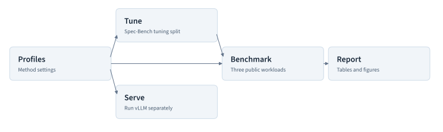

# 统一推测解码框架

<p></p>

同一 CLI 可启动 Normal、Native MTP、DSpark 和 DFlash 2，也可调参、配对压测和出图。每种发布方法有一套配置。复现早期课程实验时请使用相应报告中的协议。[当前实测](unified_framework/results.md) · [课程实验](speculative_decoding_report.md)



## 命令

从仓库根目录运行命令。启动和压测需要一台装有 vLLM 0.34.0 和相应权重的 B200 主机。用 `--model`、`--draft-model` 和 `--vllm` 指定本机路径。压测需安装 vLLM 的 benchmark 依赖。如果 pandas 安装在单独的目录，用 `--bench-deps` 告诉 `tune` 和 `benchmark` 去哪里加载。

```bash
python src/unified_framework.py profiles
draft_dir="$HOME/selected-drafts/Qwen3.8-27B-DFlash2"
hf download incoai/Qwen3.8-27B-DFlash2 config.json model.safetensors \
  --revision 015e795645c74b1a0eeef3b570031fb62e769bc5 --local-dir "$draft_dir"
python src/unified_framework.py serve --method dflash --gpu 7 --port 24827 \
  --draft-model "$draft_dir"
```

`serve` 默认使用发布配置。用 `--selection replay/dflash/selection.json` 加载自己的调参结果，用 `--print-command` 查看完整启动参数。下面的命令使用默认草稿目录。如需指定下载位置，可沿用上面的 `--draft-model`。

```bash
python src/unified_framework.py --config tuning-plan.json tune --method dflash --gpu 7 --port 24827 --output replay/dflash
python src/unified_framework.py --config tuning-plan.json benchmark --method dflash --gpu 7 --port 24827 --output replay/dflash
```

复制发布配置，为目标方法添加 `round1` 和 `round2`，再用同一调参计划运行两条命令。每个候选项都要有唯一的 `id`。第一轮填写完整的 vLLM `spec`，第二轮通过 `override` 修改首轮最快的配置。用 `null` 删除某个草稿选项。测试 MTP 或 DSpark 时，将 `dflash` 换为 `mtp` 或 `dspark`，并给每个方法单独的结果目录。直接运行默认配置的 `benchmark` 会比较发布设置和同卡 Normal。

实验目录保存数据划分、启动命令、服务日志、原始压测 JSON 和配置选择结果。中断后重跑同一条命令，框架会复用已完整结束的配置，并为未完成的配置启动新进程。DFlash 2 首次启动会编译 FlashInfer 内核。服务就绪并预热后才开始计时。

将两个固定版本的数据文件分别保存为 `speed.parquet` 和 `BurstGPT_without_fails_3.csv`。可以先在本机生成输入，再把生成目录复制到 B200 主机。[SPEED-Bench Qualitative Parquet](https://huggingface.co/datasets/nvidia/SPEED-Bench/resolve/fa4e669bee2a4393c56aa8ed05a7c667897f9590/qualitative/test-00000-of-00001.parquet) · [BurstGPT v2.0 无失败轨迹 3](https://github.com/HPMLL/BurstGPT/releases/download/v2.0/BurstGPT_without_fails_3.csv)

```bash
python -m pip install pyarrow
python src/prepare_serving_workloads.py --speed-parquet speed.parquet \
  --burst-csv BurstGPT_without_fails_3.csv --output replay/serving-inputs
python src/unified_framework.py benchmark --method dflash --gpu 7 --port 24827 \
  --workloads replay/serving-inputs --output replay/external/dflash
```

对 `mtp` 和 `dspark` 各跑一次同样的 `benchmark`，输出分别写到 `replay/external/mtp` 和 `replay/external/dspark`。框架先校验输入清单和文件哈希，再为每种方法跑同卡 Normal 对照。

```bash
python -m pip install matplotlib
python src/unified_framework.py report --results replay --external-results replay/external --output replay/report
python src/unified_framework.py report --results results/processed/unified-framework/summary.json --output replay/published-figures
```

`report` 可从完整复跑目录或已发布的 JSON 生成 Markdown、PNG 和 SVG。图表和流程图使用仓库附带的 Source Sans 3 Regular 与 Semibold，SVG 将文字转成轮廓。本次渲染使用 Matplotlib 3.11.2。[字体发行版](https://github.com/adobe-fonts/source-sans/releases/tag/3.052R) · [字体许可](../assets/fonts/OFL.txt)

## 优化结果

- DSpark 在保持草稿上限 K=8 和 FP8-per-tensor 量化的情况下，将草稿端从自动选择改为 Triton，恢复了完整 CUDA Graph 捕获。留出集在并发 1、4、16 下分别达到原配置的 **3.60×、2.87×、2.26×**，综合 **2.86×**。框架将该配置作为 DSpark 默认值。
- MTP 固定 K=5 的综合留出集吞吐为动态 K=6/5 的 **0.986×**，因此保留动态配置。
- DFlash 2 保留 **K=7**。在 B200 上，vLLM 自动为草稿端选择 FlashAttention，并启用完整 CUDA Graph 捕获。相同草稿长度切到 FlashInfer 后关闭了 CUDA Graph，调参池并发 16 的吞吐从 **1,794** 降至 **740 token/s**。

发布版本使用 DFlash 2。它和早期的 Suffix 在同一张 B200 上使用相同输入，并发上限为 16。每种方法分别与同期的同卡 Normal 配对，表中为三轮吞吐倍率的中位数。[历史 Suffix 结果](https://github.com/Zheng-Hanyu/Generative-Models-Final-Project/blob/bb52f47ab7b56d4f01b6fcee6fe52b45fabbc156/report/unified_framework/results.md)

| 负载 | Suffix | DFlash 2 |
|---|---:|---:|
| Spec-Bench | 1.007× | 1.805× |
| NVIDIA SPEED-Bench | 1.006× | 1.804× |
| BurstGPT v2.0 | 1.025× | 1.059× |

BurstGPT 回放中，DFlash 2 相对同期 Normal 的 P95 每 token 延迟从 10.85 ms 降至 8.91 ms，P95 首 token 延迟从 69.23 ms 升至 109.58 ms。

## 实验协议

- 每种方法的原配置、入选配置和 Normal 在同一张 B200 上测量。目标模型为 Qwen3.8-27B-FP8，使用 Triton Attention 和 TP=1。所有请求采用 greedy 生成，关闭 vLLM 前缀缓存。
- DSpark 使用服务器上的 Red Hat 兼容草稿权重。其原配置让 vLLM 自选草稿端注意力后端，后端对照显式指定草稿端 Triton。主模型在两种设置下都使用 Triton。
- DFlash 2 使用 Inco AI 针对 Qwen3.8-27B 发布的五层 BF16 草稿权重，由 vLLM 的 `dflash` 方法加载。权重文件 SHA-256 为 `67fc76d68dc5a9415511a4f394ef744d67510cd20e93b37cc2cc7d28e4bab65c`。[固定版本的权重和配置](https://huggingface.co/incoai/Qwen3.8-27B-DFlash2/tree/015e795645c74b1a0eeef3b570031fb62e769bc5) · [DFlash 2 技术说明](https://inco.ai/blog/dflash2/) · [DFlash 论文](https://arxiv.org/abs/2602.06036) · [vLLM 实现](https://github.com/vllm-project/vllm/pull/52816)
- 从仓库的 480 条 Spec-Bench 题目按类别抽出 144 条作为调参池，余下 336 条进入留出池。调参在并发 1、4、16 各跑 18 条。留出池按三组种子和三个并发档拆成九组互不重叠的子集，每组实测 30 条。对照配置使用相同的题目、采样顺序和输出上限 128，每次以四个独立提示预热。[Spec-Bench 数据版本](https://github.com/hemingkx/Spec-Bench/blob/66230f10cb0a02aced5ef3ce1e85163c16160454/data/spec_bench/question.jsonl) · [Xia 等，ACL Findings 2024](https://arxiv.org/abs/2401.07851)
- 第一轮筛选草稿长度。第二轮比较 MTP 动态草稿长度、DSpark 的草稿端注意力后端、块长、量化和自适应验证，以及 DFlash 2 的草稿端注意力后端和草稿长度。按三个并发档的输出 TPS 几何平均在调参池选定一个配置，再和同卡 Normal、该方法原配置配对复测。[vLLM 动态草稿长度](https://docs.vllm.ai/en/v0.34.0/features/speculative_decoding/dynamic_speculative_decoding/) · [vLLM 自适应验证](https://docs.vllm.ai/en/v0.34.0/features/speculative_decoding/adaptive_verification/)
- 随机压力测试在并发 16 和 32 各跑 64 条，分别使用种子 817 和 818，输入 1,024 tokens，输出 128 tokens，忽略 EOS。每个单元一轮。
- SPEED-Bench 使用 Qualitative 版本 `fa4e669`。先排除占位符、超过 3,500 字节的提示、重复项及与 Spec-Bench 重复的首轮提示，再得到覆盖代码、写作和多语言的 144 条独立输入。并发 1 每轮 16 条，并发 16 每轮 32 条，三轮互不重叠。强制每条生成 128 tokens，压测采用饱和到达。[SPEED-Bench 数据卡](https://huggingface.co/datasets/nvidia/SPEED-Bench) · [Abramovich 等，ICML 2026](https://proceedings.mlr.press/v306/abramovich26a.html)
- BurstGPT 使用 v2.0 发布包中第三份无失败轨迹。输入长度为 8 至 3,072 tokens，输出为 16 至 512 tokens。三轮各取 64 个连续的合格请求，保留相对到达间隔，每段缩放到 8 秒，客户端并发上限为 16。轨迹记录长度和时间，vLLM 以固定的 Python 哈希种子补全输入 token ID，并按轨迹设定输出长度。[BurstGPT v2.0](https://github.com/HPMLL/BurstGPT/releases/tag/v2.0) · [KDD 2025 论文目录](https://kdd.org/kdd2025/datasets-and-benchmarks-track-papers-2/) · [论文 DOI](https://doi.org/10.1145/3711896.3737413) · [vLLM Benchmark CLI](https://docs.vllm.ai/en/v0.34.0/benchmarking/cli/)
- 每个速度比配对同卡、同种子和同并发的运行。每套公开负载有三轮。TTFT 是首 token 耗时，TPOT 是首 token 之后的平均每 token 耗时。草稿接受率是 vLLM 记录的已接受 token 占全部草稿 token 的比例。

[统一配置](../config/unified_framework.json) · [CLI](../src/unified_framework.py) · [结构化结果](../results/processed/unified-framework/summary.json)
