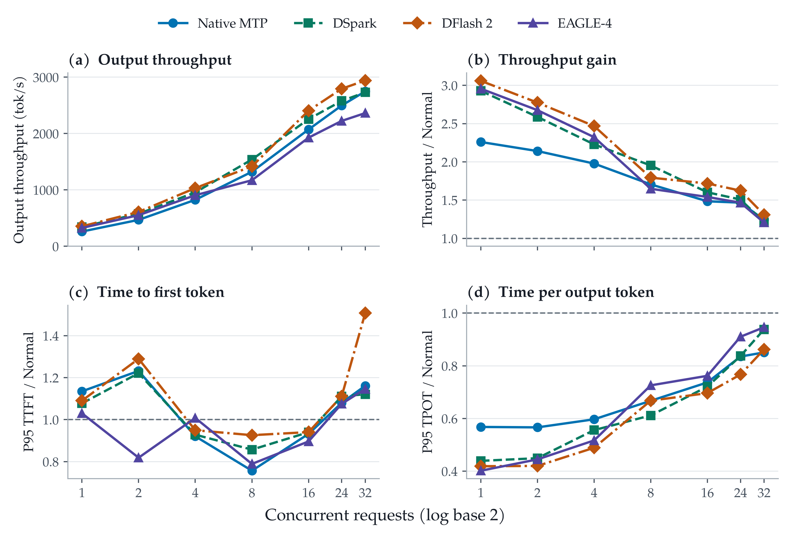

# Spec-Bench 并发重测

Qwen3.8-27B-FP8 · NVIDIA B200 · 驱动 590.48.01

并发 1、2、4、8、16、24、32，种子 423、557、691。每档、每个种子使用 64 条请求，每条最多生成 128 tokens。每个种子在所有并发档和方法中使用同一组输入，三个种子的输入互不重叠。种子内打乱档位运行顺序，两组使用同一顺序。

合计 168 组压测、10,752 条计时请求。每个方法独立配对同卡、同 vLLM 构建的 Normal。本轮用同一台服务器上的不同 B200 并行压测各方法，客户端版本一致。

## 吞吐倍率

每个倍率先对同种子、同并发的运行配对，再取各轮中位数。绝对吞吐用于查看各方法随并发的变化，相对 Normal 的倍率用于比较方法。延迟倍率低于 1 表示延迟下降。

从并发 1 到 32，相对 Normal 的吞吐倍率下降的方法有 4/4 种。

| 方法 | C=1 | C=2 | C=4 | C=8 | C=16 | C=24 | C=32 |
|---|---:|---:|---:|---:|---:|---:|---:|
| Native MTP | 2.260× | 2.141× | 1.978× | 1.706× | 1.485× | 1.468× | 1.243× |
| DSpark | 2.929× | 2.588× | 2.229× | 1.953× | 1.603× | 1.508× | 1.212× |
| DFlash 2 | 3.059× | 2.775× | 2.469× | 1.794× | 1.718× | 1.624× | 1.310× |
| EAGLE-4 | 2.957× | 2.676× | 2.323× | 1.649× | 1.542× | 1.466× | 1.207× |

## 逐方法结果

以下绝对吞吐和延迟分别取各组的逐轮中位数。括号内是最小及最大配对吞吐倍率。

### Native MTP

配置 `mtp-dynamic-smooth`，GPU 0，两组服务均使用 vLLM `0.34.0`。

| 并发 | Normal (tok/s) | 方法 (tok/s) | 配对倍率（范围） | P95 TTFT (ms) | P95 TPOT (ms) | 草稿接受率 |
|---:|---:|---:|---:|---:|---:|---:|
| 1 | 115.77 | 261.65 | 2.260× (2.235–2.269) | 51.61 → 58.58 | 8.54 → 4.84 | 43.7% |
| 2 | 219.52 | 468.83 | 2.141× (2.092–2.158) | 61.29 → 92.72 | 9.07 → 5.14 | 43.6% |
| 4 | 421.35 | 824.24 | 1.978× (1.942–2.029) | 102.83 → 86.55 | 9.37 → 5.64 | 44.8% |
| 8 | 787.40 | 1322.10 | 1.706× (1.679–1.731) | 151.72 → 105.39 | 9.99 → 6.83 | 49.8% |
| 16 | 1396.92 | 2072.31 | 1.485× (1.483–1.508) | 193.83 → 193.46 | 11.19 → 8.24 | 49.6% |
| 24 | 1701.73 | 2497.46 | 1.468× (1.398–1.501) | 278.11 → 306.16 | 12.48 → 10.36 | 49.3% |
| 32 | 2247.80 | 2747.90 | 1.243× (1.215–1.259) | 365.60 → 518.88 | 13.57 → 11.47 | 50.6% |

### DSpark

配置 `dspark-triton-k8`，GPU 1，两组服务均使用 vLLM `0.34.0`。

| 并发 | Normal (tok/s) | 方法 (tok/s) | 配对倍率（范围） | P95 TTFT (ms) | P95 TPOT (ms) | 草稿接受率 |
|---:|---:|---:|---:|---:|---:|---:|
| 1 | 117.66 | 344.73 | 2.929× (2.869–2.934) | 51.86 → 56.75 | 8.40 → 3.69 | 40.7% |
| 2 | 223.43 | 576.98 | 2.588× (2.565–2.651) | 60.29 → 77.36 | 8.91 → 3.99 | 40.8% |
| 4 | 426.93 | 956.21 | 2.229× (2.198–2.294) | 102.49 → 92.04 | 9.26 → 5.15 | 40.2% |
| 8 | 795.53 | 1539.48 | 1.953× (1.935–1.967) | 150.54 → 105.34 | 9.89 → 6.19 | 41.0% |
| 16 | 1407.11 | 2255.01 | 1.603× (1.574–1.614) | 210.10 → 197.50 | 10.97 → 8.02 | 41.4% |
| 24 | 1710.44 | 2579.46 | 1.508× (1.436–1.526) | 278.21 → 314.08 | 12.57 → 10.39 | 40.2% |
| 32 | 2252.57 | 2730.60 | 1.212× (1.202–1.226) | 368.88 → 413.53 | 13.53 → 12.62 | 40.6% |

### DFlash 2

配置 `dflash2-mxfp8`，GPU 2，两组服务均使用 vLLM `0.34.0`。

| 并发 | Normal (tok/s) | 方法 (tok/s) | 配对倍率（范围） | P95 TTFT (ms) | P95 TPOT (ms) | 草稿接受率 |
|---:|---:|---:|---:|---:|---:|---:|
| 1 | 115.95 | 354.03 | 3.059× (2.971–3.118) | 51.17 → 56.46 | 8.54 → 3.58 | 47.5% |
| 2 | 220.52 | 609.94 | 2.775× (2.766–2.818) | 60.45 → 81.01 | 9.03 → 3.83 | 47.0% |
| 4 | 422.66 | 1031.84 | 2.469× (2.429–2.548) | 102.88 → 92.11 | 9.35 → 4.57 | 46.2% |
| 8 | 788.43 | 1418.80 | 1.794× (1.709–1.819) | 152.04 → 105.21 | 9.98 → 6.66 | 46.8% |
| 16 | 1400.03 | 2405.01 | 1.718× (1.675–1.755) | 209.32 → 196.88 | 11.01 → 7.79 | 46.6% |
| 24 | 1707.16 | 2794.66 | 1.624× (1.234–1.637) | 284.55 → 307.00 | 12.22 → 9.75 | 46.9% |
| 32 | 2244.87 | 2941.22 | 1.310× (1.021–1.348) | 360.00 → 530.48 | 13.49 → 11.63 | 47.3% |

### EAGLE-4

配置 `eagle4-w8`，GPU 3，两组服务均使用 vLLM `0.32.0rc1.dev283+eagle.5`。

| 并发 | Normal (tok/s) | 方法 (tok/s) | 配对倍率（范围） | P95 TTFT (ms) | P95 TPOT (ms) | 草稿接受率 |
|---:|---:|---:|---:|---:|---:|---:|
| 1 | 110.73 | 325.92 | 2.957× (2.858–3.020) | 60.48 → 61.77 | 8.82 → 3.56 | 44.5% |
| 2 | 208.04 | 552.21 | 2.676× (2.652–2.833) | 95.33 → 77.09 | 9.34 → 4.16 | 44.8% |
| 4 | 389.72 | 905.47 | 2.323× (2.308–2.342) | 102.06 → 103.73 | 10.04 → 5.15 | 43.9% |
| 8 | 710.60 | 1171.46 | 1.649× (1.640–1.670) | 152.67 → 120.45 | 11.12 → 7.95 | 42.9% |
| 16 | 1249.85 | 1926.97 | 1.542× (1.521–1.554) | 229.44 → 215.14 | 12.41 → 9.45 | 42.2% |
| 24 | 1517.02 | 2224.44 | 1.466× (1.374–1.478) | 325.09 → 349.64 | 13.62 → 11.48 | 41.7% |
| 32 | 1957.04 | 2362.83 | 1.207× (0.912–1.284) | 400.79 → 440.30 | 14.94 → 13.84 | 41.6% |
