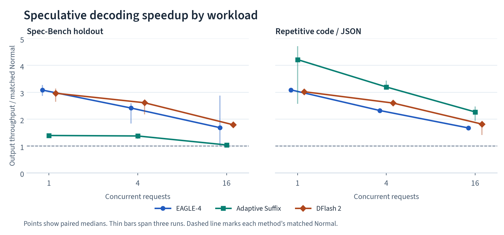
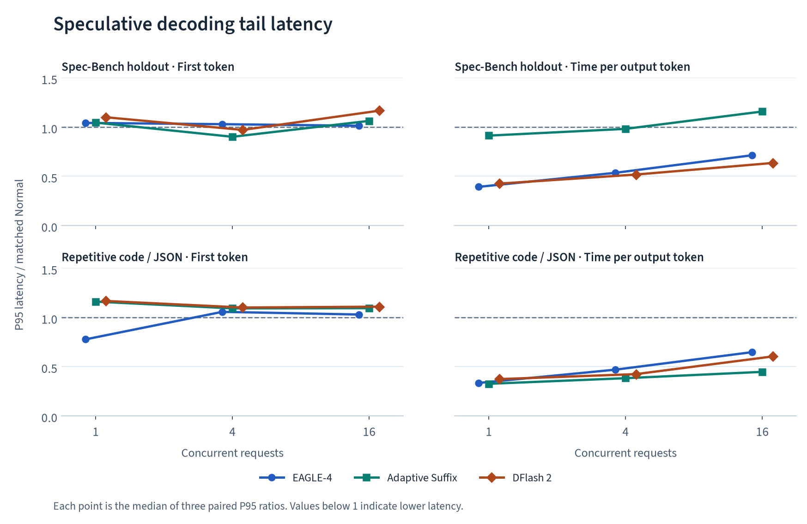

# EAGLE-4 与自适应 Suffix 单卡实测

2026-11-27，在单张 NVIDIA B200 上用 Qwen3.8-27B-FP8 比较 EAGLE-4、Adaptive Suffix 和 DFlash 2。EAGLE-4 入选设置为树宽 8、树深上限 8、每个草稿步骤保留 4 个候选，并按校准成本表决定何时停止加深草稿树。Adaptive Suffix 入选设置为 K=8、后缀树深上限 12。

各负载在并发 1、4、16 下各跑三轮，每轮 30 条请求。同一引擎构建内按输入、种子和 GPU 配对 Normal，先在每个负载及并发点取配对吞吐倍率中位数，再对六个点作等权几何平均。吞吐并列时比较平均 P95 TPOT。

| 方法 | 配对 Normal | 综合吞吐倍率 | 成功请求 |
|---|---|---:|---:|
| Adaptive Suffix | Normal（vLLM 0.34.0） | 1.982× | 540/540 |
| EAGLE-4 | Normal（EAGLE 构建） | 2.305× | 540/540 |
| DFlash 2 | Normal（vLLM 0.34.0） | 2.413× | 540/540 |

| 方法 | Spec-Bench 吞吐倍率 | 重复代码／JSON 吞吐倍率 |
|---|---:|---:|
| Adaptive Suffix | 1.256× | 3.127× |
| EAGLE-4 | 2.322× | 2.288× |
| DFlash 2 | 2.402× | 2.425× |

Spec-Bench 使用项目既有留出划分，生成上限为 128 tokens。重复代码／JSON 负载为独立构造的合成提示，代码编辑和 JSON 输出各占一半，每条生成固定 128 tokens。设置排名基于本页所列负载与并发。

## 吞吐和延迟

在重复代码／JSON 负载上，Adaptive Suffix 的草稿接受率为 62.4%–71.2%，综合吞吐为同构建 Normal 的 3.127×。在 Spec-Bench 上，它的接受率为 8.7%–9.5%，且在并发 16 时，P95 每 token 延迟由 10.74 ms 升至 12.43 ms。两套负载的重复结构不同，配对结果分别报告。

图中虚线对应同构建 Normal。吞吐图的细竖线是三轮观测范围，延迟图先对每个种子计算 P95 倍率，再取中位数。 [吞吐 SVG](figures/eagle4-suffix-throughput.svg) · [延迟 SVG](figures/eagle4-suffix-latency.svg)

## 按负载和并发的结果

吞吐、P95 TTFT、P95 TPOT 和接受率为三轮中位数。EAGLE-4 使用作者的 vLLM 构建，Adaptive Suffix 与 DFlash 2 使用 vLLM 0.34.0。

EAGLE-4 成本表由批大小 1 的校准测量拟合。拟合工具标记了 28.24% 的缓存成本测量组为不稳定。下表的吞吐及延迟来自实际压测。

EAGLE 构建的 Normal 在 Spec-Bench 并发 16、种子 557 这一轮出现额外的 CuTeDSL JIT 编译。该轮 30 条请求均成功，吞吐为 642.70 tok/s，另外两轮为 1,172.54 和 1,158.88 tok/s。逐轮结果和配对中位数均保留了这一轮。

### Spec-Bench 留出集

| 负载 | 并发 | 方法 | 吞吐 (tok/s) | 配对倍率 | P95 TTFT (ms) | P95 TPOT (ms) | 接受率 | 成功请求 |
|---|---:|---|---:|---:|---:|---:|---:|---:|
| Spec-Bench | 1 | Normal（vLLM 0.34.0） | 117.18 | — | 56.68 | 8.42 | — | 90/90 |
| Spec-Bench | 1 | Adaptive Suffix | 162.96 | 1.391× | 58.57 | 7.67 | 8.7% | 90/90 |
| Spec-Bench | 1 | DFlash 2 | 348.23 | 2.964× | 66.52 | 3.56 | 46.2% | 90/90 |
| Spec-Bench | 1 | Normal（EAGLE 构建） | 111.25 | — | 69.04 | 8.76 | — | 90/90 |
| Spec-Bench | 1 | EAGLE-4 | 342.89 | 3.082× | 70.83 | 3.42 | 45.9% | 90/90 |
| Spec-Bench | 4 | Normal（vLLM 0.34.0） | 409.17 | — | 84.03 | 9.33 | — | 90/90 |
| Spec-Bench | 4 | Adaptive Suffix | 556.02 | 1.373× | 72.05 | 9.15 | 9.5% | 90/90 |
| Spec-Bench | 4 | DFlash 2 | 1046.25 | 2.610× | 83.63 | 4.76 | 47.0% | 90/90 |
| Spec-Bench | 4 | Normal（EAGLE 构建） | 369.75 | — | 114.16 | 10.00 | — | 90/90 |
| Spec-Bench | 4 | EAGLE-4 | 892.13 | 2.413× | 117.36 | 5.34 | 44.9% | 90/90 |
| Spec-Bench | 16 | Normal（vLLM 0.34.0） | 1306.24 | — | 204.10 | 10.74 | — | 90/90 |
| Spec-Bench | 16 | Adaptive Suffix | 1347.81 | 1.038× | 218.26 | 12.43 | 9.4% | 90/90 |
| Spec-Bench | 16 | DFlash 2 | 2323.63 | 1.790× | 237.92 | 6.81 | 49.2% | 90/90 |
| Spec-Bench | 16 | Normal（EAGLE 构建） | 1158.88 | — | 258.99 | 12.10 | — | 90/90 |
| Spec-Bench | 16 | EAGLE-4 | 1850.02 | 1.683× | 262.15 | 9.00 | 45.0% | 90/90 |

### 重复代码编辑与 JSON 输出

| 负载 | 并发 | 方法 | 吞吐 (tok/s) | 配对倍率 | P95 TTFT (ms) | P95 TPOT (ms) | 接受率 | 成功请求 |
|---|---:|---|---:|---:|---:|---:|---:|---:|
| 重复代码／JSON | 1 | Normal（vLLM 0.34.0） | 116.91 | — | 33.78 | 8.39 | — | 90/90 |
| 重复代码／JSON | 1 | Adaptive Suffix | 492.74 | 4.217× | 38.95 | 2.73 | 64.4% | 90/90 |
| 重复代码／JSON | 1 | DFlash 2 | 353.48 | 3.021× | 39.45 | 3.12 | 46.8% | 90/90 |
| 重复代码／JSON | 1 | Normal（EAGLE 构建） | 111.21 | — | 56.58 | 8.67 | — | 90/90 |
| 重复代码／JSON | 1 | EAGLE-4 | 343.68 | 3.089× | 43.21 | 2.89 | 44.9% | 90/90 |
| 重复代码／JSON | 4 | Normal（vLLM 0.34.0） | 400.50 | — | 88.49 | 9.13 | — | 90/90 |
| 重复代码／JSON | 4 | Adaptive Suffix | 1280.24 | 3.197× | 96.56 | 3.48 | 62.4% | 90/90 |
| 重复代码／JSON | 4 | DFlash 2 | 1040.16 | 2.599× | 98.38 | 3.86 | 47.6% | 90/90 |
| 重复代码／JSON | 4 | Normal（EAGLE 构建） | 377.62 | — | 116.45 | 9.29 | — | 90/90 |
| 重复代码／JSON | 4 | EAGLE-4 | 876.48 | 2.321× | 121.27 | 4.35 | 43.5% | 90/90 |
| 重复代码／JSON | 16 | Normal（vLLM 0.34.0） | 1281.38 | — | 284.70 | 10.85 | — | 90/90 |
| 重复代码／JSON | 16 | Adaptive Suffix | 2905.46 | 2.267× | 307.10 | 4.86 | 71.2% | 90/90 |
| 重复代码／JSON | 16 | DFlash 2 | 2321.60 | 1.816× | 315.50 | 6.57 | 47.0% | 90/90 |
| 重复代码／JSON | 16 | Normal（EAGLE 构建） | 1158.04 | — | 326.31 | 11.45 | — | 90/90 |
| 重复代码／JSON | 16 | EAGLE-4 | 1938.36 | 1.672× | 330.15 | 7.62 | 44.7% | 90/90 |

[入选配置](../../config/eagle4_suffix_b200.json) · [逐轮结构化结果](../../results/processed/unified-framework/eagle4-suffix-b200.json) · [复跑说明](eagle4_suffix_replay.md)
