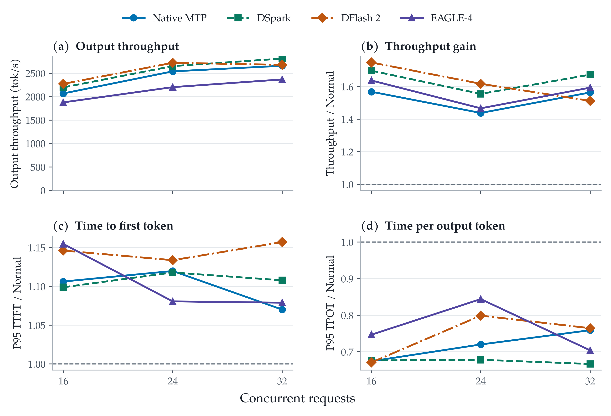

# 高并发调参留出复测

Qwen3.8-27B-FP8 · NVIDIA B200 · 驱动 590.48.01

并发 16、24、32，种子 1201、1289、1361。每档、每个种子使用 48 条请求，每条最多生成 128 tokens。每个种子在所有并发档和方法中使用同一组输入，三个种子的输入互不重叠。种子内打乱档位运行顺序，两组使用同一顺序。

图表所列配置及其 Normal 共 72 组压测、3,456 条计时请求。每个方法独立配对同卡、同 vLLM 构建的 Normal。

## 吞吐倍率

每个倍率先对同种子、同并发的运行配对，再取各轮中位数。绝对吞吐用于查看各方法随并发的变化，相对 Normal 的倍率用于比较方法。延迟倍率低于 1 表示延迟下降。

从并发 16 到 32，相对 Normal 的吞吐倍率下降的方法有 4/4 种。

| 方法 | C=16 | C=24 | C=32 |
|---|---:|---:|---:|
| Native MTP | 1.569× | 1.438× | 1.564× |
| DSpark | 1.698× | 1.555× | 1.674× |
| DFlash 2 | 1.748× | 1.617× | 1.513× |
| EAGLE-4 | 1.638× | 1.467× | 1.594× |

## 逐方法结果

以下绝对吞吐和延迟分别取各组的逐轮中位数。括号内是最小及最大配对吞吐倍率。

### Native MTP

配置 `mtp-k4`，GPU 0，两组服务均使用 vLLM `0.34.0`。

| 并发 | Normal (tok/s) | 方法 (tok/s) | 配对倍率（范围） | P95 TTFT (ms) | P95 TPOT (ms) | 草稿接受率 |
|---:|---:|---:|---:|---:|---:|---:|
| 16 | 1297.38 | 2069.17 | 1.569× (1.559–1.641) | 244.31 → 269.26 | 11.79 → 8.15 | 62.7% |
| 24 | 1695.33 | 2540.25 | 1.438× (1.432–1.537) | 294.69 → 331.70 | 13.14 → 9.53 | 63.0% |
| 32 | 1707.68 | 2659.21 | 1.564× (1.553–1.589) | 505.01 → 546.69 | 14.19 → 10.96 | 62.5% |

### DSpark

配置 `dspark-k4`，GPU 1，两组服务均使用 vLLM `0.34.0`。

| 并发 | Normal (tok/s) | 方法 (tok/s) | 配对倍率（范围） | P95 TTFT (ms) | P95 TPOT (ms) | 草稿接受率 |
|---:|---:|---:|---:|---:|---:|---:|
| 16 | 1294.53 | 2198.22 | 1.698× (1.592–1.739) | 247.07 → 271.51 | 11.56 → 7.82 | 69.0% |
| 24 | 1705.26 | 2652.41 | 1.555× (1.458–1.636) | 296.23 → 331.19 | 13.09 → 9.01 | 69.2% |
| 32 | 1713.52 | 2812.88 | 1.674× (1.547–1.710) | 478.93 → 550.18 | 14.97 → 9.73 | 69.5% |

### DFlash 2

配置 `dflash2-mxfp8`，GPU 2，两组服务均使用 vLLM `0.34.0`。

| 并发 | Normal (tok/s) | 方法 (tok/s) | 配对倍率（范围） | P95 TTFT (ms) | P95 TPOT (ms) | 草稿接受率 |
|---:|---:|---:|---:|---:|---:|---:|
| 16 | 1299.47 | 2273.62 | 1.748× (1.700–1.903) | 243.16 → 278.73 | 11.77 → 7.74 | 52.8% |
| 24 | 1693.74 | 2723.16 | 1.617× (0.827–1.653) | 298.89 → 333.03 | 13.27 → 10.61 | 53.3% |
| 32 | 1704.13 | 2679.21 | 1.513× (1.355–1.739) | 477.87 → 552.98 | 15.11 → 10.52 | 52.2% |

### EAGLE-4

配置 `eagle4-w6-d8`，GPU 3，两组服务均使用 vLLM `0.32.0rc1.dev283+eagle.5`。

| 并发 | Normal (tok/s) | 方法 (tok/s) | 配对倍率（范围） | P95 TTFT (ms) | P95 TPOT (ms) | 草稿接受率 |
|---:|---:|---:|---:|---:|---:|---:|
| 16 | 1160.59 | 1878.57 | 1.638× (1.550–1.668) | 265.41 → 300.13 | 13.21 → 9.58 | 57.3% |
| 24 | 1511.47 | 2203.88 | 1.467× (0.969–1.501) | 327.46 → 364.35 | 14.60 → 12.32 | 57.2% |
| 32 | 1509.48 | 2367.93 | 1.594× (1.408–1.664) | 527.42 → 569.12 | 16.43 → 11.53 | 57.5% |

## 调参和独立复测

筛选用调参池的两组输入，每组 64 条。独立复测用此前并发重测未使用的 144 条留出输入，分成三轮。每档先取相对现行配置的配对中位数，再对三档吞吐倍率作等权几何平均。距最快吞吐 3% 以内时，选并发 32 的 P95 首 token 延迟更低者。最佳挑战者在留出集上与现行配置及 Normal 复测。每组计时前用四条短请求预热。

| 方法 | 完成筛选 / 计划配置 | 发布配置 | 综合吞吐 vs 现行 | C32 P95 TTFT（现行 → 发布，ms） |
|---|---:|---|---:|---:|
| Native MTP | 5/5 | `mtp-k4` | 1.016× | 557.14 → 546.69 |
| DSpark | 5/5 | `dspark-k4` | 1.043× | 564.78 → 550.18 |
| DFlash 2 | 5/5 | `dflash2-mxfp8` | 1.000× | 552.98 → 552.98 |
| EAGLE-4 | 5/5 | `eagle4-w6-d8` | 1.018× | 605.70 → 569.12 |

留出集保留现行配置的比较如下。

| 方法 | 挑战者综合吞吐 vs 现行 | 挑战者 C32 P95 TTFT (ms) |
|---|---:|---:|
| DFlash 2 | 0.892× | 536.60 |

## DFlash 2 并发 32 首 token 延迟

原并发重测中，DFlash 2 的 P95 TTFT 从 C24 的 307.00 ms 升到 C32 的 530.48 ms。C32 的 Normal P95 为 360.00 ms。同档的 P50 从 Normal 的 300.67 ms 降到 DFlash 2 的 190.19 ms。客户端的并发信号量等待发生在 TTFT 开始计时之前。首轮 C32 在 15:25:23 UTC 记录了运行中 CuTeDSL JIT，后两轮的 P95 仍高于配对 Normal。三轮首次发出的 32 条请求各有 7,817 至 8,634 个输入 token，超过了每个调度步的 4,096 token 预算。

专项复测在同一张 B200 上使用原来的三个种子和输入，保持 K=7、MXFP8 及服务构建固定，分别改变 Normal 和 DFlash 2 的单步 token 预算。服务端阶段耗时是每轮请求均值的三轮中位数，服务端 prefill 从首次调度计到首次产出 token，包含阶段内的等待。客户端 P95 是每轮百分位数的三轮中位数。

| 模式 | 调度 token 预算 | 并发 | 输出 (tok/s) | P50 TTFT (ms) | P95 TTFT (ms) | 服务端排队 (ms) | 服务端 prefill (ms) | 三轮 prefill >300 ms 请求数 |
|---|---:|---:|---:|---:|---:|---:|---:|---:|
| Normal | 4096 | 24 | 1711.95 | 189.59 | 290.95 | 4.68 | 158.52 | 1/192 |
| Normal | 4096 | 32 | 2252.66 | 257.99 | 367.16 | 7.23 | 192.28 | 5/192 |
| DFlash 2 | 4096 | 24 | 2810.43 | 131.80 | 309.20 | 3.48 | 123.55 | 5/192 |
| DFlash 2 | 4096 | 32 | 2976.75 | 175.23 | 414.07 | 8.06 | 159.55 | 16/192 |
| Normal | 8192 | 24 | 1699.08 | 257.18 | 301.30 | 0.02 | 194.14 | 1/192 |
| Normal | 8192 | 32 | 2234.69 | 357.30 | 366.45 | 0.02 | 235.85 | 80/192 |
| DFlash 2 | 8192 | 24 | 2776.96 | 129.28 | 301.39 | 0.03 | 142.38 | 23/192 |
| DFlash 2 | 8192 | 32 | 3041.26 | 163.65 | 397.21 | 0.03 | 160.88 | 25/192 |

在另一个 B200 上，同一 DFlash 2 进程内将每个种子的 C32 压测立即跑第二遍。

| 调度 token 预算 | 种子 | 首次 P95 TTFT (ms) | 立即复测 P95 TTFT (ms) |
|---:|---:|---:|---:|
| 4096 | 423 | 636.70 | 611.77 |
| 4096 | 557 | 396.29 | 395.87 |
| 4096 | 691 | 347.61 | 409.30 |
| 8192 | 423 | 1013.95 | 809.95 |
| 8192 | 557 | 393.31 | 387.36 |
| 8192 | 691 | 414.04 | 418.11 |

在 4,096 预算的 C32 对照里，DFlash 2 的 P95 TTFT 为 414.07 ms，Normal 为 367.16 ms。DFlash 2 首次调度前的平均排队只多 0.83 ms。输入最重的种子 423 中，DFlash 2 有 15/64 条请求在首次调度到首 token 之间花了超过 300 ms，Normal 为 3/64。同一批最先发出的请求里，输入仅 62 和 75 token 的两条请求也各等了约 509 ms。

调度预算升至 8,192 后，DFlash 2 的 C32 平均服务端排队从 8.06 ms 降至 0.03 ms，种子 423 中超过 300 ms 的 prefill 请求增至 25/64。在另一个 B200 上，两种预算首次压测这个种子时都记录到运行中的 CuTeDSL JIT。立即复测时两组吞吐均从约 1,850 tok/s 恢复到约 2,650 tok/s，P95 仍为 611.77 ms（4,096）和 809.95 ms（8,192）。分块 prefill 和在途解码共用每个调度步的 token 预算。尾延迟集中在首次调度到首 token 之间，符合批内调度和 prefill 等待的表现。本次计时的最细粒度是服务端阶段，单个 GPU kernel 的贡献尚未测得。

独立留出集上，原 K=7 配置在并发 24 的首个计时组也遇到运行中 JIT，P95 达到 1,549.36 ms。另一个并发 32 组的 P95 达到 1,162.80 ms，说明尾延迟偶尔仍会超过 1 秒。

[vLLM 分块 prefill](https://docs.vllm.ai/en/v0.34.0/configuration/optimization/#chunked-prefill) · [调度器源码](https://github.com/vllm-project/vllm/blob/v0.34.0/vllm/v1/core/sched/scheduler.py) · [延迟指标定义](https://github.com/vllm-project/vllm/blob/v0.34.0/vllm/v1/metrics/stats.py)
