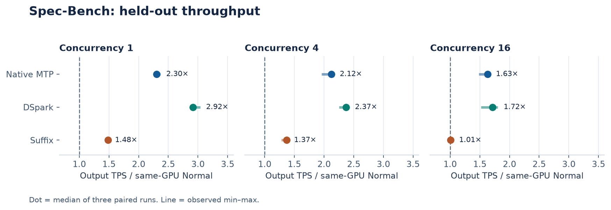
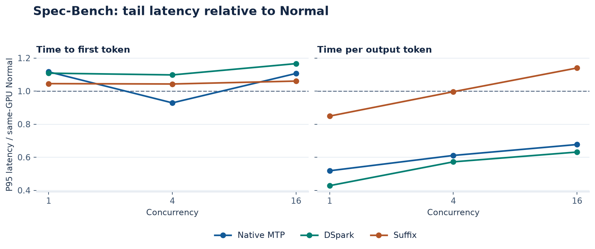
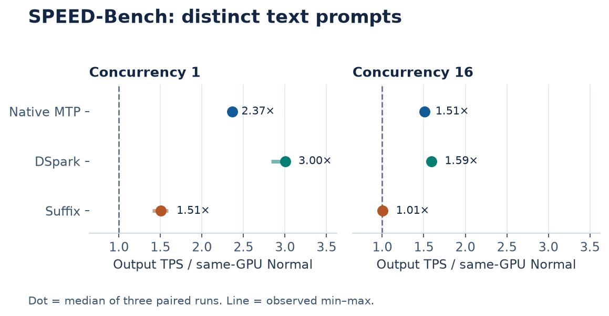
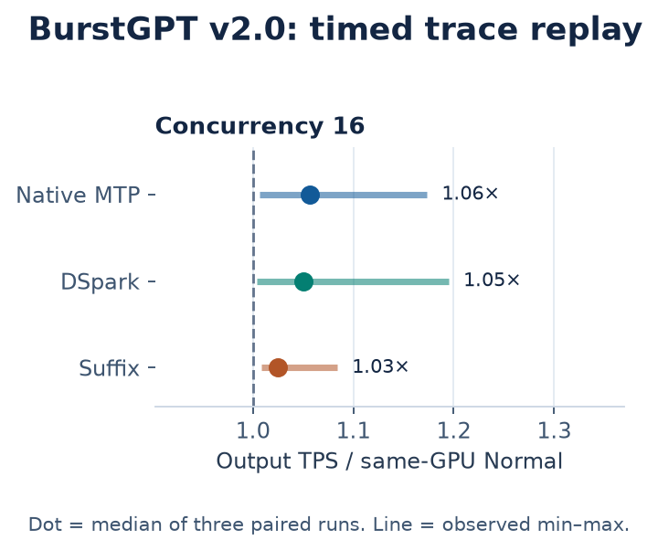
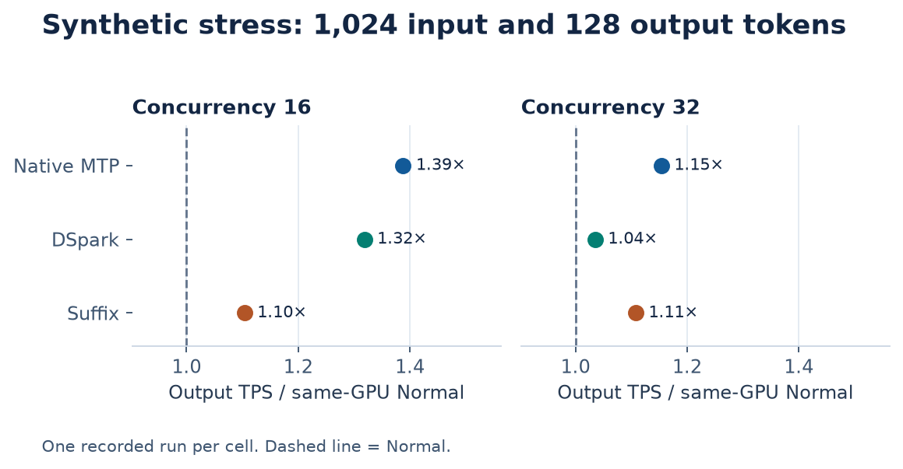

# 统一框架实测结果

Qwen3.8-27B-FP8 · NVIDIA B200 · vLLM 0.34.0 · 主模型使用 Triton Attention

| 方法 | 原配置 | 调参入选 | 入选相对原配置 | 最终配置 | 最终相对 Normal |
|---|---|---|---:|---|---:|
| Native MTP | `mtp-dynamic-smooth` | `mtp-k5` | 0.986× | `mtp-dynamic-smooth` | 1.998× |
| DSpark | `dspark-fp8-k8` | `dspark-triton-k8` | 2.858× | `dspark-triton-k8` | 2.282× |
| Suffix | `suffix-k4-depth12` | `suffix-k6-depth12` | 0.998× | `suffix-k4-depth12` | 1.269× |

综合倍数来自 Spec-Bench 三档并发配对倍率的几何平均。以下表格和图表使用每种方法最终保留的唯一设置。

TPS、P95 TTFT、P95 TPOT 和草稿接受率取各轮测值的中位数。配对倍率按同卡、同种子、同并发计算后取中位数。

## Spec-Bench 留出集

| 方法 | 并发 | Normal TPS | 方法 TPS | 配对倍率 | P95 TTFT（ms）Normal → 方法 | P95 TPOT（ms）Normal → 方法 | 成功（Normal → 方法） | 草稿接受率 |
|---|---:|---:|---:|---:|---:|---:|---:|---:|
| Native MTP | 1 | 117.20 | 269.03 | 2.303× | 57.61 → 59.53 | 8.42 → 4.35 | 90/90 → 90/90 | 45.5% |
| Native MTP | 4 | 407.83 | 852.85 | 2.124× | 90.19 → 81.95 | 9.30 → 5.64 | 90/90 → 90/90 | 46.2% |
| Native MTP | 16 | 1298.13 | 2115.15 | 1.629× | 208.16 → 224.74 | 10.77 → 7.28 | 90/90 → 90/90 | 51.5% |
| DSpark | 1 | 117.19 | 342.61 | 2.917× | 55.11 → 61.08 | 8.43 → 3.60 | 90/90 → 90/90 | 40.9% |
| DSpark | 4 | 407.29 | 948.99 | 2.371× | 84.95 → 88.63 | 9.35 → 5.29 | 90/90 → 90/90 | 41.3% |
| DSpark | 16 | 1299.35 | 2230.79 | 1.717× | 208.54 → 237.42 | 10.73 → 6.78 | 90/90 → 90/90 | 43.3% |
| Suffix | 1 | 116.86 | 173.66 | 1.483× | 55.55 → 58.06 | 8.45 → 7.17 | 90/90 → 90/90 | 17.0% |
| Suffix | 4 | 407.36 | 558.52 | 1.368× | 85.44 → 80.60 | 9.34 → 9.30 | 90/90 → 90/90 | 17.6% |
| Suffix | 16 | 1299.86 | 1300.02 | 1.007× | 209.60 → 222.28 | 10.76 → 12.31 | 90/90 → 90/90 | 18.3% |

## NVIDIA SPEED-Bench

| 方法 | 并发 | Normal TPS | 方法 TPS | 配对倍率 | P95 TTFT（ms）Normal → 方法 | P95 TPOT（ms）Normal → 方法 | 成功（Normal → 方法） | 草稿接受率 |
|---|---:|---:|---:|---:|---:|---:|---:|---:|
| Native MTP | 1 | 118.15 | 279.24 | 2.368× | 35.51 → 47.20 | 8.36 → 4.42 | 48/48 → 48/48 | 46.6% |
| Native MTP | 16 | 1451.95 | 2187.84 | 1.511× | 168.30 → 204.81 | 10.41 → 7.10 | 96/96 → 96/96 | 54.4% |
| DSpark | 1 | 117.59 | 353.31 | 3.005× | 35.14 → 40.50 | 8.38 → 4.03 | 48/48 → 48/48 | 41.4% |
| DSpark | 16 | 1446.53 | 2293.10 | 1.591× | 173.62 → 201.40 | 10.15 → 7.25 | 96/96 → 96/96 | 43.2% |
| Suffix | 1 | 117.73 | 176.68 | 1.506× | 38.35 → 39.87 | 8.37 → 6.61 | 48/48 → 48/48 | 17.6% |
| Suffix | 16 | 1453.52 | 1462.83 | 1.006× | 168.93 → 190.92 | 10.43 → 11.33 | 96/96 → 96/96 | 22.1% |

## BurstGPT v2.0

| 方法 | 并发 | Normal TPS | 方法 TPS | 配对倍率 | P95 TTFT（ms）Normal → 方法 | P95 TPOT（ms）Normal → 方法 | 成功（Normal → 方法） | 草稿接受率 |
|---|---:|---:|---:|---:|---:|---:|---:|---:|
| Native MTP | 16 | 665.13 | 702.87 | 1.057× | 63.07 → 75.91 | 10.61 → 6.60 | 192/192 → 192/192 | 45.5% |
| DSpark | 16 | 665.04 | 698.34 | 1.050× | 58.21 → 77.84 | 11.00 → 10.14 | 192/192 → 192/192 | 24.1% |
| Suffix | 16 | 665.05 | 681.73 | 1.025× | 58.32 → 131.60 | 10.98 → 11.34 | 192/192 → 192/192 | 29.2% |

SPEED-Bench 使用经去重的写作、代码和多语言提示。BurstGPT 回放三段请求长度与相对到达间隔。BurstGPT 的总吞吐受设定的到达速率约束，可结合 TTFT 和 TPOT 判断优化收益。

## 两轮调参

共完成 60 个调参单元、81 个留出复测单元、54 个独立负载单元和 18 个随机压测单元。

| 方法 | 轮次 | 配置 | C=1 TPS | C=4 TPS | C=16 TPS | 调参得分 | CUDA Graph | 入选 |
|---|---:|---|---:|---:|---:|---:|---|---|
| Native MTP | 1 | `mtp-dynamic-smooth` | 264.44 | 802.17 | 1412.03 | 669.08 | 完整 |  |
| Native MTP | 1 | `mtp-k3` | 257.62 | 786.88 | 1359.38 | 650.74 | 完整 |  |
| Native MTP | 1 | `mtp-k5` | 266.85 | 831.88 | 1431.82 | 682.45 | 完整 | ✓ |
| Native MTP | 1 | `mtp-k7` | 260.77 | 828.58 | 1395.58 | 670.58 | 完整 |  |
| Native MTP | 2 | `mtp-dynamic-7-3` | 261.12 | 819.52 | 1314.39 | 655.20 | 完整 |  |
| Native MTP | 2 | `mtp-dynamic-7-5` | 260.58 | 831.65 | 1434.58 | 677.44 | 完整 |  |
| DSpark | 1 | `dspark-fp8-k8` | 106.58 | 361.79 | 746.66 | 306.49 | 关闭 |  |
| DSpark | 1 | `dspark-fp8-k3` | 76.06 | 231.52 | 608.84 | 220.51 | 关闭 |  |
| DSpark | 1 | `dspark-fp8-k5` | 90.29 | 311.97 | 713.31 | 271.86 | 关闭 |  |
| DSpark | 1 | `dspark-fp8-k7` | 99.54 | 344.95 | 763.51 | 297.07 | 关闭 |  |
| DSpark | 2 | `dspark-triton-k5` | 320.31 | 978.21 | 1744.16 | 817.58 | 完整 |  |
| DSpark | 2 | `dspark-triton-k8` | 359.76 | 1019.48 | 1696.87 | 853.78 | 完整 | ✓ |
| DSpark | 2 | `dspark-triton-adaptive` | 333.68 | 985.33 | 1646.11 | 814.94 | 完整 |  |
| DSpark | 2 | `dspark-triton-bf16` | 356.80 | 1000.70 | 1649.58 | 838.24 | 完整 |  |
| Suffix | 1 | `suffix-k4-depth12` | 170.61 | 546.19 | 997.38 | 452.97 | 完整 |  |
| Suffix | 1 | `suffix-k2-depth12` | 159.32 | 536.37 | 994.83 | 439.71 | 完整 |  |
| Suffix | 1 | `suffix-k6-depth12` | 173.72 | 553.35 | 1013.27 | 460.11 | 完整 | ✓ |
| Suffix | 1 | `suffix-k8-depth12` | 172.33 | 523.42 | 915.94 | 435.54 | 完整 |  |
| Suffix | 2 | `suffix-adaptive` | 144.54 | 540.77 | 1021.09 | 430.55 | 完整 |  |
| Suffix | 2 | `suffix-local` | 156.79 | 470.10 | 887.23 | 402.88 | 完整 |  |

## 合成压力对照

| 方法 | 并发 | Normal TPS | 方法 TPS | 配对倍率 | P95 TTFT（ms）Normal → 方法 | P95 TPOT（ms）Normal → 方法 | 成功（Normal → 方法） | 草稿接受率 |
|---|---:|---:|---:|---:|---:|---:|---:|---:|
| Native MTP | 16 | 1073.43 | 1489.92 | 1.388× | 640.60 → 695.42 | 14.08 → 13.16 | 64/64 → 64/64 | 57.4% |
| Native MTP | 32 | 1496.44 | 1726.68 | 1.154× | 1270.14 → 1497.71 | 19.57 → 21.14 | 64/64 → 64/64 | 61.5% |
| DSpark | 16 | 1077.13 | 1420.26 | 1.319× | 634.28 → 693.15 | 14.03 → 17.68 | 64/64 → 64/64 | 36.0% |
| DSpark | 32 | 1504.69 | 1557.68 | 1.035× | 1255.15 → 1424.00 | 19.45 → 28.10 | 64/64 → 64/64 | 36.7% |
| Suffix | 16 | 1072.77 | 1184.09 | 1.104× | 634.53 → 664.80 | 13.81 → 20.21 | 64/64 → 64/64 | 29.6% |
| Suffix | 32 | 1500.92 | 1662.96 | 1.108× | 1259.03 → 1400.49 | 19.52 → 24.77 | 64/64 → 64/64 | 44.6% |

