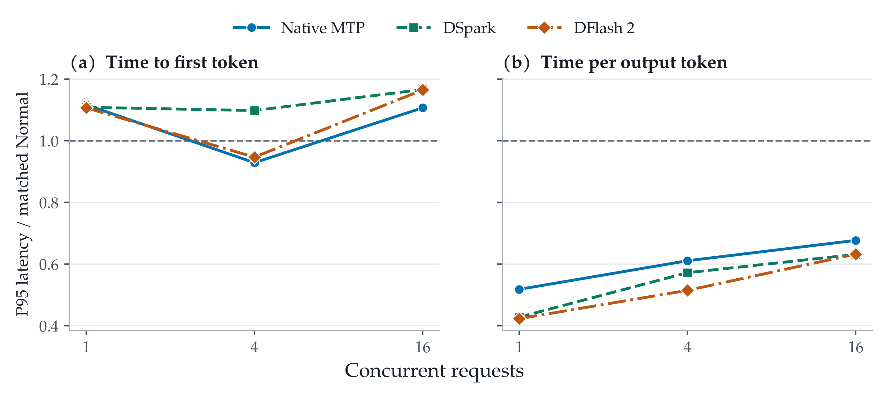
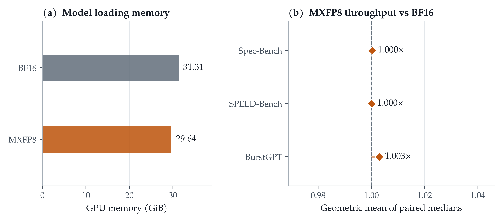

# 统一框架实测结果

Qwen3.8-27B-FP8 · NVIDIA B200 · vLLM 0.34.0 · 主模型使用 Triton Attention

| 方法 | 原配置 | 调参入选 | 入选相对原配置 | 最终配置 | 最终相对 Normal |
|---|---|---|---:|---|---:|
| Native MTP | `mtp-dynamic-smooth` | `mtp-k5` | 0.986× | `mtp-dynamic-smooth` | 1.998× |
| DSpark | `dspark-fp8-k8` | `dspark-triton-k8` | 2.858× | `dspark-triton-k8` | 2.282× |
| DFlash 2 | `dflash2-k7` | `dflash2-mxfp8` | 1.000× | `dflash2-mxfp8` | 2.385× |

Spec-Bench 综合倍率取各档并发的配对中位倍率，再作几何平均。各负载下均使用表中的最终配置。

## 各方法的吞吐和尾延迟

Spec-Bench 并发 16 时，各方法独立配对同卡、同 vLLM 构建的 Normal。表中的延迟是两组各自的逐轮中位数。

| 方法 | Spec-Bench 综合倍率 | 并发 16 吞吐倍率 | P95 TTFT (ms) | P95 TPOT (ms) |
|---|---:|---:|---:|---:|
| Native MTP | 1.998× | 1.629× | 208.16 → 224.74 | 10.77 → 7.28 |
| DSpark | 2.282× | 1.717× | 208.54 → 237.42 | 10.73 → 6.78 |
| DFlash 2 | 2.385× | 1.742× | 203.83 → 228.33 | 10.75 → 6.71 |

BurstGPT 按固定到达轨迹回放。此处同时列出吞吐、首 token 和后续生成的延迟。

| 方法 | BurstGPT 并发 16 吞吐倍率 | P95 TTFT (ms) | P95 TPOT (ms) |
|---|---:|---:|---:|
| Native MTP | 1.057× | 63.07 → 75.91 | 10.61 → 6.60 |
| DSpark | 1.050× | 58.21 → 77.84 | 11.00 → 10.14 |
| DFlash 2 | 1.063× | 60.70 → 73.77 | 11.00 → 10.80 |

吞吐柱表示配对中位数，须线覆盖各轮最小值和最大值。虚线对应 Normal，随机压力每档只测一轮。

## Spec-Bench 留出集

| 方法 | 并发 | Normal TPS | 方法 TPS | 配对倍率 | P95 TTFT（ms）Normal → 方法 | P95 TPOT（ms）Normal → 方法 | 成功（Normal → 方法） | 草稿接受率 |
|---|---:|---:|---:|---:|---:|---:|---:|---:|
| Native MTP | 1 | 117.20 | 269.03 | 2.303× | 57.61 → 59.53 | 8.42 → 4.35 | 90/90 → 90/90 | 45.5% |
| Native MTP | 4 | 407.83 | 852.85 | 2.124× | 90.19 → 81.95 | 9.30 → 5.64 | 90/90 → 90/90 | 46.2% |
| Native MTP | 16 | 1298.13 | 2115.15 | 1.629× | 208.16 → 224.74 | 10.77 → 7.28 | 90/90 → 90/90 | 51.5% |
| DSpark | 1 | 117.19 | 342.61 | 2.917× | 55.11 → 61.08 | 8.43 → 3.60 | 90/90 → 90/90 | 40.9% |
| DSpark | 4 | 407.29 | 948.99 | 2.371× | 84.95 → 88.63 | 9.35 → 5.29 | 90/90 → 90/90 | 41.3% |
| DSpark | 16 | 1299.35 | 2230.79 | 1.717× | 208.54 → 237.42 | 10.73 → 6.78 | 90/90 → 90/90 | 43.3% |
| DFlash 2 | 1 | 117.18 | 349.30 | 2.974× | 54.77 → 65.50 | 8.43 → 3.56 | 90/90 → 90/90 | 46.2% |
| DFlash 2 | 4 | 407.79 | 1048.32 | 2.619× | 83.73 → 83.39 | 9.35 → 4.76 | 90/90 → 90/90 | 46.4% |
| DFlash 2 | 16 | 1302.47 | 2269.34 | 1.742× | 203.83 → 228.33 | 10.75 → 6.71 | 90/90 → 90/90 | 50.0% |

延迟图先对各轮 P95 计算方法相对 Normal 的倍率，再取中位数。低于 1 表示延迟下降。

## NVIDIA SPEED-Bench

| 方法 | 并发 | Normal TPS | 方法 TPS | 配对倍率 | P95 TTFT（ms）Normal → 方法 | P95 TPOT（ms）Normal → 方法 | 成功（Normal → 方法） | 草稿接受率 |
|---|---:|---:|---:|---:|---:|---:|---:|---:|
| Native MTP | 1 | 118.15 | 279.24 | 2.368× | 35.51 → 47.20 | 8.36 → 4.42 | 48/48 → 48/48 | 46.6% |
| Native MTP | 16 | 1451.95 | 2187.84 | 1.511× | 168.30 → 204.81 | 10.41 → 7.10 | 96/96 → 96/96 | 54.4% |
| DSpark | 1 | 117.59 | 353.31 | 3.005× | 35.14 → 40.50 | 8.38 → 4.03 | 48/48 → 48/48 | 41.4% |
| DSpark | 16 | 1446.53 | 2293.10 | 1.591× | 173.62 → 201.40 | 10.15 → 7.25 | 96/96 → 96/96 | 43.2% |
| DFlash 2 | 1 | 117.98 | 380.37 | 3.216× | 34.65 → 37.99 | 8.38 → 3.20 | 48/48 → 48/48 | 49.9% |
| DFlash 2 | 16 | 1452.75 | 2542.37 | 1.749× | 172.90 → 204.37 | 10.43 → 6.43 | 96/96 → 96/96 | 52.8% |

## BurstGPT v2.0

| 方法 | 并发 | Normal TPS | 方法 TPS | 配对倍率 | P95 TTFT（ms）Normal → 方法 | P95 TPOT（ms）Normal → 方法 | 成功（Normal → 方法） | 草稿接受率 |
|---|---:|---:|---:|---:|---:|---:|---:|---:|
| Native MTP | 16 | 665.13 | 702.87 | 1.057× | 63.07 → 75.91 | 10.61 → 6.60 | 192/192 → 192/192 | 45.5% |
| DSpark | 16 | 665.04 | 698.34 | 1.050× | 58.21 → 77.84 | 11.00 → 10.14 | 192/192 → 192/192 | 24.1% |
| DFlash 2 | 16 | 665.43 | 707.35 | 1.063× | 60.70 → 73.77 | 11.00 → 10.80 | 192/192 → 192/192 | 29.8% |

SPEED-Bench 使用去重后的写作、代码和多语言提示。BurstGPT 回放三段轨迹，保留请求长度和相对到达间隔。回放速率会限制总吞吐，因此也要看首 token 延迟和每 token 延迟。

## 调参记录

调参跑了 54 个执行单元。留出复测、外部负载和随机压测各有 81、63 和 18 个执行单元。

| 方法 | 轮次 | 配置 | C=1 TPS | C=4 TPS | C=16 TPS | 调参得分 | CUDA Graph | 模型显存 (GiB) | 入选 |
|---|---:|---|---:|---:|---:|---:|---|---:|---|
| Native MTP | 1 | `mtp-dynamic-smooth` | 264.44 | 802.17 | 1412.03 | 669.08 | 完整 | — |  |
| Native MTP | 1 | `mtp-k3` | 257.62 | 786.88 | 1359.38 | 650.74 | 完整 | — |  |
| Native MTP | 1 | `mtp-k5` | 266.85 | 831.88 | 1431.82 | 682.45 | 完整 | — | ✓ |
| Native MTP | 1 | `mtp-k7` | 260.77 | 828.58 | 1395.58 | 670.58 | 完整 | — |  |
| Native MTP | 2 | `mtp-dynamic-7-3` | 261.12 | 819.52 | 1314.39 | 655.20 | 完整 | — |  |
| Native MTP | 2 | `mtp-dynamic-7-5` | 260.58 | 831.65 | 1434.58 | 677.44 | 完整 | — |  |
| DSpark | 1 | `dspark-fp8-k8` | 106.58 | 361.79 | 746.66 | 306.49 | 关闭 | — |  |
| DSpark | 1 | `dspark-fp8-k3` | 76.06 | 231.52 | 608.84 | 220.51 | 关闭 | — |  |
| DSpark | 1 | `dspark-fp8-k5` | 90.29 | 311.97 | 713.31 | 271.86 | 关闭 | — |  |
| DSpark | 1 | `dspark-fp8-k7` | 99.54 | 344.95 | 763.51 | 297.07 | 关闭 | — |  |
| DSpark | 2 | `dspark-triton-k5` | 320.31 | 978.21 | 1744.16 | 817.58 | 完整 | — |  |
| DSpark | 2 | `dspark-triton-k8` | 359.76 | 1019.48 | 1696.87 | 853.78 | 完整 | — | ✓ |
| DSpark | 2 | `dspark-triton-adaptive` | 333.68 | 985.33 | 1646.11 | 814.94 | 完整 | — |  |
| DSpark | 2 | `dspark-triton-bf16` | 356.80 | 1000.70 | 1649.58 | 838.24 | 完整 | — |  |
| DFlash 2 | 1 | `dflash2-k7` | 354.99 | 1019.08 | 1810.65 | 868.47 | 完整 | 31.31 |  |
| DFlash 2 | 1 | `dflash2-fp8-per-tensor` | 362.18 | 1048.44 | 1717.13 | 867.14 | 完整 | 29.58 |  |
| DFlash 2 | 1 | `dflash2-fp8-per-block` | 354.59 | 1041.19 | 1732.11 | 861.55 | 完整 | 29.54 |  |
| DFlash 2 | 2 | `dflash2-mxfp8` | 363.67 | 1057.99 | 1700.54 | 868.14 | 完整 | 29.64 | ✓ |
| DFlash 2 | 2 | `dflash2-nvfp4-w4a16` | — | — | — | 运行失败 | — | — |  |

## 合成压力对照

每档仅测一轮，适合观察该次回放的量级。

| 方法 | 并发 | Normal TPS | 方法 TPS | 配对倍率 | P95 TTFT（ms）Normal → 方法 | P95 TPOT（ms）Normal → 方法 | 成功（Normal → 方法） | 草稿接受率 |
|---|---:|---:|---:|---:|---:|---:|---:|---:|
| Native MTP | 16 | 1073.43 | 1489.92 | 1.388× | 640.60 → 695.42 | 14.08 → 13.16 | 64/64 → 64/64 | 57.4% |
| Native MTP | 32 | 1496.44 | 1726.68 | 1.154× | 1270.14 → 1497.71 | 19.57 → 21.14 | 64/64 → 64/64 | 61.5% |
| DSpark | 16 | 1077.13 | 1420.26 | 1.319× | 634.28 → 693.15 | 14.03 → 17.68 | 64/64 → 64/64 | 36.0% |
| DSpark | 32 | 1504.69 | 1557.68 | 1.035× | 1255.15 → 1424.00 | 19.45 → 28.10 | 64/64 → 64/64 | 36.7% |
| DFlash 2 | 16 | 1074.71 | 1368.64 | 1.273× | 638.56 → 678.87 | 14.05 → 16.55 | 64/64 → 64/64 | 40.1% |
| DFlash 2 | 32 | 1502.20 | 1719.80 | 1.145× | 1259.28 → 1364.41 | 19.51 → 23.53 | 64/64 → 64/64 | 44.4% |

## DFlash 2 草稿量化复测

入选量化为 `mxfp8`，发布配置为 `dflash2-mxfp8`。相对 BF16 的三套负载综合倍率为 1.001×。Spec-Bench、SPEED-Bench 和 BurstGPT 的倍率分别为 1.000×、1.000× 和 1.003×。每套负载先对各档并发的配对中位倍率取几何平均，三套负载等权。综合倍率大于 1 且各套负载降幅均在 3% 以内时采用量化。

vLLM 报告的模型加载显存为 Normal 27.55 GiB、DFlash 2 BF16 31.31 GiB、量化草稿 29.64 GiB。该值不含 KV cache 和 CUDA Graph。两种草稿使用 FlashAttention 4。

| 负载 | 并发 | TPS（BF16 → 量化） | 配对倍率（中位数及范围） | P95 TTFT (ms) | P95 TPOT (ms) | 草稿接受率 | 成功请求 |
|---|---:|---:|---:|---:|---:|---:|---:|
| Spec-Bench | 1 | 346.09 → 349.30 | 1.012× (0.904–1.015) | 59.99 → 65.50 | 3.63 → 3.56 | 46.5% → 46.2% | 90/90 → 90/90 |
| Spec-Bench | 4 | 1057.81 → 1048.32 | 0.991× (0.915–1.008) | 90.18 → 83.39 | 4.55 → 4.76 | 47.3% → 46.4% | 90/90 → 90/90 |
| Spec-Bench | 16 | 2331.37 → 2269.34 | 0.998× (0.973–1.019) | 232.67 → 228.33 | 6.56 → 6.71 | 49.3% → 50.0% | 90/90 → 90/90 |
| SPEED-Bench | 1 | 372.73 → 380.37 | 1.021× (1.007–1.024) | 39.31 → 37.99 | 3.17 → 3.20 | 49.5% → 49.9% | 48/48 → 48/48 |
| SPEED-Bench | 16 | 2593.75 → 2542.37 | 0.980× (0.563–1.029) | 188.47 → 204.37 | 5.95 → 6.43 | 53.9% → 52.8% | 96/96 → 96/96 |
| BurstGPT v2.0 | 16 | 705.19 → 707.35 | 1.003× (1.000–1.003) | 87.77 → 73.77 | 10.39 → 10.80 | 29.8% → 29.8% | 192/192 → 192/192 |

